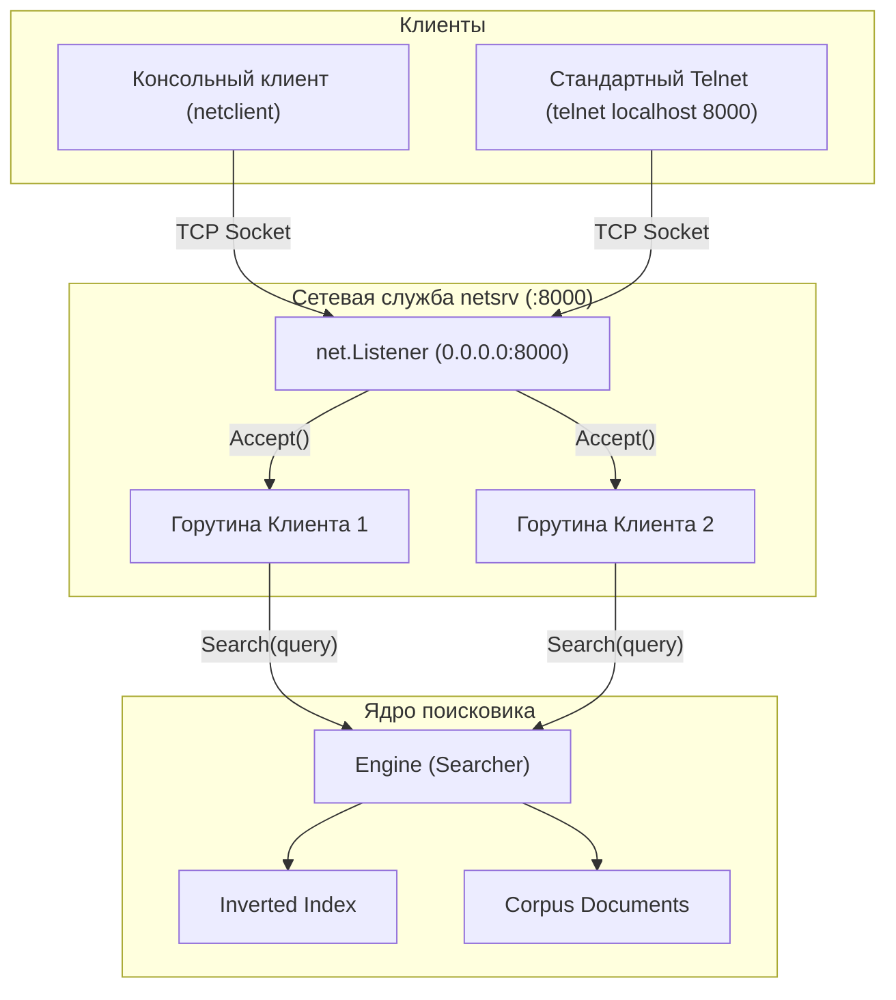

# Домашнее задание №11: Сетевое программирование (Сетевая служба GoSearch)

## Описание задания
Интеграция сетевой службы в поисковый движок GoSearch на транспортном уровне протокола TCP.

### Задачи:
1. **Задача №1**: Удалить из поисковика артефакты из прошлых занятий (флаги командной строки `-s`, интерактивный консольный ввод `os.Stdin` внутри поисковика и устаревшие файлы).
2. **Задача №2**: Создать отдельный сетевой пакет **`netsrv`**, обеспечивающий интерактивный режим работы с пользователем. Служба принимает подключения на порту **8000** на всех сетевых интерфейсах системы (`0.0.0.0:8000` / `:8000`), считывает текстовые поисковые запросы и выдает результаты поиска. Каждое клиентское подключение обрабатывается в отдельной горутине.
3. **Задача №3**: Разработать интерактивного консольного клиента **`netclient`** для службы `netsrv`, работающего в цикле «запрос — ответ — запрос».

---

## Архитектура решения



### Структура пакета:
```
homework-11/
├── README.md               # Полная документация решения
├── cmd/
│   ├── netsrv/
│   │   └── main.go         # Сервер GoSearch на :8000 (без устаревших флагов CLI)
│   └── netclient/
│       └── main.go         # Интерактивный TCP-клиент (запрос -> ответ -> запрос)
└── pkg/
    └── netsrv/
        ├── server.go       # Сетевой сервер (Server, HandleConn, SetDeadline)
        └── server_test.go  # Тестирование через net.Pipe() и реальный TCP-сокет
```

---

## Запуск и проверка

### 1. Запуск сервера:
```bash
go run ./11-network/homework-11/cmd/netsrv/main.go
```
Сервер выведет:
```
=== Запуск поисковой службы GoSearch (netsrv) ===
Индексация демонстрационного корпуса документов...
Успешно проиндексировано документов: 2
Сетевая служба netsrv ожидает входящих подключений на :8000 (0.0.0.0:8000)...
```

### 2. Подключение через интерактивный клиент:
```bash
go run ./11-network/homework-11/cmd/netclient/main.go
```

Пример диалога:
```
Подключение к поисковой службе GoSearch на localhost:8000...
Соединение успешно установлено! Для завершения работы введите 'exit'.

=== Сетевая служба GoSearch (netsrv) ===
Введите поисковый запрос (или 'exit' для завершения):

> Go
Найдено документов: 2
  1. [1] The Go Programming Language — https://go.dev
  2. [2] Documentation — https://golang.org/doc

> exit
Сеанс завершен. До свидания!

Сеанс завершён. Соединение закрыто.
```

### 3. Подключение через стандартную утилиту `telnet`:
```bash
telnet localhost 8000
```

---

## Тестирование с помощью `net.Pipe()`

В соответствии с материалом лекции (слайд 22), тестирование сетевого обработчика `HandleConn` реализовано с помощью встроенной функции **`net.Pipe()`**. Она создает виртуальное двустороннее соединение в памяти без открывания реальных сетевых портов ОС, исключая конфликты занятых портов (`address already in use`) и сетевые задержки.

```bash
go test -v -count=1 -race -cover ./11-network/homework-11/...
```
