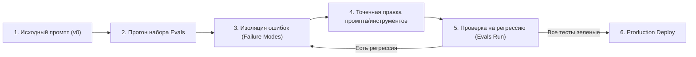
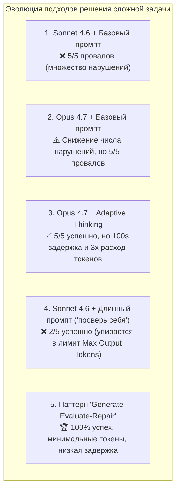
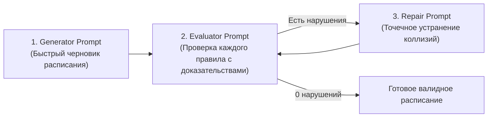
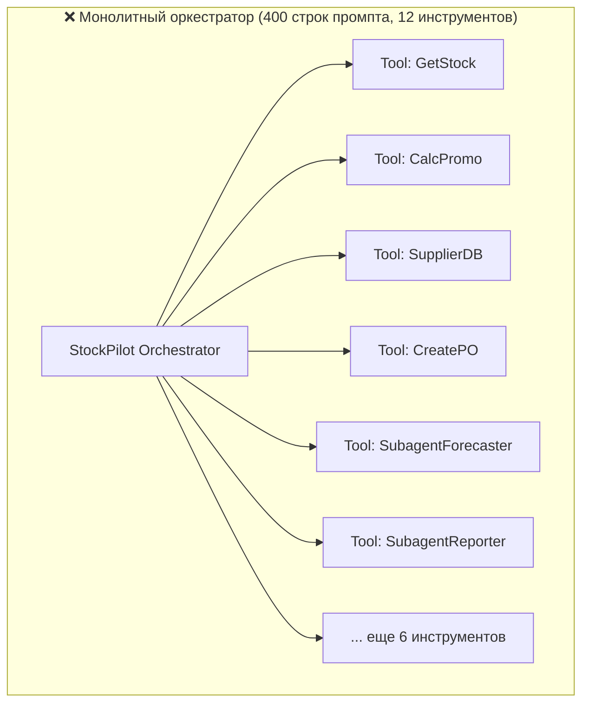
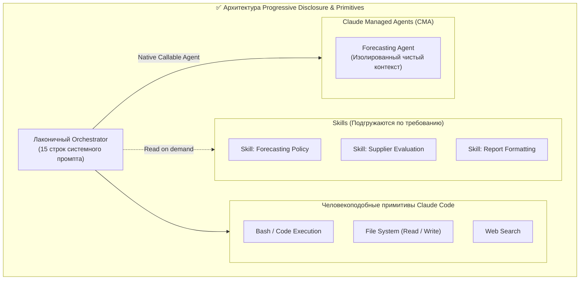
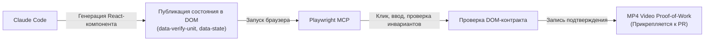
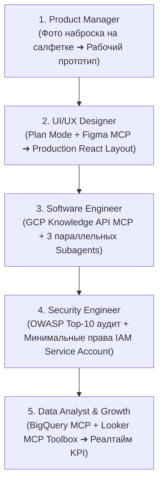
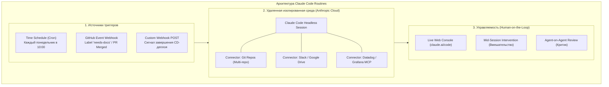
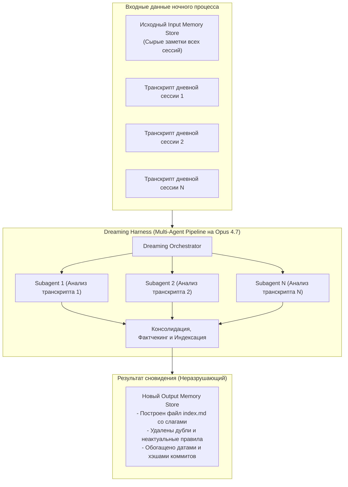
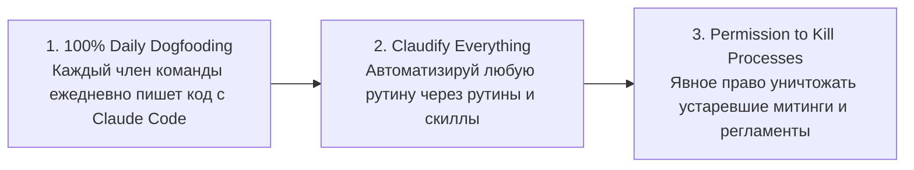

# 🧠 Anthropic Engineering Playbook: Промышленная разработка с Claude Code, Эвалы, Архитектура Агентов, Память и Инженерная Культура

> [!IMPORTANT]
> **Оригинал и первоисточник:**  
> Настоящее фундаментальное руководство составлено по материалам 4-часового инженерного интенсива Anthropic (*«Code with Claude London»*).  
> Документ детально систематизирует практический опыт ключевых инженеров и руководителей **Anthropic Applied AI** и команды **Claude Code** (Margot Vanlar, Will, Arno, Ivan Nardini, Maya, Kevin, а также инженерного лидерства Claude Code) по разработке production-агентов, написанию надежных промптов, архитектуре инструментов, автоматическим эвалам (evals), эргономике CLI Claude Code, проактивным рутинам (Claude Code Routines), персистентной памяти (Memory Stores & Dreaming) и трансформации процессов разработки в эпоху AI.

---

## 📑 Оглавление

1. [Prompting Playbook & Evals: Инженерия промптов от v0 к Production (Margot Vanlar)](#1-prompting-playbook--evals-инженерия-промптов-от-v0-к-production-margot-vanlar)
   - 1.1. Золотое правило: «Никаких правок без Eval Suite»
   - 1.2. Сценарий 1: Поддержка и миграция промпта в проде (Кейс Meridian Mobile)
     - Базовая гигиена и XML-структурирование
     - Контракт вывода и Stop Sequences (`</response>`)
     - Баг 1: Удержание информации (Hotspot на архивных тарифах)
     - Баг 2: «Инструкции не добавляют способностей» (Proration и вызов Tool)
     - Баг 3: Асимметрия оптимизации и учет обеих сторон трейдоффа (Escalation)
   - 1.3. Сценарий 2: Создание агента с нуля (Кейс расписания смены сотрудников)
     - Сравнение моделей и режимов: Sonnet 4.6 vs Opus 4.7 vs Adaptive Thinking
     - Паттерн «Generate-Evaluate-Repair» (Автономная агентная петля)
2. [Claude Code CLI: Эргономика, Скрытые Фичи и Multi-Agent Воркфлоу](#2-claude-code-cli-эргономика-скрытые-фичи-и-multi-agent-воркфлоу)
   - 2.1. Конфигурация `CLAUDE.md`: Глобальные, локальные и синтаксис `@`
   - 2.2. Управление правами: Auto-Accept режим (`Shift+Tab`) и белый список команд
   - 2.3. Контекстный менеджмент: `/compact` vs `/clear` в окне 200k токенов
   - 2.4. Интерактивное управление: `Esc` и двойной `Esc` (Time-Travel / Откат)
   - 2.5. Extended Thinking между вызовами инструментов
   - 2.6. CLI-утилиты против MCP: когда выбирать нативный CLI
   - 2.7. Параллельный запуск нескольких сессий Claude Code (tmux)
3. [Масштабирование агентных архитектур: Оркестраторы, Subagents и Skills (Will)](#3-масштабирование-агентных-архитектур-оркестраторы-subagents-и-skills-will)
   - 3.1. Ловушка монолитного оркестратора (Кейс StockPilot)
   - 3.2. Архитектура эвалов: R-задачи (регрессия) vs F-задачи (поведенческие сбои)
   - 3.3. Принцип Progressive Disclosure через Skills (сжатие промпта с 400 до 15 строк)
   - 3.4. Примитивы Claude Code против кастомных инструментов: почему исполнение кода побеждает парсинг
   - 3.5. Когда нужен Subagent, а когда достаточно одного агента (CMA Callable Agents)
4. [How We Claude Code at Anthropic: Verification-First & HTML-артефакты (Arno)](#4-how-we-claude-code-at-anthropic-verification-first--html-артефакты-arno)
   - 4.1. «Горький урок» Ричарда Саттона в AI-разработке
   - 4.2. Интервьюирование разработчика через инструмент `ask_question`
   - 4.3. «The Unreasonable Effectiveness of HTML Artifacts»: интерактивные моки вместо Markdown
   - 4.4. Verification-First: DOM-контракты (`data-*`), Playwright MCP и MP4 видео-пруфы
   - 4.5. Режимы работы: Fast mode (`/fast`) и уровни усилий (`/effort max`)
5. [Enterprise-разработка с Claude Code и Google Cloud (Ivan Nardini)](#5-enterprise-разработка-с-claude-code-и-google-cloud-ivan-nardini)
   - 5.1. Модель «5 шляп» в жизненном цикле разработки (SDLC)
   - 5.2. Инфраструктура GCP: Developer Knowledge API MCP, GCP Skills и Agent Registry
   - 5.3. Аналитика и аудит: BigQuery MCP, Looker MCP Toolbox и Cloud Run IAM
6. [Проактивные агенты: Claude Code Routines, Триггеры и Автономный запуск (Maya)](#6-проактивные-агенты-claude-code-routines-триггеры-и-автономный-запуск-maya)
   - 6.1. От реактивного инструмента к проактивному коллеге
   - 6.2. Анатомия рутины: Триггеры, Контекст/Коннекторы и Управляемость
   - 6.3. Боевые сценарии Anthropic: Sarah's Docs Sync, Deploy Verifier и Issue Triage
   - 6.4. Паттерн «Agent-on-Agent Review» (Generator-Critique)
7. [Агенты с долговременной памятью: Memory Stores и Dreaming (Kevin)](#7-агенты-с-долговременной-памятью-memory-stores-и-dreaming-kevin)
   - 7.1. Проблема сессионной амнезии и архитектура Agent Memory Stores
   - 7.2. Процесс «Dreaming» (Сновидение): ночная дедупликация, фактчекинг и индексация
   - 7.3. Экономика памяти: 95% Prompt Cache Hit Rate и Batch API
8. [Инженерное лидерство: Сдвиг бутылочных горлышек и новые нормы команд](#8-инженерное-лидерство-сдвиг-бутылочных-горлышек-и-новые-нормы-команд)
   - 8.1. Сдвиг бутылочного горлышка: от написания кода к верификации и ревью
   - 8.2. «Код побеждает в технических спорах»: генерация 3 PR вместо часов у доски
   - 8.3. JIT-планирование против устаревающих 6-месячных роадмапов
   - 8.4. Новая структура команд: плоская иерархия, менеджеры-IC и размытие ролей
   - 8.5. Три главных правила («Must-Dos»): Dogfooding, Claudify Everything, Kill Obsolete Processes
9. [Сводная шпаргалка золотых правил и антипаттернов Anthropic](#9-сводная-шпаргалка-золотых-правил-и-антипаттернов-anthropic)

---

## 1. Prompting Playbook & Evals: Инженерия промптов от v0 к Production (Margot Vanlar)

> *«Если вы сами при чтении промпта не можете с первого взгляда отличить контекст от инструкций, а правила от данных — модель гарантированно тоже не сможет.»*  
> — **Марго Ванлар (Margot Vanlar), Applied AI Engineer, Anthropic**

### 1.1. Золотое правило: «Никаких правок без Eval Suite»

В реальном продакшене промпты никогда не пишутся за один присест. Они поддерживаются месяцами, аккумулируют требования бизнеса и обрастают костылями.

* **Главная ловушка:** разработчик правит системный промпт, чтобы исправить один пограничный случай (edge case), но ломает три сценария, которые стабильно работали раньше (**регрессия**).
* **Принцип Anthropic:** прежде чем менять хотя бы одно слово в рабочем системном промпте, создайте **набор автоматических тестов (Eval Suite)**.
* **Состав эталонного набора тестов:**
  1. **Control cases (Контрольные тесты):** однозначные базовые запросы, которые модель обязана проходить со 100% стабильностью.
  2. **Edge cases (Пограничные случаи):** сложные сценарии и математические расчеты, где прошлые версии моделей ошибались.
  3. **Safety / Escalation / Refusal cases:** проверка границ применимости — когда агент должен эскалировать задачу на человека или отказать в ответе.



---

### 1.2. Сценарий 1: Поддержка и миграция промпта в проде (Кейс Meridian Mobile)

В качестве примера рассматривается служба клиентской поддержки телеком-оператора *Meridian Mobile*. Промпт накопил сотни строк: инструкции перемешаны с политиками, кусками верстки сайта и защитными заплатками от старых моделей.

#### Шаг 1: Базовая гигиена и XML-структурирование
Перед детальным разбором логики устраняется «мусор»:
* Удаляются скопированные фрагменты веб-страниц (упоминания `hero image`, куки-баннеров и CSS-классов).
* Удаляются галлюциногенные утверждения (например, указание боту: *«Ты человек-оператор по имени Анна»*).
* Вводится жесткая семантическая структура через **XML-теги**:

```xml
<system_prompt>
  <role>
    Ты — интеллектуальный ассистент службы поддержки телеком-компании Meridian Mobile.
    Твоя цель — помогать абонентам с вопросами по тарифам, балансу и услугам связи.
  </role>

  <policy>
    1. Действующий тариф "Безлимит 2026" включает 4 ГБ раздачи (Hotspot).
    2. Абоненты архивных (grandfathered) тарифов обслуживаются на индивидуальных условиях, зафиксированных в их профиле.
  </policy>

  <guidelines>
    - Отвечай вежливо, лаконично и по существу вопроса.
    - Никогда не запрашивай пароли от личного кабинета и CVV банковских карт.
  </guidelines>

  <tone_of_voice>
    Профессиональный, дружелюбный, эмпатичный.
  </tone_of_voice>

  <customer_context>
    <!-- Динамические данные абонента подставляются сюда -->
    {CUSTOMER_DATA}
  </customer_context>

  <output_format>
    Ответ должен быть строго обернут в тег <response>...</response>.
  </output_format>
</system_prompt>
```

#### Шаг 2: Контракт вывода и Stop Sequences (`</response>`)
Чтобы гарантировать детерминированный парсинг и избежать лишних вводных слов (*«Конечно! С радостью помогу...»*):
1. В промпте задается формат: `<output_format>Оберни ответ в <response>текст</response></output_format>`.
2. В параметрах вызова Anthropic API задается **Stop Sequence: `["</response>"]`**.
3. Как только модель генерирует закрывающий тег `</response>`, API прерывает генерацию. Это экономит токены, сокращает задержку (latency) и исключает ошибки парсинга. Для сложных JSON-структур рекомендуется использовать **Structured Outputs** (`tools` со строгой JSON Schema).

#### Шаг 3: Баг 1 — Удержание информации (Hotspot на архивных тарифах)
* **Симптом:** Клиент на архивном тарифе спрашивает: *«Сколько ГБ раздачи включено в мой тариф?»*. В данных профиля явно указано: `hotspot_limit: 5GB`. Однако модель отвечает: *«По нашим тарифам раздача 4 ГБ, но так как у вас архивный тариф, зайдите по ссылке в личный кабинет и посмотрите сами»*.
* **Причина:** В старом промпте жила «защитная заплатка» (patch) для Claude 2: *«Недавно мы сменили тарифы. На архивных тарифах другие условия. Никогда не сообщай клиенту неверную информацию о тарифе! Вместо этого отправляй его по ссылке на сайт»*. Новая модель (Sonnet 3.7 / 4.6) идеально следует инструкциям и перестраховывается, **удерживая информацию**, которая у нее фактически есть.
* **Урок Anthropic:** Мы боимся галлюцинаций, но обратная сторона — чрезмерная осторожность (*Information Withholding*). Защитные заплатки от старых моделей обязательно должны трекаться в Git с пояснениями, чтобы удалять их при миграции на более умные frontier-модели.
* **Исправление:**
  ```xml
  <policy>
    Для клиентов на архивных тарифах единственным источником правды являются данные из блока <customer_context>. Озвучивай лимиты напрямую из профиля клиента.
  </policy>
  ```

#### Шаг 4: Баг 2 — «Инструкции не добавляют способностей» (Proration и расчеты)
* **Симптом:** Клиент меняет тариф в середине расчетного месяца: *«Если я перейду на тариф 30 ГБ сегодня, какой счет мне придет 1-го числа?»*. Модель начинает заниматься «ментальной арифметикой» в тексте: путает дни, делит рубли на дни с погрешностями и выдает неверную сумму.
* **Ошибка разработчиков:** Попытка заставить модель считать лучше через капслок и восклицания в промпте: *«КРИТИЧЕСКИ ВАЖНО! Всегда рассчитывай пропорциональные суммы (proration) абсолютно точно и без ошибок!»*.
* **Принцип Anthropic:** **Instructions don't add capability** («Инструкции не добавляют модели способностей»). Сколько ни требуй считать точно, LLM не станет калькулятором.
* **Решение:** Дайте модели инструмент (Tool):
  ```json
  {
    "name": "calculate_proration",
    "description": "Рассчитывает точную сумму счета при смене тарифного плана в середине месяца",
    "input_schema": {
      "type": "object",
      "properties": {
        "current_plan_price": {"type": "number"},
        "new_plan_price": {"type": "number"},
        "days_remaining_in_cycle": {"type": "integer"},
        "days_in_month": {"type": "integer"}
      },
      "required": ["current_plan_price", "new_plan_price", "days_remaining_in_cycle", "days_in_month"]
    }
  }
  ```
  Модель формирует аргументы, детерминированный код считает математику, а модель озвучивает клиенту гарантированно точный результат.

#### Шаг 5: Баг 3 — Асимметрия оптимизации и учет обеих сторон трейдоффа
* **Симптом:** Клиент жалуется на ошибочное списание средств. Система требует эскалации на живого оператора, но бот упорно спорит с клиентом и пытается диагностировать проблему самостоятельно.
* **Причина:** В промпте было указано: *«Избегай эскалаций на оператора, так как каждый перевод стоит компании $8 и снижает наш KPI быстрого закрытия обращения»*. Модели показали только стоимость эскалации, но не показали цену отказа! Модель честно оптимизировала единственный заданный критерий — минимизацию расходов на операторов.
* **Принцип Anthropic:** Современные frontier-модели прекрасно умеют находить баланс, если им открыто описаны **обе стороны трейдоффа**:
  ```xml
  <escalation_policy>
    Перевод диалога на оператора поддержки стоит компании $8.
    Однако неверное решение финансового спора или ошибочный отказ клиенту приводит к выплате компенсации, штрафам регулятора и потере доверия к бренду, что обходится значительно дороже $8.
    Эскалируй обращение на человека всегда, когда обнаружен спор по списаниям или конфликт начислений.
  </escalation_policy>
  ```

---

### 1.3. Сценарий 2: Создание агента с нуля (Кейс расписания смены сотрудников)

Задача: составить недельное расписание смен для розничного магазина на 8 сотрудников с жесткими ограничениями (минимальный headcount в часы пик, запрет на работу более 5 дней подряд, учет отпусков).



#### Сравнение подходов на бенчмарке:
1. **Детерминированный эвал:** Вместо дорогого LLM-as-a-judge написана Python-функция, которая математически проверяет готовый JSON расписания на количество нарушений правил.
2. **Sonnet 4.6 (базовый промпт):** Полный провал (5 из 5 запусков с нарушениями). Модель пытается решить все ограничения за один шаг генерации текста.
3. **Opus 4.7 (базовый промпт):** Количество нарушений упало вдвое, но ни один тест не пройден на 100%. Сырой интеллект помогает, но не решает задачу целиком.
4. **Opus 4.7 с Adaptive Thinking:** Все 5 тестов пройдены успешно! Но цена: задержка выросла до 100 секунд, а расход токенов утроился. Неприемлемо для интерактивных пользовательских интерфейсов.
5. **Sonnet 4.6 + Промпт «Тщательно проверь свою работу»:** Модель сжигает лимит токенов на рассуждения и обрывает генерацию на середине JSON (2 из 5 тестов).

#### Победное решение: Паттерн «Generate-Evaluate-Repair»
Вместо одного гигантского монолитного вызова задача разбивается на три независимых компактных промпта в изолированном цикле:



1. **Generator:** Делает черновой драфт расписания на основе входных данных.
2. **Evaluator:** Независимый промпт-проверяльщик. Он не строит расписание, а только ищет нарушения по чек-листу правил и возвращает точный отчет: *«Нарушение правила №3: Сотрудник Иван поставлен на 6 смен подряд (Пн–Сб). Нарушение правила №1: В среду во 2 смену не хватает 1 человека»*.
3. **Repair:** Принимает черновик и точечный отчет об ошибках. Его задача — сделать минимальную хирургическую правку только указанных слотов.

> [!TIP]
> **Суперсила петли Evaluator-Repair:**  
> Она позволяет налету внедрять **мягкие динамические ограничения (Soft Constraints)** без переписывания бэкенд-кода: *«Гарри не любит работать в одну смену с Салли — постарайся их развести»*. Жесткий алгоритм на Python потребовал бы переписывания математической модели, а агентный Evaluator гибко учитывает пожелания.

---

## 2. Claude Code CLI: Эргономика, Скрытые Фичи и Multi-Agent Воркфлоу

Команда Claude Code в Anthropic сама использует CLI-инструмент на 100% для собственной разработки. В лекциях были раскрыты ключевые приемы эффективной работы.

### 2.1. Конфигурация `CLAUDE.md`: Глобальные, локальные и синтаксис `@`
Claude Code не хранит скрытого состояния проекта между сессиями. Главный мост передачи контекста — файлы `CLAUDE.md`:
* **Где размещать:**
  - В корне репозитория (коммитится в Git для всей команды).
  - В домашней директории (`~/.claude/CLAUDE.md`) — для персональных глобальных предпочтений.
* **Защита контекста в монорепозиториях:**  
  Если у вас монорепа, Claude Code **не считывает автоматически** все `CLAUDE.md` из вложенных папок, чтобы не перегрузить контекстное окно (Context Explosion). Модель читает их динамически при переходе в соответствующую поддиректорию.
* **Импорт через синтаксис `@`:**  
  Внутри `CLAUDE.md` можно явно подключать внешние документы:
  ```markdown
  # Инструкции проекта
  Ознакомься с архитектурой перед внесением правок:
  @docs/architecture.md
  @packages/auth/SPEC.md
  ```

---

### 2.2. Управление правами: Auto-Accept режим (`Shift+Tab`) и белый список команд
По умолчанию Claude Code работает в безопасном режиме:
* Чтение файлов и поиск по коду (`grep`, `glob`, `read_file`) выполняются **автоматически без запроса подтверждения**.
* Любая запись, изменение файлов или выполнение shell-команд требуют нажатия Enter в терминале.

**Ускорение работы:**
1. **Auto-Accept Mode (`Shift+Tab`):** переключает терминал в режим автоматического одобрения действий. Claude непрерывно пишет код, прогоняет тесты и правит ошибки без ожидания человека.
2. **Белый список в настройках (`/config`):**  
   Чтобы не нажимать `Y` на каждый запуск тестов, добавьте доверенные команды в авто-одобрение: `npm run test`, `go test ./...`, `cargo check`.

---

### 2.3. Контекстный менеджмент: `/compact` vs `/clear` в окне 200k токенов
В нижнем правом углу терминала Claude Code отображается индикатор заполнения контекста. При приближении к лимиту в 200 000 токенов у вас есть две стратегии:
* `/clear` — полная очистка контекста. Сбрасывает историю переписки до нуля, заново перечитывая только `CLAUDE.md`. Рекомендуется при переходе к совершенно новой изолированной задаче.
* `/compact` — вставляет синтетическое сообщение: *«Суммируй всю проделанную работу, текущее состояние кода, обнаруженные проблемы и следующие шаги так, будто передаешь задачу новому инженеру»*. Контекст сжимается до компактного резюме, на базе которого сессия продолжается без потери сути задачи.

---

### 2.4. Интерактивное управление: `Esc` и двойной `Esc` (Time-Travel / Откат)
* **Однократный `Esc`:** мгновенно останавливает вывод модели или затянувшееся выполнение команды. Позволяет скорректировать вектор движения: *«Стой, не трогай этот файл, используй существующий хелпер в pkg/utils»*.
* **Двойной `Esc` (секретная фича):** активирует **Time-Travel (путешествие во времени)**. Позволяет интерактивно перемещаться вверх по истории диалога, вернуться на несколько шагов назад к развилке и начать генерацию заново с другой подсказкой.

---

### 2.5. Extended Thinking между вызовами инструментов
В старых версиях модели думали (Extended Thinking) только перед первым действием. В Claude 4 / 3.7 реализована поддержка **Thinking Between Tool Calls**:
* Модель выполняет рассуждения **между последовательными вызовами инструментов**.
* Пример: прочитав файл `user.go`, модель в блоке размышлений анализирует интерфейсы, замечает несоответствие типов, и только после этого формулирует параметры для вызова `edit_file`.
* Режим активируется командами с указанием глубины мысли: *«think hard and inspect project architecture»* или через параметр `/effort max`.

---

### 2.6. CLI-утилиты против MCP: когда выбирать нативный CLI
> *«Если существует хорошо документированная, стабильная консольная утилита (например, GitHub CLI `gh`), ВСЕГДА предпочитайте CLI-утилиту вместо подключения MCP-сервера!»*  
> — **Рекомендация инженеров команды Claude Code**

* **Почему:** MCP-серверы часто передают гигантские JSON-схемы десятков инструментов на каждый запрос, загрязняя контекст.
* Консольные утилиты вроде `gh`, `aws-cli`, `gcloud`, `docker` знакомы модели из предобучения. Claude Code выполняет `gh pr create` или `gh issue list` через стандартный bash-инструмент с минимальным расходом токенов.

---

### 2.7. Параллельный запуск нескольких сессий Claude Code (tmux)
Ведущие инженеры Anthropic практически никогда не работают с одним окном терминала:
* В `tmux` или вкладках iTerm2 запускается **от 2 до 4 параллельных инстансов Claude Code**.
* Один агент пишет unit-тесты, второй рефакторит компонент, третий исследует чужую кодовую базу.
* **Синхронизация между параллельными агентами:** организуется через локальные markdown-файлы:
  > *«Агент 1: Зафиксируй API контракты и типы данных в файле specs/ticket-42.md.  
  > Агент 2: Прочитай specs/ticket-42.md и напиши клиентский сервис на Go, реализующий этот контракт.»*

---

## 3. Масштабирование агентных архитектур: Оркестраторы, Subagents и Skills (Will)

> *«Когда система растет, разработчики совершают типичную ошибку: продолжают раздувать системный промпт оркестратора до сотен строк и навешивать десятки инструментов. Качество падает лавинообразно.»*  
> — **Уилл (Will), Applied AI Team, Anthropic**

### 3.1. Ловушка монолитного оркестратора (Кейс StockPilot)

Воркшоп демонстрирует агента управления складскими запасами **StockPilot** крупного ритейлера:
* Агент умеет: выявлять низкие остатки, прогнозировать спрос, выбирать поставщиков, оформлять заказы (PO) и формировать еженедельные отчеты.
* **Как развивалась архитектура:** разработчики по очереди добавляли новые фичи. Системный промпт раздулся до **400 строк**, агент обвешался **12 инструментами** (часть из которых неявно оборачивала другие агенты).
* **Результат:** качество упало до **62% успешных эвалов** (проходили только 7 из 12). Модель путала множители акций, уходила в циклические вызовы и галлюцинировала.



---

### 3.2. Архитектура эвалов: R-задачи (регрессия) vs F-задачи (поведенческие сбои)

Набор тестов StockPilot состоял из 12 сценариев, разделенных на два типа:
1. **R-Tasks (Regression, одношаговые):** проверка детерминированных фактов и расчетов за один шаг (например, `R8` — расчет прогноза в промо-месяц).
2. **F-Tasks (Failure Modes, многошаговые):** сквозные сценарии взаимодействия (например, `F1` — полный аудит склада; `F2` — процесс заказа по спецусловиям).

#### Три классических источника сбоев:
* **F1 (Неэффективный блуждающий путь):** агент приходит к правильному ответу, но делает 15 промежуточных бесполезных вызовов инструментов вместо прямого пути из точки А в точку Б.
* **F2 (Сбой коммуникации Orchestrator ↔ Subagent):** подагент выполнил свою работу корректно, но не смог вернуть структурированный ответ, и оркестратор не понял результат.
* **R8 (Конфликт политик в раздутом промпте):** в начале 400-строчного промпта было указано базовое правило прогноза (12 единиц в день), а в конце — правило промо-акций (множитель 3.1x). Модель запуталась в противоречиях контекста и применила случайный коэффициент 1.35x.

---

### 3.3. Принцип Progressive Disclosure через Skills (сжатие промпта с 400 до 15 строк)

Решение проблемы монолита — **Progressive Disclosure (прогрессивное раскрытие контекста)** с помощью **Skills**:
* **System Prompt оркестратора сокращен с 400 до 15 строк!** В нем оставлена только базовая роль и список доступных навыков.
* Все правила прогнозирования, политики выбора поставщиков и стили отчетов вынесены в **модульные Skills** (пакеты markdown-инструкций).
* Модель сама считывает нужный Skill в память **только тогда**, когда поступает специфический запрос на расчет или отчет.



---

### 3.4. Примитивы Claude Code против кастомных инструментов: почему исполнение кода побеждает парсинг

В исходном агенте было создано 12 узкоспециализированных инструментов: `read_excel`, `parse_csv`, `calculate_variance`, `filter_suppliers` и т.д.
* При передаче гигантского CSV в контекст для каждого вопроса расходовалось **более 200 000 токенов** на один вызов!
* **Инженерный инсайт Anthropic:** Замените специализированные инструменты базовыми **человекоподобными примитивами**:
  - `bash` (выполнение скриптов);
  - `read_file` / `write_file`;
  - `grep` / `glob`.
* Вместо загрузки 50 МБ CSV-файла в промпт, Claude Code пишет однострочный скрипт на Python:
  ```python
  import pandas as pd
  df = pd.read_csv('inventory.csv')
  print(df[df['stock'] < df['min_threshold']][['sku', 'stock']])
  ```
* Скрипт выполняется в изолированном контейнере, а модель считывает только **финальный результат из 5 строк**.
* **Результат:** расход токенов упал с 200 000 до 1 500 токенов (в 130 раз!), задержка и стоимость снизились пропорционально.

---

### 3.5. Когда нужен Subagent, а когда достаточно одного агента (CMA Callable Agents)

В индустрии возник антипаттерн «дробить всё на десятки подагентов». Anthropic дает строгое разграничение:

| Критерий | Единый агент + Skills | Изолированный Subagent |
| :--- | :--- | :--- |
| **Характер задачи** | Последовательное рассуждение, переиспользование контекста. | Тяжелая параллельная работа или необходимость «свежего взгляда». |
| **Примеры применения** | Написание кода фичи, правка стилей, вызов API. | 1. **Code Reviewer:** проверяет написанный код свежим взглядом без предвзятости автора.<br>2. **Deep Research:** поиск по тысячам файлов/страниц веба, генерирующий тысячи токенов промежуточного мусора. |
| **Опасность** | Загрязнение контекста при длительной сессии. | Потеря смысла при передаче данных между оркестратором и подагентом (*Breakdown in Communication*). |

Для исключения сбоев коммуникации в **Claude Managed Agents (CMA)** встроен механизм **Callable Agents**: оркестратор вызывает подагента как нативную типизированную функцию, а платформа обеспечивает сквозную трассировку, сбор логов и единый дашборд сессии.

В итоге оптимизации StockPilot:
* Количество инструментов сокращено с 12 до 3 базовых примитивов (`bash`, `read`, `write`).
* Системный промпт сокращен с 400 до 15 строк.
* Эвалы выросли с 62% до **92%**, а расход токенов сократился более чем вдвое.

---

## 4. How We Claude Code at Anthropic: Verification-First & HTML-артефакты (Arno)

> *«Горький урок Ричарда Саттона гласит: методы, опирающиеся на вычисления и поиск, всегда побеждают попытки людей зашить экспертные эвристики вручную. Не пытайтесь заставлять агента думать как вы — дайте ему надежную среду проверки.»*  
> — **Арно (Arno), Member of Applied AI, Anthropic**

### 4.1. «Горький урок» Ричарда Саттона в AI-разработке
Ричард Саттон (отец обучения с подкреплением) доказал: любые попытки программистов вручную зашить правила предметной области в долгосрочной перспективе проигрывают общему вычислению.
В контексте Claude Code: разработчики тратят часы на написание 10-страничных спецификаций, пытаясь предусмотреть все детали интерфейса, но терпят неудачу. Намного эффективнее дать агенту **интерактивно извлечь требования из человека**, а затем **автоматически верифицировать результат**.

---

### 4.2. Интервьюирование разработчика через инструмент `ask_question`
* **Антипаттерны промптинга:** *«Make it better»* («Сделай получше») или *«Make no mistakes»* («Не делай ошибок»). Модель не знает субъективных эстетических критериев автора.
* **Канонический паттерн:** разработчик задает общие границы домена и явно просит Claude Code провести интервью с помощью инструмента `ask_question`:
  > *«Я хочу создать приложение для совместного разделения чеков в ресторанах между друзьями. Прежде чем писать какой-либо код или план, задай мне серию уточняющих вопросов через инструмент ask_question, чтобы снять неопределенность по целевой аудитории, крайним сценариям (чаевые, раздельная оплата алкоголя) и визуальному стилю.»*

Claude Code выводит интерактивные вопросы с множественным выбором прямо в терминале, извлекая латентные требования за 2 минуты.

---

### 4.3. «The Unreasonable Effectiveness of HTML Artifacts»: интерактивные моки вместо Markdown
Концепция, сформулированная инженером Anthropic Tar (TK):
* Markdown — отличный язык, но для UI-задач он плоский, статичный и требует чтения простыней текста.
* Вместо Markdown Claude Code генерирует **единый самодостаточный HTML-артефакт**:
  - В один файл встраиваются **4 альтернативных дизайн-направления** (например, *Tokyo Minimal, Brutalist Fintech, Neo-Corporate, Skeuomorphic*).
  - Наверху размещаются интерактивные вкладки переключения стилей.
  - Компоненты полностью живые (можно вводить цифры, переключать тогглы и нажимать кнопки).
* Человек визуально оценивает концепт за 5 секунд, делает скриншот и отправляет его обратно в Claude: благодаря зрению Opus 4.7 модель мгновенно устраняет визуальные недочеты.

---

### 4.4. Verification-First: DOM-контракты (`data-*`), Playwright MCP и MP4 видео-пруфы

Как гарантировать, что сгенерированный фронтенд действительно работает без багов?



#### 1. DOM State Contracts
Вместо того чтобы парсить внутренности React-состояния (`useState`) или привязываться к нестабильным CSS-классам, фронтенд-компоненты публикуют свое бизнес-состояние прямо в data-атрибуты HTML:
```html
<div 
  data-verify-unit="todo-app"
  data-total-items="3"
  data-completed-items="1"
  data-active-items="2"
  data-state="idle"
>
  <!-- Внутренняя верстка -->
</div>
```

#### 2. Playwright MCP Server
Claude Code подключается к браузеру через MCP:
* Выполняет клик по кнопке добавления задачи.
* Считывает DOM-атрибут `data-total-items`.
* Проверяет математический инвариант: `total == active + completed`.
* Если атрибут не совпал (например, разработчик допустил ошибку и `3 + 4 != 10`), проверка падает, а Claude Code сам находит причину в коде.

#### 3. MP4 Видеодоказательства (Proof of Work)
В команде Claude Code при каждом изменении фронтенда Playwright записывает короткий видеоклип (`.mp4`) выполнения сценария:
* Видео автоматически прикрепляется к Pull Request на GitHub или загружается в S3.
* Ревьюер видит живое 5-секундное видео работы интерфейса и нажимает Merge без необходимости локального поднятия сервера.

---

### 4.5. Режимы работы: Fast mode (`/fast`) и уровни усилий (`/effort max`)
* `/fast` — включает режим генерации с минимальной латентностью для простых типовых правок.
* `/effort high` / `/effort max` — подключает Extended Thinking максимальной глубины для архитектурного проектирования, поиска утечек памяти и нетривиального рефакторинга.

---

## 5. Enterprise-разработка с Claude Code и Google Cloud (Ivan Nardini)

> *«В реальной Enterprise-среде разработчик надевает 5 разных шляп: Product Manager, Architect, Software Engineer, Security Auditor и DevOps. Claude Code способен выступать в каждой из этих ролей при наличии правильных MCP-серверов.»*  
> — **Иван Нардини (Ivan Nardini), Developer Advocate, Google Cloud**

### 5.1. Модель «5 шляп» в жизненном цикле разработки (SDLC)



1. **Product Manager:** Инженер фотографирует от руки нарисованный на салфетке за чашкой кофе вайрфрейм приложения обратной связи. Claude Code по картинке создает первый работающий HTML-прототип.
2. **UI/UX Designer:** Включается `/plan`. Claude Code подключает дизайн-док (или Figma MCP) и формирует архитектурный план из 3 экранов (Landing, Feedback Form, Live Admin Dashboard).
3. **Software Engineer:** Разработчик может не знать наизусть SDK Google Cloud. Через **Developer Knowledge API MCP** Claude Code подтягивает свежайшую документацию GCP и генерирует архитектуру: Cloud Run (серверлесс API) + Firestore (хранение сырых ответов). Для ускорения запускаются **3 параллельных Subagents** (один пишет API, второй — пайплайн обработки, третий — клиентский дашборд).
4. **Security Engineer:** Автоматический аудит на уязвимости OWASP Top-10, ограничение прав Service Account (Principle of Least Privilege — доступ только к нужным коллекциям Firestore) и генерация команд безопасного деплоя в Cloud Run.
5. **Data Analyst / Growth Marketer:** Агрегация логов и ответов пользователей в хранилище BigQuery с визуализацией через MCP-коннектор Looker (анализ метрик задержки и NPS).

---

### 5.2. Инфраструктура GCP: Developer Knowledge API MCP, GCP Skills и Agent Registry
* **Application Default Credentials (ADC):** Настройка связки занимает секунды командой `gcloud auth application-default login`. Никаких открытых API-ключей в коде — всё авторизуется через сервисные аккаунты GCP.
* **GCP Agent Registry:** Централизованный реестр MCP-серверов Google Cloud, позволяющий агентам на лету подключать инструменты работы с Cloud Storage, Spanner, BigQuery и Kubernetes.
* **Модель оплаты:** В облаке GCP использование Claude оплачивается строго per-token (без ограничений на количество сообщений в час) с возможностью заказа **Provisioned Throughput** для Enterprise SLA.

---

## 6. Проактивные агенты: Claude Code Routines, Триггеры и Автономный запуск (Maya)

> *«Если вы запускаете агента на локальном ноутбуке, закрытие крышки убивает сессию. Но настоящая ценность агентов раскрывается тогда, когда они работают проактивно — без участия человека, реагируя на события в репозитории.»*  
> — **Майя (Maya), Applied AI Team, Anthropic**

### 6.1. От реактивного инструмента к проактивному коллеге
* **Инструмент (Reactive):** пассивно ждет, пока человек напишет промпт и нажмет `Enter`.
* **Коллега (Proactive):** сам замечает, что билд сломался, документация отстала от API или упали бизнес-метрики, и инициирует исправление.

**Почему самодельные скрипты на локальном cron не работают:**
- Закрытие крышки ноутбука или потеря Wi-Fi убивает сессию.
- Локальные токены авторизации истекают.
- Нет визуального дашборда и невозможно перехватить упавшую сессию.

---

### 6.2. Анатомия рутины: Триггеры, Контекст/Коннекторы и Управляемость



Рутина настраивается командой `/schedule` в CLI или через веб-интерфейс `claude.ai/code/routines`:
1. **Триггер (When):** Расписание (Cron) либо вебхук событий (GitHub events: `issue_opened`, `pull_request_merged`, `release_cut`).
2. **Контекст (What):** Доступ к нескольким репозиториям одновременно (например, репозиторий бэкенда + репозиторий документации), Google Drive (маркетинговые брифы), Slack (оповещения).
3. **Управляемость (Human-on-the-Loop):** Удаленная сессия в облаке доступна через браузер. Инженер может открыть текущий лог рассуждений агента в реальном времени, вмешаться на середине шага (*mid-session steer*), остановить или скорректировать выполнение.

---

### 6.3. Боевые сценарии Anthropic: Sarah's Docs Sync, Deploy Verifier и Issue Triage

#### Кейс 1: Sarah's Docs Automation (Реальный кейс Anthropic)
После Нового года количество еженедельных PR в Claude Code выросло на 200%. Единственный технический писатель (Сара) не успевала обновлять документацию по новым API.
* **Настроенная Routine:**
  - Триггер: каждое воскресенье ночью (или по метке `needs-docs`).
  - Контекст: репозиторий исходного кода Claude Code + репозиторий публичной документации.
  - Действие: агент находит diff между сигнатурами в коде и markdown-файлами документации.
  - Результат: агент открывает готовый Pull Request с актуальными сигнатурами и примерами кода, призывая инженера только на финальный аппрув.

#### Кейс 2: Deploy Verifier Routine
* Триггер: вебхук от пайплайна CI/CD сразу после деплоя новой версии в прод.
* Контекст: метрики Grafana/Datadog, репозиторий сервиса, Slack-канал дежурных.
* Действие: агент в течение 15 минут мониторит 5xx-ошибки и latency. При аномалиях агент проводит расследование, публикует в Slack отчет и предлагает команду отката (или выполняет rollback сам).

---

### 6.4. Паттерн «Agent-on-Agent Review» (Generator-Critique)
Чтобы не нагружать человека сырыми авто-PR:
* Первая рутина (**Generator**) генерирует код или документацию и создает Pull Request.
* Создание PR автоматически триггерит вторую рутину (**Reviewer/Critique**).
* Подагент-критик запускает линтеры, проверяет граничные условия, оставляет комментарии в коде и исправляет мелкие огрехи еще до того, как человек откроет уведомление на GitHub.

---

## 7. Агенты с долговременной памятью: Memory Stores и Dreaming (Kevin)

> *«Базовая проблема современных агентов — изоляция. Каждая новая сессия начинается с амнезии. Агенты повторяют одни и те же ошибки и не помнят контекст прошлых обсуждений. Решение Anthropic — персистентные Memory Stores и процесс Dreaming.»*  
> — **Кевин (Kevin), Engineer, Anthropic**

### 7.1. Проблема сессионной амнезии и архитектура Agent Memory Stores

Сессии агентов по умолчанию эфемерны. Для решения проблемы Anthropic представила в **Claude Managed Agents (CMA)** концепцию **Agent Memory Stores**:
* **Файловая природа памяти:** Хранилище монтируется в сессионный контейнер как виртуальная файловая система.
* **Примитивы доступа:** Модель взаимодействует с памятью через стандартные человеческие команды: `grep`, `bash`, `read_file`, `write_file` (сохраняя заметки в markdown-структуре, например `/memory/sessions.md` или `/memory/preferences.md`).
* **Гранулярность:** Хранилище может создаваться на уровне организации, проекта или конкретного пользователя (`user_id`).
* **Конфигурация подключения к сессии:**
  - `memory_store_id` — идентификатор хранилища.
  - `prompt` — директива, на чем агенту фокусироваться при чтении/записи (например: *«Запоминай предпочтения по библиотекам Go и найденные ошибки компиляции»*).
  - `access` — режим доступа: `read_write` (по умолчанию) или `read_only` (для защиты эталонной базы знаний от случайных правок).

---

### 7.2. Процесс «Dreaming» (Сновидение): ночная дедупликация, фактчекинг и индексация

Если агенты в каждой сессии будут бесконтрольно дописывать факты в память, хранилище быстро деградирует: накопятся дубли, устаревшие инструкции и противоречия.



#### Ключевые принципы Dreaming:
1. **Асинхронность и автономность:** Процесс запускается ночью по API или расписанию и может длиться от десятков минут до нескольких часов.
2. **Неразрушающая мутация (Non-destructive):** Процесс никогда не изменяет исходный `input_memory_store` «на лету». Он создает и наполняет новый `output_memory_store`. Если результат устроил команду, старое хранилище отправляется в архив (`retire`).
3. **Обогащение метаданными (Enrichment):** Проверяет факты по транскриптам сессий, привязывая утверждения к точным датам, ссылкам на PR и авторам.
4. **Генерация структуры `index.md`:** Создает индексный файл с короткими слагами (slugs). Будущие агенты сначала считывают компактный индекс, а затем точечно переходят в нужный файл, не сканируя всю память грепом.

---

### 7.3. Экономика памяти: 95% Prompt Cache Hit Rate и Batch API
* Поскольку процесс Dreaming работает агентно и перечитывает большие массивы схожих логов, **коэффициент попадания в кэш промптов (Prompt Cache Hit Rate) достигает 95%**.
* Использование **Anthropic Batch API** для ночного процесса Dreaming дает дополнительную **скидку 50% на стоимость токенов**.

---

## 8. Инженерное лидерство: Сдвиг бутылочных горлышек и новые нормы команд

> *«В течение десятилетий самым дорогим ресурсом в софтверной инженерии была пропускная способность программистов — написание кода. С появлением AI этот ресурс стал фактически бесплатным. Бутылочные горлышки мгновенно сместились в другие области.»*  
> — **Инженерный директор команды Claude Code & Co-work (ex-Meta, ex-Microsoft)**

### 8.1. Сдвиг бутылочного горлышка: от написания кода к верификации и ревью
В истории индустрии правила менялись не раз: от дискет и коробочных CD-ROM (Visual Studio 2005 с жесткими дедлайнами отправки на завод) до Agile и Cloud-релизов.
Сегодня происходит новый фундаментальный сдвиг:
* **Что стало дешевым:** генерация кода, написание бойлерплейта, реализация юнит-тестов, проведение рефакторинга.
* **Где возникли новые бутылочные горлышки:**
  1. **Верификация (Verification):** Действительно ли этот код работает так, как задумано бизнесом?
  2. **Code Review:** Как команде инженеров успевать вычитывать лавинообразно растущий поток Pull Request'ов?
  3. **Архитектурные границы и безопасность (Trust Boundaries):** Соответствие IAM, OWASP и лицензиям.
  4. **Продуктовый вкус (Product Sense & Taste):** Удобен ли интерфейс реальным людям?

---

### 8.2. «Код побеждает в технических спорах»: генерация 3 PR вместо часов у доски

Классический подход: инженеры часами спорят у маркерной доски о дизайне нового API или архитектуре модуля.
**Новая норма Claude Code команды:**
* *«Когда написание кода стоит копейки, спорить на словах становится непозволительно дорого»*.
* Инженер просит Claude Code сгенерировать **3 альтернативных Pull Request'а**, реализующих три разных архитектурных подхода.
* Команда сравнивает не абстрактные идеи на доске, а реальный код: сигнатуры, удобство вызова на стороне клиентов и влияние изменений на соседние модули.

---

### 8.3. JIT-планирование против устаревающих 6-месячных роадмапов
* Попытка составить детальный план разработки на 6 месяцев вперед проваливается: через 3 месяца новые возможности моделей делают старые планы нерелевантными.
* **Just-In-Time (JIT) Planning:** планирование короткими итерациями с мгновенным прототипированием.
* *«Вместо написания 20-страничного Design Doc — создайте рабочий прототип через PR»*.

---

### 8.4. Новая структура команд: плоская иерархия, менеджеры-IC и размытие ролей
1. **Каждый менеджер — играющий тренер (IC):** На этапе найма в команду Claude Code обязательным условием для менеджеров является работа в качестве индивидуального разработчика (IC), пишущего код с Claude Code. Лидеры обязаны на себе чувствовать все шероховатости продукта.
2. **Размытие ролей:**
   - Менеджеры продуктов (PM) и дизайнеры пишут код и открывают боевые PR.
   - Разработчики используют Claude как профессионального копирайтера и контент-дизайнера для выверки формулировок в интерфейсе.
3. **Кого нанимать в эпоху AI:**
   - Меньше ценится скорость ручного набора кода (*raw typing speed*).
   - Больше ценятся два профиля:
     1. **Творческие созидатели с продуктовым вкусом (Creative Builders):** высокий уровень любопытства, эмпатия к пользователю, развитое чувство стиля.
     2. **Глубокие системные эксперты (Deep Systems Engineers):** знатоки распределенных систем, компиляторов, сетевого ядра Linux и виртуализации.

---

### 8.5. Три главных правила («Must-Dos»): Dogfooding, Claudify Everything, Kill Obsolete Processes



1. **Dogfooding без исключений:** Каждый коммит в репозиторий Claude Code создается при содействии Claude Code.
2. **Claudify Everything («Клодифицируй всё, что можешь»):** Если инженер делает какую-то задачу руками второй раз (составление отчета по багам, проверка контрактов, обновление статуса), он обязан превратить ее в Skill или Routine.
3. **Explicit Permission to Kill Processes (Право убивать процессы):** Процессы в компаниях имеют свойство накапливаться, как накипь. Команды получают явное разрешение закрывать неэффективные статусные митинги, удалять громоздкие Excel-таблицы синхронизации и заменять их автоматическими скиллами.

---

## 9. Сводная шпаргалка золотых правил и антипаттернов Anthropic

### ❌ Антипаттерны (Как делать НЕ надо):
1. **«Раздутый системный промпт»:** пытаться описать все правила мира и схемы всех баз данных в одном файле оркестратора (ведет к деградации рассуждений).
2. **«Правки наугад»:** менять системный промпт в надежде починить баг без предварительно написанного набора тестов (Eval Suite).
3. **«Инструкции вместо инструментов»:** требовать от модели идеальных математических расчетов через восклицания вместо предоставления вызова Tool / Python-кода.
4. **«Однобокие ограничения»:** указывать модели только цену действия (например, стоимость звонка оператора), провоцируя чрезмерный перекос в отказах.
5. **«Ручной парсинг тяжелых данных»:** скармливать агенту гигантские логи или дампы таблиц вместо выдачи bash-инструмента для фильтрации скриптом.
6. **«Свалка в памяти»:** позволять агентам бесконечно писать заметки в память без периодической фоновой консолидации (Dreaming).
7. **«Бесконечные споры у доски»:** тратить недели на словесные баталии об архитектуре вместо сравнения сгенерированных рабочих прототипов.

### ✅ Золотые стандарты (Production Best Practices):
1. **XML-структурирование:** четко разграничивать системную роль (`<role>`), жесткие бизнес-ограничения (`<policy>`), контекст (`<data>`) и контракт ответа (`<output_format>`).
2. **Stop Sequences:** гарантировать детерминированную остановку генерации и экономию токенов через стоп-токены вроде `</response>`.
3. **Progressive Disclosure:** держать системный промпт компактным (15–30 строк); доменные знания и правила загружать по требованию через **Skills**.
4. **Примитивы Claude Code как база:** начинать архитектуру агента с базовых инструментов (`bash`, `read`, `write`, `grep`), минимизируя зоопарк специализированных MCP.
5. **Verification-First & Proof-of-Work:** публиковать бизнес-состояние фронтенда в DOM-атрибуты (`data-*`), валидировать интерфейс через Playwright MCP и прикреплять короткие MP4-видеозаписи к PR.
6. **Proactive Routines:** выносить регулярные задачи сопровождения репозитория (синхронизация документации, проверка релизов) в облачные рутины (`/schedule`).
7. **Curated Memory:** связывать сессии через виртуальную файловую систему `Memory Stores` с ночным фоновым процессом `Dreaming` для дедупликации и индексации.
8. **Shift-Left Culture:** смещать фокус команды с скорости набора кода на глубину автоматической верификации, продуктовый вкус и системную надежность.
