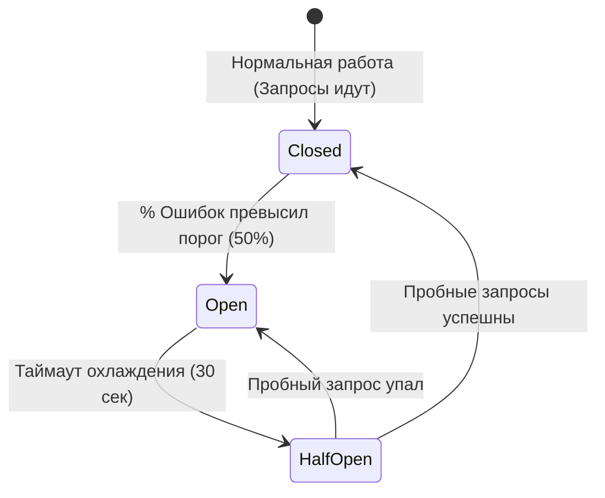

# Паттерны проектирования в Go: GoF, Concurrency, Highload & Distributed Systems

Комплексное инженерное руководство и практический справочник по паттернам проектирования в **Go (Golang)**: от классических идиоматичных GoF-адаптаций до конкурентных механизмов синхронизации и паттернов распределенных микросервисных систем под высокую нагрузку (BigTech / Highload 2026).

---

## 🎯 Инженерная философия паттернов в Go

Go — прагматичный, минималистичный язык программирования. В отличие от языков с тяжелым классическим ООП (Java, C#), в Go **нет наследования классов, нет перегрузки методов, нет исключений и нет сложных метапрограммных иерархий**.

> [!IMPORTANT]
> **Золотое правило Go-инженерии:**  
> Паттерн — это не цель, а проверенный временем способ решения конкретной проблемы. Если задачу можно решить простой функцией или срезом без создания абстракций — **решайте её просто**. Применяйте паттерны только тогда, когда цена введения абстракции окупается гибкостью, тестируемостью, локальностью данных или производительностью.

### 4 столпа проектирования на Go:
1. **Composition over Inheritance:** Композиция структур и встраивание интерфейсов вместо наследования классов.
2. **Accept interfaces, return structs:** Принимайте узкие интерфейсы на стороне потребителя (1–2 метода), возвращайте конкретные структуры из конструкторов.
3. **Explicit over Implicit:** Явная передача контекста (`context.Context`), явный возврат ошибок (`val, err := fn()`), явное выделение ресурсов (`defer file.Close()`).
4. **Share memory by communicating:** Общайтесь через каналы для передачи владения данными; используйте мьютексы и атомики только для локального низкоуровневого состояния.

---

## 🧭 Сводная матрица паттернов (Quick Reference Table)

| Паттерн | Категория | Решаемая инженерная задача | Влияние на перформанс / Надежность |
| :--- | :--- | :--- | :--- |
| **Functional Options** | Порождающий | Расширяемая инициализация сложных структур с дефолтными значениями | 0 накладных расходов, 100% обратная совместимость API |
| **Singleton (`sync.Once`)** | Порождающий | Гарантия строго однократной ленивой инициализации тяжелых ресурсов (БД) | Потокобезопасно, без накладных расходов мьютекса после инициализации |
| **Decorator / Middleware** | Структурный | Сквозная функциональность (метрики, трассировка, логирование, лимиты) | $O(1)$, чистая композиция поверх интерфейсов (`http.Handler`, `io.Reader`) |
| **Adapter (Порты и Адаптеры)** | Структурный | Изоляция бизнес-логики от внешних библиотек и SDK (Postgres, S3, Kafka) | Полная заменяемость инфраструктуры, легкое мокирование в тестах |
| **Strategy** | Поведенческий | Динамическое переключение алгоритмов (сжатие, хэширование, маршрутизация) | Полиморфизм через интерфейсы, соблюдение Open-Closed Principle (OCP) |
| **Worker Pool** | Конкурентность | Ограничение числа параллельных горутин (Bounded Concurrency) | Защита от OOM, стабильный RPS, предсказуемая нагрузка на CPU/БД |
| **Pipeline (Конвейер)** | Конкурентность | Потоковая обработка больших потоков данных стадиями через каналы | Снижение пикового потребления RAM до фиксированного размера буфера |
| **Fan-Out / Fan-In** | Конкурентность | Распараллеливание медленного шага пайплайна на $N$ воркеров и слияние | Линейное ускорение тяжелых CPU/IO этапов с координацией через `WaitGroup` |
| **`errgroup.Group`** | Конкурентность | Координация группы горутин с отменой по первой ошибке | Предотвращение утечек горутин (Goroutine Leaks), мгновенный Fail-Fast |
| **Singleflight** | Конкурентность | Устранение Thundering Herd (кэш-шторма) при одновременных запросах | Схлопывание 10 000 идентичных запросов к БД в **1 физический запрос** |
| **Lock-Free Config Reload** | Синхронизация | Обновление конфигурации/кэша на лету без блокировок `sync.RWMutex` | $O(1)$ чтение через `atomic.Pointer[T]`, 0 конкуренции за кэш-линии CPU |
| **Striped Locking (`KeyLocker`)** | Синхронизация | Сериализация запросов к одному ресурсу (кошелек) в userspace памяти Go | 1000 RPS на 1 строку БД без истощения пула соединений (`wallet`) |
| **Clean Architecture** | Архитектура | Направление зависимостей внутрь к ядру домена (Dependency Rule) | Независимость бизнес-правил от СУБД, UI, фреймворков и библиотек |
| **Cache-Aside (Lazy Loading)** | Распределенный | Кэширование при доминировании чтения над записью (Read/Write 100:1) | 80–90% экономия RAM в Redis, в кэше только горячие ключи (`lynks`) |
| **Transactional Outbox** | Распределенный | Гарантированная доставка событий в Kafka без проблемы Dual Write | At-least-once семантика при сбоях сети между сервисом и брокером |
| **Saga (Оркестрация)** | Распределенный | Распределенные транзакции между микросервисами без блокировок 2PC | Eventual Consistency и откат через компенсирующие транзакции |
| **Circuit Breaker** | Отказоустойчивость | Защита от каскадного падения системы при отказе внешней зависимости | Мгновенный отказ (Fail-Fast) вместо ожидания таймаутов, авто-восстановление |
| **Rate Limiter (Token Bucket)** | Защита ресурсов | Защита сервисов от перегрузки и DDoS-атак, сглаживание пиков трафика | Предсказуемый RPS, неблокирующее отсечение лишних запросов (HTTP 429) |
| **Dead Letter Queue (DLQ)** | Очереди | Изоляция «ядовитых» сообщений (Poison Pills), ломающих консьюмер | Бесперебойная обработка очереди, аудит и ручной разбор ошибок |

---

## 1. Идиоматичные Go-паттерны (GoF в Go)

### 1.1. Functional Options Pattern (Функциональные опции)

#### ❓ Проблема:
В Go нет перегрузки методов (overloading) и значений параметров по умолчанию. Если конструктор принимает 10 аргументов (`host, port, timeout, maxConns, tlsConfig, logger, metrics...`), вызовы становятся нечитаемыми, а добавление нового поля ломает весь существующий код.

#### 💡 Решение на Go:
```go
package server

import (
	"log/slog"
	"time"
)

type Server struct {
	addr    string
	timeout time.Duration
	maxConn int
	logger  *slog.Logger
}

// Option определяет сигнатуру функции-мутатора
type Option func(*Server)

func WithTimeout(d time.Duration) Option {
	return func(s *Server) {
		if d > 0 {
			s.timeout = d
		}
	}
}

func WithMaxConnections(n int) Option {
	return func(s *Server) {
		if n > 0 {
			s.maxConn = n
		}
	}
}

func WithLogger(logger *slog.Logger) Option {
	return func(s *Server) {
		if logger != nil {
			s.logger = logger
		}
	}
}

// NewServer применяет опции поверх безопасных дефолтных значений
func NewServer(addr string, opts ...Option) *Server {
	srv := &Server{
		addr:    addr,
		timeout: 30 * time.Second, // Дефолтное значение
		maxConn: 1000,             // Дефолтное значение
		logger:  slog.Default(),   // Дефолтное значение
	}

	for _, opt := range opts {
		opt(srv)
	}

	return srv
}
```

* **Когда применять:** При создании публичных API, SDK, клиентов БД и HTTP-серверов с множеством необязательных настроек.
* **Когда НЕ применять:** Если у структуры всего 1–2 обязательных поля (используйте обычный `New(addr, port)`).
* **Практическая польза:** 100% обратная совместимость при эволюции API, отсутствие невалидных промежуточных состояний, лаконичный клиентский код:
  ```go
  srv := server.NewServer(":8080", server.WithTimeout(5*time.Second))
  ```

---

### 1.2. Singleton через `sync.Once`

#### ❓ Проблема:
Необходимость ленивой (on-demand) инициализации тяжелого разделяемого ресурса (пул соединений с СУБД, клиент конфигурации) ровно один раз в многопоточной среде без накладных расходов мьютекса при каждом последующем чтении.

#### 💡 Решение на Go:
```go
package database

import (
	"context"
	"sync"

	"github.com/jackc/pgx/v5/pgxpool"
)

var (
	poolInstance *pgxpool.Pool
	poolOnce     sync.Once
	initErr      error
)

// GetPool возвращает глобальный экземпляр пула соединений,
// гарантируя строго однократное выполнение инициализации.
func GetPool(ctx context.Context, dsn string) (*pgxpool.Pool, error) {
	poolOnce.Do(func() {
		poolInstance, initErr = pgxpool.New(ctx, dsn)
	})
	return poolInstance, initErr
}
```

* **Почему именно `sync.Once`:** Внутри используется атомарная загрузка (`atomic.LoadUint32`). После первого выполнения проверка флага выполняется за **~1 наносекунду** без захвата мьютекса ОС.
* **Антипаттерн:** Использование глобального синглтона в бизнес-логике (затрудняет изоляцию unit-тестов). Передавайте инстанс через конструкторы (`Dependency Injection`).

---

### 1.3. Decorator / Middleware Pattern (Декоратор через композицию)

#### ❓ Проблема:
Необходимо добавить сквозную функциональность (логирование, сбор метрик Prometheus, трассировка, аутентификация) к обработчикам или потокам данных без изменения их исходного кода.

#### 💡 Решение на Go (HTTP Middleware):
```go
package middleware

import (
	"log/slog"
	"net/http"
	"time"
)

// Logging декорирует стандартный http.Handler
func Logging(logger *slog.Logger) func(http.Handler) http.Handler {
	return func(next http.Handler) http.Handler {
		return http.HandlerFunc(func(w http.ResponseWriter, r *http.Request) {
			start := time.Now()
			next.ServeHTTP(w, r)
			logger.Info("request completed",
				slog.String("method", r.Method),
				slog.String("path", r.URL.Path),
				slog.Duration("duration", time.Since(start)),
			)
		})
	}
}
```

#### 💡 Решение на Go (Потоковый декоратор `io.Reader`):
```go
// CountingReader считает количество прочитанных байт прозрачно для вызывающего
type CountingReader struct {
	reader io.Reader
	bytesRead int64
}

func NewCountingReader(r io.Reader) *CountingReader {
	return &CountingReader{reader: r}
}

func (cr *CountingReader) Read(p []byte) (int, error) {
	n, err := cr.reader.Read(p)
	cr.bytesRead += int64(n)
	return n, err
}

func (cr *CountingReader) TotalBytes() int64 {
	return cr.bytesRead
}
```

* **Практическая польза:** Соответствие принципу открытости/закрытости (OCP). Позволяет компоновать пайплайны обработки данных произвольной длины.

---

### 1.4. Adapter Pattern (Адаптер)

#### ❓ Проблема:
Бизнес-логика приложения должна работать с внешними сервисами (платежные шлюзы, хранилища S3, отправка SMS), но прямая зависимость от сторонней библиотеки делает код хрупким и нетестируемым.

#### 💡 Решение на Go:
```go
package domain

import "context"

// PaymentGateway — контракт (порт), нужный нашему домену
type PaymentGateway interface {
	Charge(ctx context.Context, amountKopecks int64, customerID string) (string, error)
}
```

```go
package stripeadapter

import (
	"context"
	"github.com/stripe/stripe-go/v78"
	"github.com/stripe/stripe-go/v78/charge"
)

// StripeAdapter адаптирует сторонний SDK Stripe под наш контракт PaymentGateway
type StripeAdapter struct {
	apiKey string
}

func New(apiKey string) *StripeAdapter {
	return &StripeAdapter{apiKey: apiKey}
}

func (a *StripeAdapter) Charge(ctx context.Context, amountKopecks int64, customerID string) (string, error) {
	params := &stripe.ChargeParams{
		Amount:   stripe.Int64(amountKopecks),
		Currency: stripe.String(string(stripe.CurrencyRUB)),
		Customer: stripe.String(customerID),
	}
	ch, err := charge.New(params)
	if err != nil {
		return "", err
	}
	return ch.ID, nil
}
```

* **Практическая польза:** При смене платежного шлюза (например, со Stripe на Т-Банк или ЮKassa) доменная бизнес-логика не меняется вовсе — пишется только новый адаптер.

---

## 2. Паттерны конкурентности и синхронизации

### 2.1. Worker Pool (Пул воркеров с Bounded Concurrency)

#### ❓ Проблема:
При обработке очередей задач запуск неограниченного числа горутин (`for msg := range queue { go process(msg) }`) под нагрузкой приводит к созданию сотен тысяч горутин, исчерпанию соединений с БД, дикому давлению на GC и OOM-падению.

#### 💡 Решение на Go:
```go
package workerpool

import (
	"context"
	"sync"
)

type Job func(ctx context.Context)

// Pool управляет пулом горутин фиксированного размера
type Pool struct {
	workers int
	jobs    chan Job
	wg      sync.WaitGroup
}

func New(workers, queueSize int) *Pool {
	return &Pool{
		workers: workers,
		jobs:    make(chan Job, queueSize),
	}
}

func (p *Pool) Start(ctx context.Context) {
	for i := 0; i < p.workers; i++ {
		p.wg.Add(1)
		go func() {
			defer p.wg.Done()
			for {
				select {
				case <-ctx.Done():
					return
				case job, ok := <-p.jobs:
					if !ok {
						return
					}
					job(ctx)
				}
			}
		}()
	}
}

func (p *Pool) Submit(job Job) {
	p.jobs <- job
}

func (p *Pool) Stop() {
	close(p.jobs)
	p.wg.Wait()
}
```

* **Обоснование:** Bounded Concurrency (ограниченный параллелизм) задает жесткий верхний предел потребления ресурсов. Если задачи поступают быстрее, чем воркеры их переваривают, очередь в буфере сигнализирует о необходимости горизонтального масштабирования.

---

### 2.2. Pipeline (Конвейер потоковой обработки)

#### ❓ Проблема:
Обработка больших файлов (логирование, ETL-выгрузки на гигабайты данных) целиком в оперативной памяти требует огромного объема RAM.

#### 💡 Решение на Go:
```go
package pipeline

import "context"

// Стадия 1: Генератор чисел
func Generate(ctx context.Context, nums ...int) <-chan int {
	out := make(chan int)
	go func() {
		defer close(out)
		for _, n := range nums {
			select {
			case <-ctx.Done():
				return
			case out <- n:
			}
		}
	}()
	return out
}

// Стадия 2: Возведение в квадрат
func Square(ctx context.Context, in <-chan int) <-chan int {
	out := make(chan int)
	go func() {
		defer close(out)
		for n := range in {
			select {
			case <-ctx.Done():
				return
			case out <- n * n:
			}
		}
	}()
	return out
}
```

* **Практическая польза:** Данные передаются потоково через каналы. Стадии работают параллельно на разных ядрах CPU, а потребление оперативной памяти остается фиксированным и не зависит от размера входящего потока.

---

### 2.3. Fan-Out / Fan-In

#### ❓ Проблема:
В конвейере одна из стадий выполняет тяжелые вычисления или сетевые вызовы (например, парсинг страниц или шифрование данных) и становится узким горлышком.

#### 💡 Решение на Go:
```go
package concurrency

import (
	"context"
	"sync"
)

// FanIn объединяет несколько входных каналов в один
func FanIn[T any](ctx context.Context, channels ...<-chan T) <-chan T {
	out := make(chan T)
	var wg sync.WaitGroup

	for _, ch := range channels {
		wg.Add(1)
		go func(c <-chan T) {
			defer wg.Done()
			for val := range c {
				select {
				case <-ctx.Done():
					return
				case out <- val:
				}
			}
		}(ch)
	}

	go func() {
		wg.Wait()
		close(out)
	}()

	return out
}
```

* **Схема работы:**
  ```text
  Входной канал ---> [Worker 1] --                 ---> [Worker 2] ---> [Fan-In] ---> Итоговый канал
                 ---> [Worker 3] --/
  ```
* **Практическая польза:** Линейное масштабирование пропускной способности этапа пропорционально числу ядер CPU.

---

### 2.4. `errgroup.Group` (Координация с Fail-Fast отменой)

#### ❓ Проблема:
Необходимо запустить несколько независимых параллельных задач (например, запрос в профиль, баланс и историю транзакций). Если хотя бы один запрос падает, ждать остальные бессмысленно — нужно отменить их и вернуть ошибку.

#### 💡 Решение на Go:
```go
package service

import (
	"context"
	"golang.org/x/sync/errgroup"
)

func (s *Service) FetchDashboard(ctx context.Context, userID string) (*Dashboard, error) {
	g, ctx := errgroup.WithContext(ctx)

	var (
		profile *Profile
		balance *Balance
		orders  []Order
	)

	g.Go(func() error {
		var err error
		profile, err = s.userClient.GetProfile(ctx, userID)
		return err
	})

	g.Go(func() error {
		var err error
		balance, err = s.walletClient.GetBalance(ctx, userID)
		return err
	})

	g.Go(func() error {
		var err error
		orders, err = s.orderClient.GetOrders(ctx, userID)
		return err
	})

	if err := g.Wait(); err != nil {
		return nil, err // Вернет первую возникшую ошибку, отменив ctx для остальных
	}

	return &Dashboard{Profile: profile, Balance: balance, Orders: orders}, nil
}
```

* **Практическая польза:** Устраняет «висячие» горутины, экономит сетевой и процессорный ресурс, заменяя 30 строк шаблонного кода с `sync.WaitGroup` на лаконичную конструкцию.

---

### 2.5. Singleflight (Дедупликация идентичных запросов)

#### ❓ Проблема:
**Thundering Herd (Кэш-шторм):** При истечении TTL горячего ключа в Redis (например, главная страница или каталог товаров) 10 000 одновременных запросов получают Cache Miss и одновременно идут в PostgreSQL, убивая базу данных.

#### 💡 Решение на Go (`golang.org/x/sync/singleflight`):
```go
package repository

import (
	"context"
	"golang.org/x/sync/singleflight"
)

type ProductRepo struct {
	group singleflight.Group
}

func (r *ProductRepo) GetProduct(ctx context.Context, id string) (*Product, error) {
	// Если прямо сейчас этот же ID уже запрашивается другой горутиной,
	// текущая горутина НЕ идет в БД, а ждет результат первого вызова.
	val, err, _ := r.group.Do(id, func() (any, error) {
		return r.queryDatabase(ctx, id)
	})

	if err != nil {
		return nil, err
	}
	return val.(*Product), nil
}
```

* **Практическая польза:** 10 000 параллельных запросов за одним товаром превращаются в **ровно 1 запрос к СУБД**. Остальные 9 999 запросов получают копию результата в памяти.

---

### 2.6. Striped Locking (`KeyLocker` на 4096 шардов)

#### ❓ Проблема:
В высоконагруженном кошельке или инвентаре (1000+ RPS на один ID) наивная блокировка строки в базе (`SELECT FOR UPDATE`) забивает пул соединений и вызывает таймауты. Глобальный мьютекс `sync.Mutex` в Go превращает сервис в однопоточный.

#### 💡 Решение на Go (Реализовано в проекте [`wallet`](file:///Users/user/workspace/golang_projects/go-core-4/go-production-engineering/wallet)):
```go
package sync

import (
	"hash/fnv"
	"sync"
	"github.com/google/uuid"
)

type KeyLocker struct {
	stripes []sync.Mutex
	mask    uint32
}

func NewKeyLocker(powerOfTwo int) *KeyLocker {
	return &KeyLocker{
		stripes: make([]sync.Mutex, powerOfTwo),
		mask:    uint32(powerOfTwo - 1), // Битовая маска вместо медленного деления %
	}
}

func (kl *KeyLocker) Lock(id uuid.UUID) {
	idx := kl.hash(id) & kl.mask
	kl.stripes[idx].Lock()
}

func (kl *KeyLocker) Unlock(id uuid.UUID) {
	idx := kl.hash(id) & kl.mask
	kl.stripes[idx].Unlock()
}
```

* **Практическая польза:** Разные ключи не блокируют друг друга (параллелизм на 4096 потоков). Запросы к одному ключу выстраиваются в очередь в памяти рантайма Go, потребляя **ровно 1 коннект к БД**.

---

## 3. Распределенные и микросервисные паттерны

### 3.1. Clean Architecture (Чистая архитектура / Ports & Adapters)

#### ❓ Проблема:
Смешивание SQL-запросов, HTTP-роутинга и бизнес-правил в одном месте («толстые контроллеры») делает систему хрупкой. Смена фреймворка или базы данных требует переписывания всего проекта.

#### 💡 Архитектурное правило зависимостей (The Dependency Rule):
Зависимости исходного кода должны быть направлены **строго внутрь**:

```text
  [ Внешний мир: HTTP API, gRPC, CLI, PostgreSQL, Redis, Kafka ]
                                │
                                ▼  (зависит от)
                [ Адаптеры: Controllers, Repositories ]
                                │
                                ▼  (зависит от)
                   [ Use Cases: Сценарии бизнеса ]
                                │
                                ▼  (зависит от)
                  [ Entities: Доменные сущности ]
```

* **Практическая реализация в репозитории:** Домашнее задание [homework-17](file:///Users/user/workspace/golang_projects/go-core-4/go-production-engineering/lessons/17-system-design/homework-17/README.md) и микросервис [`wallet`](file:///Users/user/workspace/golang_projects/go-core-4/go-production-engineering/wallet).
* **Практическая польза:** Доменное ядро не зависит от сторонних библиотек. Бизнес-логику можно протестировать на 100% за несколько миллисекунд с помощью in-memory моков без запуска Docker или базы данных.

---

### 3.2. Transactional Outbox Pattern (Решение проблемы Dual Write)

#### ❓ Проблема Dual Write:
Вам нужно обновить баланс в PostgreSQL и отправить событие `OrderCreated` в Apache Kafka:
```go
// ❌ АНТИПАТТЕРН: Dual Write
db.Exec("UPDATE balance ...") // Успешно записали в БД
kafka.Produce("OrderCreated") // Сеть моргнула! Падение!
```
Если брокер упал — деньги списаны, а заказ не отправлен. Если поменять порядок — брокер отправил событие, а транзакция БД откатилась.

#### 💡 Решение через Transactional Outbox:
В PostgreSQL создается таблица `outbox_events`. Запись в базу и добавление события в outbox выполняются в **одной неделимой ACID-транзакции**:

```sql
BEGIN;
UPDATE wallets SET balance = balance - 100 WHERE id = $1;
INSERT INTO outbox_events (aggregate_type, aggregate_id, event_type, payload)
VALUES ('wallet', $1, 'MoneyWithdrawn', '{"amount": 100}');
COMMIT;
```

* **Как данные попадают в Kafka:**
  1. Либо фоновый воркер на Go периодически читает неотправленные записи (`SELECT ... FOR UPDATE SKIP LOCKED`).
  2. Либо используется **Debezium CDC (Change Data Capture)**, который вычитывает WAL-журнал PostgreSQL и гарантированно стримит события в Kafka без нагрузки на саму базу.
* **Практическая польза:** Гарантия доставки **At-Least-Once** без рассинхрона данных.

---

### 3.3. Cache-Aside Pattern (Ленивое кэширование)

#### ❓ Проблема:
Прямой поток всех чтений в PostgreSQL перегружает базу. Паттерн *Write-Through* (запись в кэш сразу при создании) забивает оперативную память Redis «мертвыми» ключами, которые никто никогда не запросит.

#### 💡 Решение на Go (Реализовано в проекте [`lynks`](file:///Users/user/workspace/golang_projects/go-core-4/go-production-engineering/lynks)):
```go
func (s *Service) Get(ctx context.Context, key string) (string, error) {
    // 1. Сначала читаем быстрый in-memory кэш Redis
    val, err := s.cache.Get(ctx, key)
    if err == nil {
        return val, nil // Cache Hit!
    }

    // 2. Cache Miss: идем в постоянную базу данных
    val, err = s.db.FindByKey(ctx, key)
    if err != nil {
        return "", err
    }

    // 3. Асинхронно или синхронно прогреваем кэш с TTL
    go func() {
        _ = s.cache.Set(context.Background(), key, val, 24*time.Hour)
    }()

    return val, nil
}
```

* **Практическая польза:** При соотношении Read/Write 100:1 база данных разгружается на 95–99%, а память Redis используется максимально эффективно.

---

### 3.4. Circuit Breaker (Предохранитель отказоустойчивости)

#### ❓ Проблема:
Внешний сервис (например, сервис доставки) начинает деградировать и отвечать по 30 секунд. Ваши HTTP-хендлеры удерживают соединения, исчерпывают пул потоков, и весь ваш сервис перестает отвечать клиентам (Cascading Failure).

#### 💡 Решение:
Предохранитель отслеживает процент ошибок. При превышении порога он переходит в состояние **Open** и немедленно возвращает клиенту ошибку (Fail-Fast), не отправляя реальных сетевых запросов к упавшему сервису:



* **Практическая польза:** Спасает систему от каскадного падения и дает упавшему сервису возможность восстановиться без бомбардировки новыми запросами.

---

## 4. Каталог антипаттернов в Go (Чего делать НЕЛЬЗЯ)

| ❌ Антипаттерн | В чем скрытая опасность | ✅ Идиоматичное решение |
| :--- | :--- | :--- |
| **`interface{}` (any) везде** | Утрата типобезопасности во время компиляции, накладные расходы на boxing/unboxing в рантайме. | Дженерики `[T any]` или четкие узкие интерфейсы. |
| **Пакеты `utils/`, `common/`, `helpers/`** | Свалка несвязанного кода, приводящая к циклическим импортам (Cyclic Dependency). | Разделение по предметной области (DDD): пакеты `auth`, `order`, `cryptoutil`. |
| **Копирование `sync.Mutex`** | Передача структуры с мьютексом по значению копирует состояние замка. Приводит к дедлокам. | Передавать структуры с мьютексами **строго по указателю (`*T`)**, использовать линтер `copylocks`. |
| **Синхронизация через `time.Sleep`** | Флакающие тесты (Flaky Tests). На медленном CI 100мс не хватит, на быстром тест работает неоправданно долго. | Синхронизация через каналы, `sync.WaitGroup` или `testing/synctest` (Go 1.25+). |
| **Запуск горутин без механизма завершения** | Утечки горутин (Goroutine Leaks): горутина зависает на чтении из канала навечно, удерживая стек памяти. | Обязательная передача `ctx.Done()` и прерывание цикла по отмене контекста. |
| **Игнорирование ошибок (`_ = file.Close()`)** | Скрытая потеря данных при сбросе буферов на диск при записи. | Явная проверка возвращаемой ошибки, логирование или проброс наверх. |

---

## 🔗 Связанные материалы в репозитории

- [Том 2: ООП, Методы и Интерфейсы](file:///Users/user/workspace/golang_projects/go-core-4/go-production-engineering/go-documentation/02-go-core-oop-methods.md)
- [Том 3: Многопоточность и конкурентность](file:///Users/user/workspace/golang_projects/go-core-4/go-production-engineering/go-documentation/03-go-core-concurrency.md)
- [Том 5: Тестирование и Clean Architecture](file:///Users/user/workspace/golang_projects/go-core-4/go-production-engineering/go-documentation/05-go-core-testing-arch.md)
- [Руководство по System Design](file:///Users/user/workspace/golang_projects/go-core-4/go-production-engineering/go-documentation/go-system-design-guide.md)
- [Архитектура Highload Wallet (Striped Locking)](file:///Users/user/workspace/golang_projects/go-core-4/go-production-engineering/wallet/ARCHITECTURE.md)
