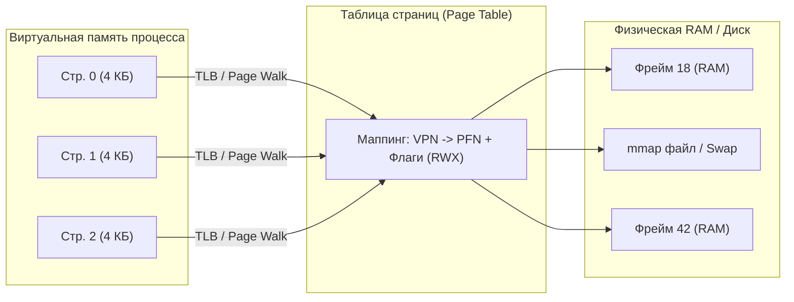
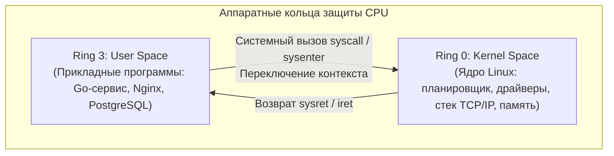
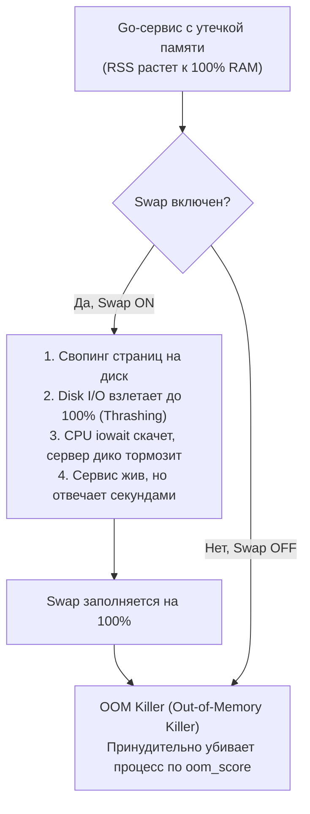
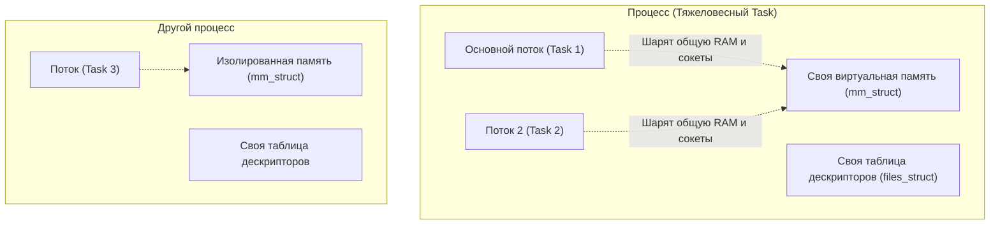
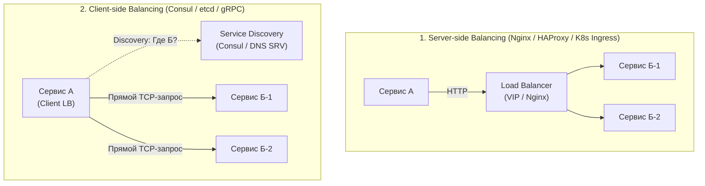
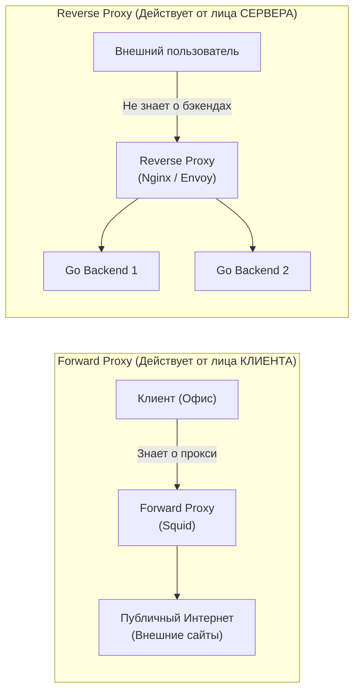

# ОС, Ядро Linux, Сети и Системное программирование для Go-разработчика

> [!IMPORTANT]
> 🐧 **Настольное руководство к техническим собеседованиям уровня Middle, Senior и Lead (Ozon, VK, Яндекс, Т-Банк, Авито):**  
> В высоконагруженном бэкенде знание чистого синтаксиса Go недостаточно. Senior-разработчик обязан понимать физику работы операционной системы, архитектуру виртуальной памяти, системные вызовы, сетевой стек ядра Linux и типовые инфраструктурные аварии.

---

## 📑 Оглавление

1. [Виртуальная память, Страницы памяти, TLB и Hugepages](#1-виртуальная-память-страницы-памяти-tlb-и-hugepages)
   - [1.1. Что такое страница памяти (Memory Page)](#11-что-такое-страница-памяти-memory-page)
   - [1.2. Как маппинг работает быстро: Аппаратный TLB-кэш процессора](#12-как-маппинг-работает-быстро-аппаратный-tlb-кэш-процессора)
   - [1.3. Что такое Hugepages и зачем они нужны в Highload](#13-что-такое-hugepages-и-зачем-они-нужны-в-highload)
2. [User Space vs Kernel Space и Системные вызовы (Syscalls)](#2-user-space-vs-kernel-space-и-системные-вызовы-syscalls)
   - [2.1. Разделение User Space и Kernel Space: Зачем нужны кольца защиты](#21-разделение-user-space-и-kernel-space-зачем-нужны-кольца-защиты)
   - [2.2. Анатомия системного вызова (Syscall): Что происходит при вызове](#22-анатомия-системного-вызова-syscall-что-происходит-при-вызове)
   - [2.3. Ключевые системные вызовы: fork (Copy-on-Write) и epoll (I/O Multiplexing)](#23-ключевые-системные-вызовы-fork-copy-on-write-и-epoll-io-multiplexing)
3. [Примитивы синхронизации на уровне операционной системы](#3-примитивы-синхронизации-на-уровне-операционной-системы)
   - [3.1. Спинлоки (Spinlock), Мьютексы (Mutex) и Семафоры (Semaphore)](#31-спинлоки-spinlock-мьютексы-mutex-и-семафоры-semaphore)
   - [3.2. Файловые блокировки (flock / fcntl)](#32-файловые-блокировки-flock--fcntl)
   - [3.3. Futex (Fast Userspace Mutex) в Linux и его роль в Go Runtime](#33-futex-fast-userspace-mutex-в-linux-и-его-роль-в-go-runtime)
4. [Файловые дескрипторы и Диагностика дискового пространства](#4-файловые-дескрипторы-и-диагностика-дискового-пространства)
   - [4.1. Что такое файловый дескриптор: stdin (0), stdout (1), stderr (2)](#41-что-такое-файловый-дескриптор-stdin-0-stdout-1-stderr-2)
   - [4.2. Авария: «Место на диске кончилось, но du показывает мало» (lsof и удалённые дескрипторы)](#42-авария-место-на-диске-кончилось-но-du-показывает-мало-lsof-и-удалённые-дескрипторы)
5. [Утечки памяти на сервере и OOM Killer](#5-утечки-памяти-на-сервере-и-oom-killer)
   - [5.1. Утечка памяти на голом сервере: Включенный Swap vs Отключенный Swap](#51-утечка-памяти-на-голом-сервере-включенный-swap-vs-отключенный-swap)
   - [5.2. На какую память опирается OOM Killer: RSS vs VIRT и oom_score](#52-на-какую-память-опирается-oom-killer-rss-vs-virt-и-oom_score)
   - [5.3. Зачем нужна виртуальная память](#53-зачем-нужна-виртуальная-память)
6. [Процессы vs Системные потоки в Linux и IPC](#6-процессы-vs-системные-потоки-в-linux-и-ipc)
   - [6.1. Всё есть Task (task_struct) и системный вызов clone()](#61-всё-есть-task-task_struct-и-системный-вызов-clone)
   - [6.2. Механизмы межпроцессного взаимодействия (IPC)](#62-механизмы-межпроцессного-взаимодействия-ipc)
7. [Диагностика процессов в Linux: top, CPU 146% и сигналы](#7-диагностика-процессов-в-linux-top-cpu-146-и-сигналы)
   - [7.1. Процесс потребляет 146% CPU в top: Норма или авария? (Планировщик CFS)](#71-процесс-потребляет-146-cpu-в-top-норма-или-авария-планировщик-cfs)
   - [7.2. Управление процессами: kill, killall, htop и сигналы SIGTERM (15) vs SIGKILL (9)](#72-управление-процессами-kill-killall-htop-и-сигналы-sigterm-15-vs-sigkill-9)
8. [Протокол HTTP: Текстовый формат и Архитектура статики](#8-протокол-http-текстовый-формат-и-архитектура-статики)
   - [8.1. Из чего состоит HTTP-запрос и HTTP-ответ (RFC 9112)](#81-из-чего-состоит-http-запрос-и-http-ответ-rfc-9112)
   - [8.2. Почему статические файлы размещают на отдельном домене (Cookie-free domain)](#82-почему-статические-файлы-размещают-на-отдельном-домене-cookie-free-domain)
9. [Сетевая Архитектура: Балансировка и Проксирование](#9-сетевая-архитектура-балансировка-и-проксирование)
   - [9.1. Масштабирование сервисов: Server-side vs Client-side балансировка](#91-масштабирование-сервисов-server-side-vs-client-side-балансировка)
   - [9.2. Forward Proxy vs Reverse Proxy](#92-forward-proxy-vs-reverse-proxy)

---

## 1. Виртуальная память, Страницы памяти, TLB и Hugepages

### 1.1. Что такое страница памяти (Memory Page)

**Страница памяти (Memory Page)** — это базовая неделимая единица структурирования виртуальной памяти фиксированного размера (по умолчанию в архитектуре x86-64 и ARM64 размер страницы составляет **4 КБ** = 4096 байт).



#### Зачем нужна страничная организация:
1. **Трансляция адресов (Address Translation):** процесс оперирует непрерывным виртуальным адресным пространством (от `0x0` до `0x7FFFFFFFFFFF` на x86-64), а ядро ОС через многоуровневую таблицу страниц (**Page Table**) транслирует виртуальные страницы (Virtual Page Number) в произвольные физические фреймы RAM (Page Frame Number).
2. **Изоляция и защита памяти:** для каждой страницы в таблице страниц хранятся биты доступа:
   - **`R` (Read):** чтение разрешено.
   - **`W` (Write):** запись разрешена (попытка записи в read-only страницу вызывает аппаратное прерывание `SIGSEGV` — Segmentation Fault).
   - **`X` (Execute):** исполнение инструкций (бит NX — No-Execute, предотвращает выполнение вредоносного кода со стека).
3. **Отображение файлов в память (`mmap`):** страница может отображаться не на оперативную память, а напрямую на блоки файла на диске.

---

### 1.2. Как маппинг работает быстро: Аппаратный TLB-кэш процессора

> ❓ **Вопрос собеседования:** *«Если страницы мапятся на физическую память, то каждое обращение к памяти требует поиска в таблице страниц. В 64-битных ОС таблица 4- или 5-уровневая (PML4/PML5), то есть каждое чтение RAM требовало бы 4–5 дополнительных обращений к памяти! Как это работает быстро?»*

**Ответ:**  
У процессора есть специализированный сверхбыстрый аппаратный ассоциативный кэш прямо на кристалле CPU — **TLB (Translation Lookaside Buffer)**:
1. **TLB Hit:** процессор мгновенно (за 0.5–1 такта) находит физический адрес фрейма в кэше TLB и сразу выполняет инструкцию.
2. **TLB Miss:** если адреса в TLB нет, аппаратный блок CPU (**Page Table Walker**) выполняет дорогостоящий обход многоуровневой таблицы страниц в оперативной памяти (тратя 10–50 наносекунд), загружает трансляцию в TLB и только затем читает данные.
3. **Принцип локальности (Locality of Reference):** программы обычно работают с близкими адресами памяти (пространственная локальность), поэтому один 4-килобайтный диапазон покрывает тысячи инструкций, и процент попаданий в TLB (TLB Hit Rate) превышает 99%.

---

### 1.3. Что такое Hugepages и зачем они нужны в Highload

> ❓ **Вопрос собеседования:** *«Что такое Hugepages, зачем они нужны и для каких программ критически важны?»*

**Ответ:**  
**Hugepages (большие страницы)** — механизм ядра ОС, позволяющий выделять страницы памяти нестандартного увеличенного размера:
- Стандартная страница: **4 КБ**.
- Большие страницы (Hugepages): **2 МБ** или **1 ГБ**.

#### В чём проблема 4 КБ страниц для больших баз данных:
Если у сервера базы данных (PostgreSQL, ClickHouse, Redis, ScyllaDB) выделено **256 ГБ RAM** под shared buffers / кэш:
- При размере страницы **4 КБ** требуется **67 108 864 страницы**! Таблица страниц сама по себе займет гигабайты памяти, а ограниченный аппаратный кэш TLB (обычно 1000–2000 записей) будет непрерывно «вымываться» (TLB Thrashing), вызывая миллионы промахов TLB Miss в секунду.
- При размере Hugepages **2 МБ** требуется всего **131 072 страницы** (в 512 раз меньше!).
- При размере **1 ГБ** требуется всего **256 страниц**, которые **целиком помещаются в кэш TLB процессора**.

> [!TIP]
> **Итог:** Hugepages уменьшают количество записей в таблице страниц, радикально сокращают TLB-misses и ускоряют транзакционную производительность баз данных и Highload-памяти на **10–30%**.

---

## 2. User Space vs Kernel Space и Системные вызовы (Syscalls)

### 2.1. Разделение User Space и Kernel Space: Зачем нужны кольца защиты

Архитектура современных процессоров (x86, ARM) аппаратно поддерживает уровни привилегий — **кольца защиты (Protection Rings)**:



* **User Space (Ring 3):** пространство пользователя. Прикладным программам запрещено напрямую обращаться к физическим устройствам, менять регистры управления процессора (`CR3`, управляющий таблицей страниц) или обращаться к памяти ядра. Доступна только изолированная виртуальная память своего процесса.
* **Kernel Space (Ring 0):** пространство ядра. Ядру доступен весь набор инструкций процессора, прямой доступ к сетевым картам, контроллерам дисков и всей физической памяти.
* **Зачем нужно разделение:** защита и стабильность. Любая критическая ошибка (паника, segfault, бесконечный цикл) в прикладной Go-программе убивает только этот процесс, но не может уронить операционную систему или повредить данные соседних процессов.

---

### 2.2. Анатомия системного вызова (Syscall): Что происходит при вызове

**Системный вызов (Syscall)** — это программно-аппаратный шлюз (API операционной системы), через который программа из Ring 3 запрашивает привилегированную операцию у ядра (Ring 0): чтение файла, отправка пакета в сокет, создание потока или аллокация памяти.

#### Пошаговая физика системного вызова:
1. Go-программа подготавливает аргументы вызова в регистрах CPU (например, `RAX` — номер сисколла, `RDI`, `RSI`, `RDX` — параметры).
2. Выполняется ассемблерная инструкция `syscall` (или `sysenter`).
3. **Аппаратное переключение:** CPU мгновенно переключает уровень привилегий с Ring 3 на Ring 0, сохраняет программный счетчик (`RIP`) и регистр флагов, и загружает стек ядра.
4. Ядро сохраняет регистры пользователя, выполняет запрошенную операцию (например, читает данные из сокета сетевой карты).
5. Ядро помещает результат в регистр возврата (`RAX`) и выполняет инструкцию `sysret`, возвращая процессор в Ring 3.

> [!NOTE]
> Накладные расходы системного вызова составляют около **50–100 наносекунд** (а с защитой от уязвимостей Meltdown/Spectre через KPTI — до 200–500 нс). Именно поэтому в Go сетевой ввод-вывод сделан асинхронным через сетевой поллер (`epoll`), чтобы не дергать сисколлы попусту на каждый байт.

---

### 2.3. Ключевые системные вызовы: fork (Copy-on-Write) и epoll (I/O Multiplexing)

#### Системный вызов `fork()`:
- Создает точную копию текущего процесса (дочерний процесс).
- **Механизм Copy-on-Write (CoW):** ядро физически **не копирует** гигабайты памяти процесса при `fork`. Вместо этого ядро дублирует только таблицу страниц, помечая все физические страницы флагом **Read-Only**.
- Реальное выделение и копирование конкретной 4-КБ страницы происходит только тогда, когда родитель или потомок пытается в неё записать (`Page Fault` $\to$ ядро дублирует только эту 1 страницу). На этом построен быстрый `BGSAVE` snapshot в Redis!

#### Системный вызов `epoll` (`epoll_create`, `epoll_ctl`, `epoll_wait`):
- Мультиплексирование ввода-вывода (I/O Multiplexing) за $O(1)$.
- В старых вызовах `select` и `poll` процессор перебирал массив дескрипторов за $O(N)$ при каждом вызове.
- В `epoll` сетевая карта при поступлении пакета вызывает аппаратное прерывание, драйвер ядра помещает дескриптор в очередь готовых событий (**Ready List** на базе связного списка), а `epoll_wait` забирает только готовые дескрипторы без сканирования спящих соединений.
- На `epoll` построен весь **Netpoller в рантайме Go**.

---

## 3. Примитивы синхронизации на уровне операционной системы

> ❓ **Вопрос собеседования:** *«Какие вы знаете примитивы синхронизации в ОС (не в Go, а в операционной системе)?»*

| Примитив ОС | Где живет | Механика работы | Накладные расходы | Сценарий применения |
| :--- | :---: | :--- | :--- | :--- |
| **Spinlock (Спинлок)** | Ring 0 / Ring 3 | Поток не засыпает, а крутится в непрерывном цикле `busy-wait` (CPU polling), проверяя атомарную переменную | 100% нагрузка ядра CPU во время ожидания, 0 нс на пробуждение | Блокировка на доли наносекунд внутри ядра ОС на многоядерных машинах |
| **Семафор (Semaphore)** | Ядро ОС (SysV / POSIX) | Счетчик ресурсов. `wait/P` декрементирует, `post/V` инкрементирует. При $0$ поток усыпляется ядром | Переключение контекста в ядро (~1-2 мкс) | Ограничение пула ресурсов, очередей |
| **Файловая блокировка (`flock`/`fcntl`)** | Файловая система ядра | Блокировка дескриптора файла (Shared lock `LOCK_SH` для чтения, Exclusive `LOCK_EX` для записи) | Системный вызов ядра | Синхронизация между разными независимыми процессами (Daemon single-instance) |
| **Futex (Fast Userspace Mutex)** | Гибрид: Userspace + Ядро Linux | Атомарный CAS в userspace. Если конкуренции нет — **0 сисколлов**! Если лок занят — сисколл `futex_wait` усыпляет поток | 1-2 нс без конкуренции, ~1-2 мкс при конфликте | База для `pthread_mutex` и `sync.Mutex` в Go |

### 3.3. Futex (Fast Userspace Mutex) в Linux и его роль в Go Runtime

До изобретения `futex` в Linux каждый захват мьютекса требовал обязательного системного вызова в ядро, что катастрофически замедляло многопоточный код.

#### Как устроен `futex`:
1. В памяти процесса выделяется 32-битный целочисленный атомик (например, `0` — свободно, `1` — заблокировано).
2. **Fast Path (быстрый путь без конкуренции):** вызывающий поток делает атомарную процессорную инструкцию `LOCK CMPXCHG`. Если там был `0`, поток моментально ставит `1` и идет дальше. **Перехода в Kernel Space не происходит!**
3. **Slow Path (конфликт блокировок):** если переменная уже равна `1`, поток понимает, что мьютекс занят. Он делает системный вызов `futex(val_addr, FUTEX_WAIT, 1)`. Ядро Linux переводит поток в состояние `TASK_INTERRUPTIBLE` (сна) и вешает его в очередь ожидания.
4. При освобождении (`Unlock`) поток атомарно сбрасывает значение в `0` и, если есть ждущие, вызывает `futex(val_addr, FUTEX_WAKE, 1)`, чтобы ядро разбудило один спящий поток.

---

## 4. Файловые дескрипторы и Диагностика дискового пространства

### 4.1. Что такое файловый дескриптор: stdin (0), stdout (1), stderr (2)

**Файловый дескриптор (File Descriptor, FD)** — это неотрицательное целое число (индекс в таблице открытых файлов процесса ядра Linux), представляющее абстракцию над открытым ресурсом ввода-вывода.

В Unix действует принцип: *«Всё есть файл»*. Один и тот же интерфейс дескриптора используется для:
- Обычных файлов на диске.
- Сетевых TCP/UDP сокетов.
- Каналов межпроцессного обмена (Pipes).
- Устройств ввода/вывода (терминалы `/dev/tty`).

Стандартные зарезервированные дескрипторы любого процесса:
- **`0`:** `stdin` (стандартный ввод, клавиатура или пайп).
- **`1`:** `stdout` (стандартный вывод).
- **`2`:** `stderr` (стандартный вывод ошибок).

---

### 4.2. Авария: «Место на диске кончилось, но du показывает мало» (lsof и удалённые дескрипторы)

> ❓ **Топ-вопрос собеседования:**  
> *«Утилита `df -h` показывает 100% заполнения диска, запись невозможна ("No space left on device"). При этом утилита `du -sh /*` насчитала файлов всего на 20 ГБ из 100 ГБ. Почему так произошло и как это исправить?»*

#### Причина аварии:
В файловых системах Linux (ext4, XFS) удаление файла через команду `rm /var/log/app.log` удаляет только имя файла из каталога (директории) и уменьшает счетчик жестких ссылок (**Hard Links count**) inode.  
Однако **физическое освобождение дисковых блоков происходит ТОЛЬКО тогда, когда закрыты ВСЕ дескрипторы этого файла во всех работающих процессах!**  
Если фоновый сервис (например, сервис на Go или Nginx) держал открытым лог-файл и продолжает писать в него, после `rm` файл становится «невидимым» для утилиты `du` (так как имени в каталоге больше нет), но блоки на диске продолжают удерживаться и расти!

#### Пошаговое решение аварии:
1. **Найти процессы, удерживающие удалённые файлы:**
   ```bash
   lsof +L1
   # или:
   lsof | grep deleted
   ```
   *Вывод покажет PID процесса, размер удерживаемого файла и имя:*
   ```text
   my-service  14280  appuser   3u   REG  252,1  85899345920  0  /var/log/app.log (deleted)
   ```
2. **Как освободить место моментально:**
   - **Вариант А (штатный):** перезапустить или остановить виновный процесс (`systemctl restart my-service`). Процесс завершится, ядро закроет все его дескрипторы, и место мгновенно освободится.
   - **Вариант Б (Zero-Downtime, если процесс нельзя останавливать):** очистить файл через дескриптор в виртуальной ФС `/proc`:
     ```bash
     # Обнуляем размер файла через дескриптор процесса (PID 14280, FD 3):
     : > /proc/14280/fd/3
     ```
     Размер файла в файловой системе мгновенно сожмется до 0 байт без остановки сервиса!

---

## 5. Утечки памяти на сервере и OOM Killer

### 5.1. Утечка памяти на голом сервере: Включенный Swap vs Отключенный Swap

> ❓ **Вопрос собеседования:** *«На голом сервере без Docker/K8s запущен Go-сервис с утечкой памяти. Память сервера подходит к концу. Что произойдет?»*

**Ответ: развитие событий зависит от того, включен ли файл/раздел подкачки (Swap):**



1. **Если Swap включен:**  
   Ядро ОС начнет активно вытеснять холодные страницы памяти на диск. Поскольку утекающий сервис непрерывно требует новую память, начнется катастрофическое явление — **Disk Thrashing (пробуксовка)**. Нагрузка на диск взлетает до 100%, `iowait` зашкаливает, весь сервер «замораживается» и перестает отвечать на запросы. В таком полумертвом состоянии сервер может существовать часами, пока не закончится и swap.
2. **Если Swap выключен:**  
   Когда физическая память заканчивается, ядро не может выделить новые страницы под системный вызов `mmap`/`brk`. Срабатывает внутренний механизм ядра — **OOM Killer**.

---

### 5.2. На какую память опирается OOM Killer: RSS vs VIRT и oom_score

> ❓ **Вопрос собеседования:** *«На какой тип памяти опирается OOM Killer при решении, какой процесс убить: на виртуальную (VIRT) или физическую (RSS)?»*

**Ответ:**  
OOM Killer опирается **ИСКЛЮЧИТЕЛЬНО на физическую реально используемую память — RSS (Resident Set Size)**, а не на виртуальную память (VIRT).

* **VIRT (Virtual Memory):** объем адресного пространства, которое процесс запросил у ядра. Go-рантайм сразу при старте резервирует через `mmap` с флагом `PROT_NONE` сотни гигабайт виртуального адресного пространства под будущие арены кучи. Это просто записи в таблицах ядра, они **не занимают физическую память RAM**. Убивать процесс за большой VIRT бессмысленно.
* **RSS (Resident Set Size):** страницы памяти, которые были реально прочитаны или записаны процессом и физически загружены в микросхемы RAM.
* **Как OOM Killer выбирает жертву (`oom_score`):**  
  Ядро рассчитывает для каждого процесса показатель `oom_score` (от 0 до 1000):
  $$\text{oom\_score} \approx \frac{\text{RSS процесса}}{\text{Общая доступная RAM}} \times 1000 + \text{oom\_score\_adj}$$
  Процесс с максимальным баллом мгновенно уничтожается сигналом `SIGKILL` (код завершения 137).

---

### 5.3. Зачем нужна виртуальная память

1. **Изоляция процессов:** ни один процесс не может получить доступ к памяти другого процесса или памяти ядра.
2. **Абстракция плоского адресного пространства:** компилятору Go не нужно знать, сколько физической RAM установлено на компьютере и по каким адресам она свободна.
3. **Разделение общих библиотек:** один и тот же бинарный код `glibc` в физической RAM мапится в виртуальное пространство сотен разных процессов в режиме Read-Only.
4. **Механизм Overcommit:** ОС позволяет процессам запрашивать больше виртуальной памяти, чем есть физически в RAM, выделяя реальные фреймы только при первом обращении (`Demand Paging`).

---

## 6. Процессы vs Системные потоки в Linux и IPC

### 6.1. Всё есть Task (task_struct) и системный вызов clone()

> ❓ **Вопрос собеседования:** *«Чем отличается процесс от системного потока в Linux?»*

**Ответ:**  
С точки зрения ядра Linux между процессом и системным потоком фундаментальной разницы нет!  
В ядре Linux оба представлены одной и той же структурой данных — **`struct task_struct`**. И процесс, и поток планируются планировщиком ядра (CFS) абсолютно одинаково как независимые единицы выполнения (**Task**).

Разница заключается исключительно в том, какие ресурсы они **разделяют (шарят)** между собой при создании системным вызовом **`clone()`**:



| Параметр | Процессы (Processes) | Потоки одного процесса (Threads) |
| :--- | :--- | :--- |
| **Флаги `clone()`** | Создается с независимыми структурами | Флаги `CLONE_VM` (общая память), `CLONE_FILES` (общие дескрипторы), `CLONE_FS`, `CLONE_SIGHAND` |
| **Память** | По умолчанию изолирована | **Общее адресное пространство (куча, глобальные переменные)** |
| **Файлы и сокеты** | Своя независимая таблица дескрипторов | Общая таблица: сокет, открытый в одном потоке, сразу виден всем |
| **Переключение контекста** | Дорогое: смена регистра `CR3`, сброс TLB кэша CPU | Дешевле: регистр `CR3` и таблицы страниц не меняются |

---

### 6.2. Механизмы межпроцессного взаимодействия (IPC)

Если процессам нужно обмениваться данными, используются механизмы **IPC (Inter-Process Communication)**:
1. **Unix Domain Sockets (`net.Listen("unix", "/tmp/app.sock")`):** передача байтовых потоков или дейтаграмм через ядро в памяти без сетевого оверхеда TCP/IP.
2. **Pipes / Именованные каналы (FIFO):** однонаправленный байтовый поток между связанными процессами (`cmd1 | cmd2`).
3. **Разделяемая память (Shared Memory: `shm_open`, `mmap`):** самый быстрый способ IPC. Выделяется физический блок памяти, который мапится в адресное пространство обоих процессов. Запись одного процесса мгновенно видна другому без единого системного вызова (синхронизация через мьютексы в общей памяти).
4. **Сигналы (Signals):** асинхронные уведомления (`SIGTERM`, `SIGHUP`, `SIGUSR1`).

---

## 7. Диагностика процессов в Linux: top, CPU 146% и сигналы

### 7.1. Процесс потребляет 146% CPU в top: Норма или авария? (Планировщик CFS)

> ❓ **Вопрос собеседования:**  
> *«Команда `top` показывает, что процесс потребляет 146% CPU. Это реальная ситуация или глюк? Нужно ли что-то с этим делать?»*

**Ответ:**  
Это **абсолютно реальная и стандартная ситуация**.  
В утилите `top` в Linux по умолчанию 100% утилизации означает **полную загрузку ровно 1 ядра процессора** (режим Irix Mode).
- Если на сервере установлено 8 ядер (или потоков Hyper-Threading), максимальная суммарная утилизация составляет **800%**.
- Значение **146% CPU** означает, что процесс в данный момент параллельно исполняет свои системные потоки на нескольких ядрах суммарной мощностью примерно **1.46 ядра CPU**.
- В общем случае это абсолютно нормально (приложение эффективно утилизирует многоядерность). Делать что-либо нужно только в том случае, если данный сервис уперся в лимиты cgroup/квот или процессорного времени не хватает другим процессам.

> [!WARNING]
> 🚩 **Красный флаг на собеседовании:** если кандидат пугается цифры $>100\%$ и говорит: *«Это перегрузка системы, процессор сломался или процесс сошел с ума»*. Это сразу выдает отсутствие опыта работы с Linux-серверами.

#### Роль планировщика CFS (Completely Fair Scheduler):
Планировщик CFS в ядре Linux гарантирует «справедливое» распределение процессорного времени между всеми задачами на основе красно-черного дерева (Red-Black Tree) виртуального времени выполнения (`vruntime`). Потоки с наименьшим `vruntime` получают процессор первыми.

---

### 7.2. Управление процессами: kill, killall, htop и сигналы SIGTERM (15) vs SIGKILL (9)

> ❓ **Вопрос собеседования:** *«Как завершить процесс в Linux? Чем отличается сигнал 15 от сигнала 9 и почему нельзя всегда использовать kill -9?»*

#### Способы завершения:
1. Поиск PID: `ps aux | grep app`, `pgrep app`, `pidof app`.
2. Команды завершения:
   - `kill <PID>` — отправка сигнала процессу по PID (по умолчанию сигнал `15 / SIGTERM`).
   - `killall <process_name>` — отправка сигнала всем процессам с указанным именем.
   - `top` / `htop` $\to$ нажать клавишу `k` $\to$ ввести PID и номер сигнала.

#### Сигналы SIGTERM (15) vs SIGKILL (9):

| Характеристика | `SIGTERM` (сигнал 15) | `SIGKILL` (сигнал 9 / `kill -9`) |
| :--- | :--- | :--- |
| **Кем обрабатывается** | Самим приложением | **Ядром операционной системы** |
| **Можно ли перехватить** | **Да.** В Go: `signal.NotifyContext` | **НЕТ.** Процесс даже не узнает о получении сигнала |
| **Graceful Shutdown** | **Да.** Завершает активные HTTP-запросы, коммитит транзакции в БД, сбрасывает дисковые буферы | **НЕТ.** Мгновенный сброс процесса из памяти |
| **Опасность** | Безопасен | **Высокая:** обрыв сетевых соединений, незакрытые файлы, повреждение структур БД, блокировки |

> [!IMPORTANT]
> **Золотое правило эксплуатации:**  
> Всегда сначала посылать **`kill <PID>` (SIGTERM)** и давать сервису 10–30 секунд на штатное завершение. Использовать **`kill -9 <PID>` (SIGKILL)** допустимо **только как крайнюю меру**, если сервис намертво завис в бесконечном цикле или неустранимом Deadlock.

---

## 8. Протокол HTTP: Текстовый формат и Архитектура статики

### 8.1. Из чего состоит HTTP-запрос и HTTP-ответ (RFC 9112)

HTTP/1.1 является текстовым протоколом прикладного уровня, работающим по модели «Запрос–Ответ» поверх надежного транспорта TCP.

#### Анатомия HTTP-запроса:
```http
POST /api/v1/orders HTTP/1.1
Host: api.example.com
User-Agent: Go-http-client/1.1
Content-Type: application/json
Content-Length: 26

{"product_id": 42, "qty": 1}
```
1. **Стартовая строка (Request-Line):**
   - **Метод (HTTP Method):** `GET`, `POST`, `PUT`, `DELETE`, `PATCH`, `HEAD`, `OPTIONS`.
   - **URI ресурса:** путь к эндпоинту (`/api/v1/orders`).
   - **Версия протокола:** `HTTP/1.1`.
2. **Заголовки (Headers):** пары `Ключ: Значение` (метаданные запроса, авторизация, сжатие, cookie).
3. **Пустая строка (`\r\n` — CRLF):** обязательный разделитель заголовков и тела.
4. **Тело сообщения (Body):** полезная нагрузка (JSON, бинарные данные, форма).

#### Анатомия HTTP-ответа:
```http
HTTP/1.1 200 OK
Content-Type: application/json
Content-Length: 17
Date: Mon, 26 Oct 2026 12:00:00 GMT

{"status":"paid"}
```
1. **Стартовая строка состояния (Status-Line):**
   - Версия протокола (`HTTP/1.1`).
   - Код состояния (`200`).
   - Пояснительная фраза (`OK`).
2. **Заголовки ответа.**
3. **Пустая строка (`\r\n`).**
4. **Тело ответа.**

#### Классы кодов состояний:
- **`1xx` (Informational):** информационные (`101 Switching Protocols` для WebSockets).
- **`2xx` (Success):** успешная обработка (`200 OK`, `201 Created`, `204 No Content`).
- **`3xx` (Redirection):** перенаправление (`301 Moved Permanently`, `304 Not Modified`).
- **`4xx` (Client Error):** ошибка клиента (`400 Bad Request`, `401 Unauthorized`, `403 Forbidden`, `404 Not Found`, `429 Too Many Requests`).
- **`5xx` (Server Error):** ошибка сервера (`500 Internal Server Error`, `502 Bad Gateway`, `503 Service Unavailable`, `504 Gateway Timeout`).

---

### 8.2. Почему статические файлы размещают на отдельном домене (Cookie-free domain)

> ❓ **Вопрос собеседования:** *«Почему в Highload-архитектурах статику (изображения, стили, скрипты) выносят на отдельный домен (например, `static.ozon.ru` или `cdn.site.com`)?»*

**Ответ (3 ключевые причины):**
1. **Cookie-Free Domain (экономия сетевого трафика):**  
   Браузер автоматически прикрепляет все `Cookie` основного домена (`ozon.ru` — сессии, JWT-токены, аналитика на 2–4 КБ) **к каждому исходящему HTTP-запросу**. Если страница загружает 100 картинок, браузер впустую прокачает $100 \times 4\text{ КБ} = 400\text{ КБ}$ ненужных cookie на сервер! Размещение статики на независимом домене предотвращает отправку cookie.
2. **Лимит одновременных TCP-соединений в браузерах:**  
   По стандарту браузер открывает не более **6 параллельных TCP-соединений к одному доменному имени** (FQDN). Если статика вынесена на отдельный домен (или несколько шардов `static1`, `static2`), браузер загружает ресурсы параллельно без очередей (**Domain Sharding**).
3. **Оптимизация кэширования и CDN:**  
   Статический домен легко перенаправляется на глобальные кэширующие сети (**CDN — Content Delivery Network**), отдающие контент из ближайшей точки присутствия к пользователю (Edge location) с агрессивным кэшированием `Cache-Control: max-age=31536000, immutable`.

---

## 9. Сетевая Архитектура: Балансировка и Проксирование

### 9.1. Масштабирование сервисов: Server-side vs Client-side балансировка

> ❓ **Вопрос собеседования:** *«Сервис А отправляет HTTP-запросы в сервис Б. Как масштабировать сервис Б? Какие существуют подходы к балансировке?»*



#### Сравнение подходов:

| Критерий | Server-Side Balancing (L4/L7 Балансировщик) | Client-Side Balancing (gRPC, Consul, DNS SRV) |
| :--- | :--- | :--- |
| **Архитектура** | Сервис А знает только адрес балансировщика (`vip.prod`). Балансировщик сам распределяет запросы на бэкенды | Сервис А сам опрашивает реестр сервисов (Service Discovery), получает список живых IP и балансирует трафик |
| **Плюсы** | Простая логика приложения; клиенту не нужен сложный SDK | **Нет лишнего сетевого хопа** (меньше латентность); нет единого узла отказа; нет узкого горлышка по трафику |
| **Минусы** | Лишний сетевой прыжок (+0.5–2 мс latency); балансировщик — точка отказа и бутылочное горлышко | Клиент должен быть «умным» (поддержка health checks, retry, алгоритмов балансировки) |

#### Как сделать балансировщики отказоустойчивыми (если их несколько):
1. **DNS Round-Robin (A-записи):** домен `lb.prod` резолвится сразу в 2–4 IP-адреса. Клиент выбирает случайный IP.
2. **DNS SRV-записи:** возвращают не только IP, но и порт, приоритет и вес каждого инстанса.
3. **VRRP / Keepalived:** виртуальный IP (**Floating VIP**) мигрирует между двумя нодами балансировщика за миллисекунды при падении мастера.
4. **Anycast BGP:** один и тот же IP анонсируется несколькими маршрутизаторами дата-центра.

---

### 9.2. Forward Proxy vs Reverse Proxy

> ❓ **Вопрос собеседования:** *«В чем разница между Proxy и Reverse Proxy?»*



1. **Forward Proxy (Прямой прокси):**
   - **Защищает и представляет КЛИЕНТА.**
   - Клиент явно настраивает свой браузер или HTTP-клиент на работу через прокси.
   - Сервер в интернете **не знает реального IP клиента**, видя только IP прокси-сервера.
   - Применение: корпоративный шлюз, контроль доступа сотрудников, обход географических ограничений, кэширование исходящего интернет-трафика.
2. **Reverse Proxy (Обратный прокси):**
   - **Защищает и представляет СЕРВЕР.**
   - Внешний клиент обращается к нему как к конечному веб-сайту и **ничего не знает о топологии внутренних серверов**.
   - Обратный прокси распределяет запросы на закрытые приватные бэкенды.
   - Применение: балансировка нагрузки, терминация SSL/TLS, сжатие gzip/brotli, WAF (защита от DDoS и атак), кэширование статики, маршрутизация микросервисов.
