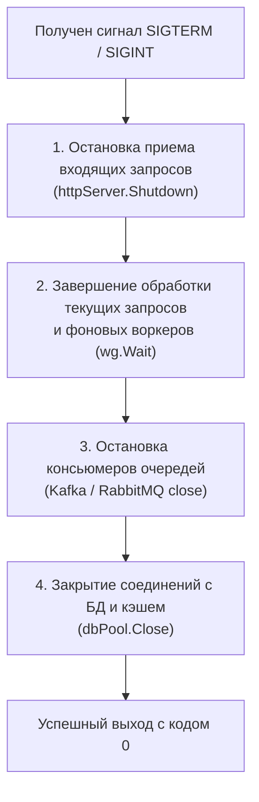
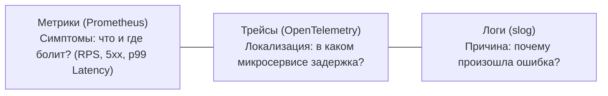
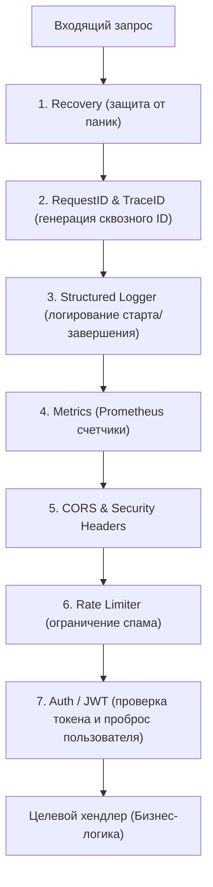

# 🏭 Руководство по промышленной разработке на Go (Go Production Engineering Guide)

> [!IMPORTANT]
> **От учебного кода — к боевому продакшену.**
> На собеседованиях и в академических курсах проверяют знание структур данных, алгоритмов и рантайма Go (слайсы, планировщик GMP, каналы). Но в **ежедневной коммерческой разработке** 80% времени уходит на надежность, инфраструктурную обвязку, архитектурные контракты и наблюдаемость сервисов.
>
> Этот гайд содержит проверенные практикой шаблоны и рецепты production-grade кода, обязательные для любого Enterprise/Fintech Go-бэкенда.

---

## 📑 Оглавление

1. [12-Factor Конфигурация и Fail-Fast старт сервиса](#1-12-factor-конфигурация-и-fail-fast-старт-сервиса)
2. [Graceful Shutdown и управление жизненным циклом (Lifecycle)](#2-graceful-shutdown-и-управление-жизненным-циклом-lifecycle)
3. [Базы данных в реальном мире: sqlc, миграции и транзакции](#3-базы-данных-в-реальном-мире-sqlc-миграции-и-транзакции)
4. [Observability: Метрики (Prometheus), Трейсинг (OpenTelemetry) и Логи (slog)](#4-observability-метрики-prometheus-трейсинг-opentelemetry-и-логи-slog)
5. [Отказоустойчивый HTTP-клиент: Таймауты, Backoff-Retry и Circuit Breaker](#5-отказоустойчивый-http-клиент-таймауты-backoff-retry-и-circuit-breaker)
6. [Валидация входящих данных (DTO Validation) и ошибки RFC 7807](#6-валидация-входящих-данных-dto-validation-и-ошибки-rfc-7807)
7. [Аутентификация: JWT (Access/Refresh), Context Injection и Pipeline Middleware](#7-аутентификация-jwt-accessrefresh-context-injection-и-pipeline-middleware)
8. [Production Tooling: golangci-lint, Makefile и Multi-Stage Dockerfile](#8-production-tooling-golangci-lint-makefile-и-multi-stage-dockerfile)

---

## 1. 12-Factor Конфигурация и Fail-Fast старт сервиса

### Проблема «наивного» кода
В учебных проектах адреса БД и порты часто объявляют константами в коде или читают разрозненными вызовами `os.Getenv("PORT")`. В production:
1. Значения приходят из переменных окружения (Kubernetes ConfigMaps/Secrets, Docker Compose, `.env`).
2. Опечатка в названии переменной или отсутствие критического параметра (например, `JWT_SECRET`) приводит к падению сервиса спустя часы работы, когда пользователь нажимает на определенную ручку.

### Паттерн Fail-Fast и библиотека `cleanenv`
Сервис должен **упасть в первую же секунду запуска** с понятным описанием проблемы, если обязательные параметры отсутствуют или невалидны.

```go
package config

import (
	"fmt"
	"os"
	"time"

	"github.com/ilyakaznacheev/cleanenv"
)

type Config struct {
	App  AppConfig  `yaml:"app"`
	HTTP HTTPConfig `yaml:"http"`
	DB   DBConfig   `yaml:"db"`
}

type AppConfig struct {
	Env     string `yaml:"env" env:"APP_ENV" env-default:"development"` // development, staging, production
	Name    string `yaml:"name" env:"APP_NAME" env-default:"order-service"`
	Version string `yaml:"version" env:"APP_VERSION" env-default:"1.0.0"`
}

type HTTPConfig struct {
	Port         int           `yaml:"port" env:"HTTP_PORT" env-default:"8080"`
	ReadTimeout  time.Duration `yaml:"read_timeout" env:"HTTP_READ_TIMEOUT" env-default:"5s"`
	WriteTimeout time.Duration `yaml:"write_timeout" env:"HTTP_WRITE_TIMEOUT" env-default:"10s"`
	IdleTimeout  time.Duration `yaml:"idle_timeout" env:"HTTP_IDLE_TIMEOUT" env-default:"60s"`
}

type DBConfig struct {
	URL          string        `yaml:"url" env:"DATABASE_URL" env-required:"true"`
	MaxConns     int32         `yaml:"max_conns" env:"DB_MAX_CONNS" env-default:"25"`
	MinConns     int32         `yaml:"min_conns" env:"DB_MIN_CONNS" env-default:"5"`
	MaxIdleTime  time.Duration `yaml:"max_idle_time" env:"DB_MAX_IDLE_TIME" env-default:"15m"`
	ConnTimeout  time.Duration `yaml:"conn_timeout" env:"DB_CONN_TIMEOUT" env-default:"5s"`
}

// MustLoad загружает конфигурацию или паникует/завершает процесс при ошибке
func MustLoad(configPath string) *Config {
	var cfg Config

	// 1. Если передан путь к yaml/json файлу (локальная разработка)
	if configPath != "" {
		if _, err := os.Stat(configPath); err == nil {
			if err := cleanenv.ReadConfig(configPath, &cfg); err != nil {
				panic(fmt.Sprintf("failed to read config file %s: %v", configPath, err))
			}
		}
	}

	// 2. Читаем переменные окружения, переопределяющие файл
	if err := cleanenv.ReadEnv(&cfg); err != nil {
		panic(fmt.Sprintf("failed to parse environment variables: %v", err))
	}

	return &cfg
}
```

> [!TIP]
> Функция называется `MustLoad`, подчеркивая идиому Go: функции с префиксом `Must` вызываются только на старте приложения и паникуют при невозможности инициализации.

---

## 2. Graceful Shutdown и управление жизненным циклом (Lifecycle)

### Зачем нужен Graceful Shutdown?
В Kubernetes поды постоянно завершаются (rolling updates, pod eviction, autoscaling).
Когда Kubelet решает завершить контейнер:
1. Он отправляет процессу сигнал **`SIGTERM`**.
2. Ждет время `terminationGracePeriodSeconds` (по умолчанию 30 секунд).
3. Если процесс не завершился — принудительно убивает его сигналом **`SIGKILL` (`kill -9`)**.

Если ваш сервис не обрабатывает `SIGTERM`, все текущие HTTP-запросы пользователей обрываются, сокеты закрываются с ошибкой `connection reset by peer`, а клиенты видят `502 Bad Gateway`.

### Каскадный порядок остановки сервиса:


### Эталонный шаблон `main.go`:

```go
package main

import (
	"context"
	"errors"
	"fmt"
	"log/slog"
	"net/http"
	"os"
	"os/signal"
	"sync"
	"syscall"
	"time"
)

func main() {
	// 1. Инициализация структурированного логера
	logger := slog.New(slog.NewJSONHandler(os.Stdout, &slog.HandlerOptions{Level: slog.LevelInfo}))
	slog.SetDefault(logger)

	// 2. Создаем контекст, который отменяется при поступлении сигналов SIGINT или SIGTERM
	ctx, stop := signal.NotifyContext(context.Background(), os.Interrupt, syscall.SIGTERM)
	defer stop()

	// 3. Подключение к БД (псевдокод)
	// dbPool := initDatabase(...)
	// defer dbPool.Close()

	// 4. Настройка HTTP-сервера
	mux := http.NewServeMux()
	mux.HandleFunc("GET /healthz", func(w http.ResponseWriter, r *http.Request) {
		w.WriteHeader(http.StatusOK)
		w.Write([]byte("OK"))
	})
	mux.HandleFunc("POST /api/v1/orders", func(w http.ResponseWriter, r *http.Request) {
		// Имитация долгой полезной нагрузки
		time.Sleep(2 * time.Second)
		w.WriteHeader(http.StatusCreated)
		w.Write([]byte(`{"status":"created"}`))
	})

	server := &http.Server{
		Addr:         ":8080",
		Handler:      mux,
		ReadTimeout:  5 * time.Second,
		WriteTimeout: 10 * time.Second,
		IdleTimeout:  60 * time.Second,
	}

	// 5. Запуск фоновых воркеров с WaitGroup
	var wg sync.WaitGroup
	wg.Add(1)
	go func() {
		defer wg.Done()
		backgroundWorker(ctx, logger)
	}()

	// 6. Запуск HTTP-сервера в отдельной горутине
	go func() {
		logger.Info("HTTP server starting", "addr", server.Addr)
		if err := server.ListenAndServe(); err != nil && !errors.Is(err, http.ErrServerClosed) {
			logger.Error("HTTP server failed", "error", err)
			os.Exit(1)
		}
	}()

	// 7. Ожидание сигнала завершения
	<-ctx.Done()
	logger.Info("Shutdown signal received, initiating graceful shutdown...")

	// 8. Контекст с таймаутом на безопасную остановку (например, 15 секунд)
	shutdownCtx, shutdownCancel := context.WithTimeout(context.Background(), 15*time.Second)
	defer shutdownCancel()

	// Останавливаем HTTP-сервер: он закрывает слушающий сокет (новые запросы не приходят),
	// но дожидается завершения уже обрабатывающихся запросов
	if err := server.Shutdown(shutdownCtx); err != nil {
		logger.Error("HTTP server forced shutdown", "error", err)
	} else {
		logger.Info("HTTP server stopped gracefully")
	}

	// Ждем остановки фоновых воркеров
	workerChan := make(chan struct{})
	go func() {
		wg.Wait()
		close(workerChan)
	}()

	select {
	case <-workerChan:
		logger.Info("All background workers finished")
	case <-shutdownCtx.Done():
		logger.Warn("Background workers shutdown timed out")
	}

	logger.Info("Service exited cleanly")
}

func backgroundWorker(ctx context.Context, logger *slog.Logger) {
	ticker := time.NewTicker(1 * time.Second)
	defer ticker.Stop()

	for {
		select {
		case <-ctx.Done():
			logger.Info("Background worker received cancellation, cleaning up...")
			return
		case <-ticker.C:
			// фоновая работа
		}
	}
}
```

---

## 3. Базы данных в реальном мире: sqlc, миграции и транзакции

### Проблема: `database/sql` vs Тяжелые ORM (GORM)
- **`database/sql` с ручным сканированием:** при изменении таблицы в БД разработчик забывает обновить поле в `rows.Scan(&a, &b, ...)`, что приводит к падениям в рантайме.
- **ORM (GORM / Ent):** прячут реальный SQL. В простых запросах удобны, но на высоконагруженных проектах приводят к неоптимальным JOIN, скрытым аллокациям рефлексии и проблеме $N+1$.

### Стандарт индустрии: `sqlc` (Compile-time Type-Safe SQL)
Инструмент **`sqlc`** компилирует чистый SQL в строгий, идиоматичный Go-код без использования рефлексии.

#### 1. Конфиг `sqlc.yaml`:
```yaml
version: "2"
sql:
  - engine: "postgresql"
    schema: "migrations/schema.sql"
    queries: "queries.sql"
    gen:
      go:
        package: "db"
        out: "internal/db"
        sql_package: "pgx/v5"
        emit_json_tags: true
        emit_empty_slices: true
```

#### 2. SQL-запросы (`queries.sql`):
```sql
-- name: GetUserByID :one
SELECT id, email, full_name, created_at
FROM users
WHERE id = $1 LIMIT 1;

-- name: ListUsers :many
SELECT id, email, full_name, created_at
FROM users
ORDER BY created_at DESC
LIMIT $1 OFFSET $2;

-- name: CreateUser :one
INSERT INTO users (email, full_name)
VALUES ($1, $2)
RETURNING id, email, full_name, created_at;
```

`sqlc generate` создаст Go-структуру `User`, методы `GetUserByID(ctx, id)` и `CreateUser(ctx, params)` с полной проверкой типов аргументов и возвращаемых значений на этапе сборки.

---

### Миграции базы данных (`goose`)
Схема базы данных должна версионироваться вместе с кодом. Самый популярный инструмент в Go-сообществе — **`goose`** (или `golang-migrate`).

Файлы миграций хранятся в `migrations/`:
```sql
-- 20261021100000_create_users_table.sql
-- +goose Up
CREATE TABLE users (
    id BIGSERIAL PRIMARY KEY,
    email VARCHAR(255) NOT NULL UNIQUE,
    full_name VARCHAR(255) NOT NULL,
    created_at TIMESTAMPTZ NOT NULL DEFAULT NOW()
);

CREATE INDEX idx_users_email ON users(email);

-- +goose Down
DROP TABLE IF EXISTS users;
```

---

### Управление транзакциями в Clean Architecture
Вечный вопрос: *как сделать транзакцию, затрагивающую несколько репозиториев (например, списать деньги в `AccountRepo` и создать заказ в `OrderRepo`), не протаскивая `*sql.Tx` в сервисный слой?*

**Идиоматичный паттерн: Репозиторий с замыканием (`WithTx`):**

```go
type Transactor interface {
	WithinTransaction(ctx context.Context, fn func(ctx context.Context) error) error
}

type PostgresTransactor struct {
	pool *pgxpool.Pool
}

type txKey struct{}

func (t *PostgresTransactor) WithinTransaction(ctx context.Context, fn func(ctx context.Context) error) error {
	tx, err := t.pool.Begin(ctx)
	if err != nil {
		return fmt.Errorf("begin tx: %w", err)
	}
	defer tx.Rollback(ctx) // Игнорируется, если выполнен Commit()

	// Вкладываем транзакцию в контекст
	txCtx := context.WithValue(ctx, txKey{}, tx)

	if err := fn(txCtx); err != nil {
		return err
	}

	if err := tx.Commit(ctx); err != nil {
		return fmt.Errorf("commit tx: %w", err)
	}

	return nil
}

// В репозитории извлекаем транзакцию из контекста или используем обычный пул:
func (r *OrderRepository) getExecutor(ctx context.Context) DBExecutor {
	if tx, ok := ctx.Value(txKey{}).(pgx.Tx); ok {
		return tx
	}
	return r.pool
}
```

---

## 4. Observability: Метрики (Prometheus), Трейсинг (OpenTelemetry) и Логи (slog)

### Три столпа наблюдаемости (Observability)


### 1. Метрики Prometheus (`client_golang`)
Для продакшена критически важны 4 золотых сигнала (Google SRE): **Latency, Traffic, Errors, Saturation**.

```go
package metrics

import (
	"net/http"
	"strconv"
	"time"

	"github.com/prometheus/client_golang/prometheus"
	"github.com/prometheus/client_golang/prometheus/promauto"
)

var (
	// Количество запросов с разбивкой по методу, пути и коду ответа
	HttpRequestsTotal = promauto.NewCounterVec(
		prometheus.CounterOpts{
			Name: "http_requests_total",
			Help: "Total number of HTTP requests processed",
		},
		[]string{"method", "path", "status"},
	)

	// Гистограмма времени выполнения запросов (для вычисления p50, p95, p99)
	HttpRequestDuration = promauto.NewHistogramVec(
		prometheus.HistogramOpts{
			Name:    "http_request_duration_seconds",
			Help:    "HTTP request latencies in seconds",
			Buckets: []float64{0.005, 0.01, 0.025, 0.05, 0.1, 0.25, 0.5, 1, 2.5, 5},
		},
		[]string{"method", "path"},
	)
)

// Middleware для автоматического сбора метрик
func PrometheusMiddleware(next http.Handler) http.Handler {
	return http.HandlerFunc(func(w http.ResponseWriter, r *http.Request) {
		start := time.Now()
		ww := &statusResponseWriter{ResponseWriter: w, statusCode: http.StatusOK}

		next.ServeHTTP(ww, r)

		duration := time.Since(start).Seconds()
		path := r.Pattern // Go 1.22+ сохраняет паттерн маршрута, предотвращая кардинальность меток

		HttpRequestsTotal.WithLabelValues(r.Method, path, strconv.Itoa(ww.statusCode)).Inc()
		HttpRequestDuration.WithLabelValues(r.Method, path).Observe(duration)
	})
}

type statusResponseWriter struct {
	http.ResponseWriter
	statusCode int
}

func (w *statusResponseWriter) WriteHeader(code int) {
	w.statusCode = code
	w.ResponseWriter.WriteHeader(code)
}
```

### 2. Корреляция Трейсов (OpenTelemetry) и Логов (`slog`)
Когда в логах появляется ошибка, разработчик должен иметь возможность скопировать `trace_id` и открыть полный путь запроса в Jaeger/Grafana Tempo.

```go
// slogHandler обогащает каждую запись лога текущим trace_id из контекста
type TraceHandler struct {
	slog.Handler
}

func (h *TraceHandler) Handle(ctx context.Context, r slog.Record) error {
	span := trace.SpanFromContext(ctx)
	if span.SpanContext().IsValid() {
		r.AddAttrs(
			slog.String("trace_id", span.SpanContext().TraceID().String()),
			slog.String("span_id", span.SpanContext().SpanID().String()),
		)
	}
	return h.Handler.Handle(ctx, r)
}
```

---

## 5. Отказоустойчивый HTTP-клиент: Таймауты, Backoff-Retry и Circuit Breaker

### Почему `http.DefaultClient` запрещен в проде?
В стандартном `http.DefaultClient` таймаут равен **0 (бесконечность)**. Если внешний сервис зависнет, горутина вызова заблокируется навсегда. При потоке в 100 запросов в секунду за минуту утекут тысячи горутин и сокетов, что приведет к OOM (Out Of Memory).

### Настройка эталонного `http.Client`:
```go
func NewResilientHTTPClient() *http.Client {
	transport := &http.Transport{
		Proxy: http.ProxyFromEnvironment,
		DialContext: (&net.Dialer{
			Timeout:   5 * time.Second,  // Таймаут TCP handshake
			KeepAlive: 30 * time.Second, // Поддержание TCP соединения
		}).DialContext,
		MaxIdleConns:          100,              // Всего свободных соединений в пуле
		MaxIdleConnsPerHost:   20,               // Свободных соединений на каждый хост
		IdleConnTimeout:       90 * time.Second, // Время жизни простаивающего соединения
		TLSHandshakeTimeout:   5 * time.Second,  // Таймаут TLS-рукопожатия
		ExpectContinueTimeout: 1 * time.Second,
	}

	return &http.Client{
		Transport: transport,
		Timeout:   10 * time.Second, // Общий таймаут всего запроса (включая чтение тела)
	}
}
```

### Retry с Exponential Backoff и Full Jitter
Если внешний сервис временно перегружен, нельзя повторять запрос сразу (это добьет его). Нужно увеличивать интервал экспоненциально и добавлять случайный разброс (jitter), чтобы клиенты не стреляли синхронно (Thundering Herd Problem).


```go
// DoWithRetry выполняет операцию с экспоненциальной задержкой и джиттером
func DoWithRetry(ctx context.Context, maxRetries int, baseDelay time.Duration, op func() error) error {
	var err error
	for attempt := 0; attempt < maxRetries; attempt++ {
		err = op()
		if err == nil {
			return nil
		}

		// Экспоненциальный рост: baseDelay * 2^attempt
		backoff := float64(baseDelay * (1 << attempt))
		// Добавляем Full Jitter: случайное число от 0 до backoff
		jitter := rand.Float64() * backoff
		sleepDuration := time.Duration(jitter)

		select {
		case <-ctx.Done():
			return ctx.Err()
		case <-time.After(sleepDuration):
		}
	}
	return fmt.Errorf("all %d attempts failed: %w", maxRetries, err)
}
```

---

## 6. Валидация входящих данных (DTO Validation) и ошибки RFC 7807

### Валидация через `go-playground/validator/v10`

```go
package dto

type CreateOrderRequest struct {
	CustomerID string  `json:"customer_id" validate:"required,uuid4"`
	UserEmail  string  `json:"email" validate:"required,email"`
	Amount     float64 `json:"amount" validate:"required,gt=0"`
	Currency   string  `json:"currency" validate:"required,oneof=USD EUR RUB KZT"`
	ItemsCount int     `json:"items_count" validate:"required,min=1,max=100"`
}
```

### Формат ошибок: RFC 7807 (Problem Details)
Клиенты API (фронтенд, мобильные приложения) ожидают структурированный ответ при ошибках валидации (HTTP 422 / 400).

```json
{
  "type": "https://api.example.com/errors/validation-failed",
  "title": "Validation Failed",
  "status": 422,
  "detail": "One or more fields failed validation checks",
  "invalid_params": [
    {
      "field": "email",
      "reason": "must be a valid email address"
    },
    {
      "field": "amount",
      "reason": "must be greater than 0"
    }
  ]
}
```

```go
type ProblemDetails struct {
	Type          string          `json:"type"`
	Title         string          `json:"title"`
	Status        int             `json:"status"`
	Detail        string          `json:"detail"`
	InvalidParams []InvalidParam  `json:"invalid_params,omitempty"`
}

type InvalidParam struct {
	Field  string `json:"field"`
	Reason string `json:"reason"`
}

func FormatValidationError(err error) ProblemDetails {
	var invalidParams []InvalidParam
	if validationErrors, ok := err.(validator.ValidationErrors); ok {
		for _, fe := range validationErrors {
			invalidParams = append(invalidParams, InvalidParam{
				Field:  fe.Field(),
				Reason: fmt.Sprintf("failed check on tag '%s'", fe.Tag()),
			})
		}
	}

	return ProblemDetails{
		Type:          "https://example.com/errors/validation-failed",
		Title:         "Validation Failed",
		Status:        http.StatusUnprocessableEntity,
		Detail:        "Invalid input parameters",
		InvalidParams: invalidParams,
	}
}
```

---

## 7. Аутентификация: JWT (Access/Refresh), Context Injection и Pipeline Middleware

### Конвейер Middleware (Строгий порядок выполнения)
Порядок объявления middleware в коде критичен:


### Безопасное внедрение пользователя в `context.Context`

> [!WARNING]
> Никогда не используйте встроенные типы (`string`, `int`) в качестве ключей `context.WithValue`! Это приводит к коллизиям между сторонними пакетами. Всегда объявляйте неэкспортируемый приватный тип `type ctxKey struct{}`.

```go
package auth

import (
	"context"
	"errors"
	"net/http"
	"strings"

	"github.com/golang-jwt/jwt/v5"
)

type userContextKey struct{}

type UserClaims struct {
	UserID string `json:"user_id"`
	Role   string `json:"role"`
	jwt.RegisteredClaims
}

// AuthMiddleware проверяет валидность Bearer JWT и инжектит пользователя в контекст
func AuthMiddleware(secretKey []byte) func(http.Handler) http.Handler {
	return func(next http.Handler) http.Handler {
		return http.HandlerFunc(func(w http.ResponseWriter, r *http.Request) {
			authHeader := r.Header.Get("Authorization")
			if authHeader == "" || !strings.HasPrefix(authHeader, "Bearer ") {
				http.Error(w, `{"error":"unauthorized"}`, http.StatusUnauthorized)
				return
			}

			tokenString := strings.TrimPrefix(authHeader, "Bearer ")
			claims := &UserClaims{}

			token, err := jwt.ParseWithClaims(tokenString, claims, func(t *jwt.Token) (interface{}, error) {
				if _, ok := t.Method.(*jwt.SigningMethodHMAC); !ok {
					return nil, errors.New("unexpected signing method")
				}
				return secretKey, nil
			})

			if err != nil || !token.Valid {
				http.Error(w, `{"error":"invalid token"}`, http.StatusUnauthorized)
				return
			}

			// Инжектим данные в контекст
			ctx := context.WithValue(r.Context(), userContextKey{}, claims)
			next.ServeHTTP(w, r.WithContext(ctx))
		})
	}
}

// UserFromContext безопасно извлекает утверждения пользователя из контекста
func UserFromContext(ctx context.Context) (*UserClaims, bool) {
	claims, ok := ctx.Value(userContextKey{}).(*UserClaims)
	return claims, ok
}
```

---

## 8. Production Tooling: golangci-lint, Makefile и Multi-Stage Dockerfile

### 1. Конфигурация `.golangci.yml`
В промышленной разработке линтеры запускаются на каждый Pull Request. Базовый набор защищает от утечек памяти, пропущенных ошибок и небезопасного кода:

```yaml
run:
  timeout: 5m
  tests: true

linters:
  enable:
    - errcheck      # Проверяет, что ошибки не игнорируются
    - govet         # Официальный анализатор Go
    - staticcheck   # Мощнейший набор статических проверок
    - bodyclose     # Ловит утечки незакрытых http.Response.Body!
    - noctx         # Требует передачи context в HTTP-запросы
    - gocritic      # Советы по стилю и производительности
    - revive        # Быстрая замена устаревшего golint
    - gosec         # Поиск уязвимостей (SQL injection, слабые хэши)
```

---

### 2. Универсальный `Makefile` для Go-проекта:

```makefile
.PHONY: run build test lint migrate-up migrate-down sqlc docker-build

APP_NAME = order-service
BIN_DIR = bin

run:
	go run cmd/app/main.go

build:
	CGO_ENABLED=0 go build -ldflags="-s -w" -o $(BIN_DIR)/$(APP_NAME) cmd/app/main.go

test:
	go test -race -v -coverprofile=coverage.out ./...

lint:
	golangci-lint run ./...

sqlc:
	sqlc generate

migrate-up:
	goose -dir migrations postgres "$$DATABASE_URL" up

migrate-down:
	goose -dir migrations postgres "$$DATABASE_URL" down

docker-build:
	docker build -t $(APP_NAME):latest .
```

---

### 3. Production Multi-Stage `Dockerfile` (Размер образа: ~15 МБ)

```dockerfile
# ---------------------------------------------------------------------
# ЭТАП 1: Сборка бинарника (Build Stage)
# ---------------------------------------------------------------------
FROM golang:1.24-alpine AS builder

WORKDIR /app

# Устанавливаем сертификаты и зависимости для сборки
RUN apk add --no-cache git ca-certificates tzdata

# Сначала копируем только файлы зависимостей (для эффективного кэширования слоев Docker)
COPY go.mod go.sum ./
RUN go mod download && go mod verify

# Копируем исходный код
COPY . .

# Собираем минималистичный статический бинарник:
# - CGO_ENABLED=0 (без зависимостей от системного libc)
# - -ldflags="-s -w" (удаление отладочной таблицы символов DWARF для снижения размера на 40%)
RUN CGO_ENABLED=0 GOOS=linux GOARCH=amd64 go build \
    -ldflags="-s -w" \
    -o /bin/app ./cmd/app/main.go

# ---------------------------------------------------------------------
# ЭТАП 2: Финальный минимальный контейнер (Runtime Stage)
# ---------------------------------------------------------------------
FROM alpine:3.21

# Создаем непривилегированного пользователя appuser (защита от container escape)
RUN addgroup -S appgroup && adduser -S appuser -G appgroup

# Копируем корневые сертификаты для исходящих HTTPS-запросов и таймзоны
COPY --from=builder /etc/ssl/certs/ca-certificates.crt /etc/ssl/certs/
COPY --from=builder /usr/share/zoneinfo /usr/share/zoneinfo
COPY --from=builder /bin/app /bin/app

USER appuser

EXPOSE 8080

ENTRYPOINT ["/bin/app"]
```

> [!TIP]
> **Почему этот Dockerfile эталонный:**
> 1. **Безопасность:** Запуск от `appuser` (не root).
> 2. **Размер:** Всего ~18 МБ вместо ~1 ГБ стандартного Go-образа.
> 3. **Быстрый CI:** Слой `go mod download` кэшируется и не перезакачивается, пока не изменились зависимости.
> 4. **Корректный TLS:** В образ скопированы `ca-certificates.crt`, поэтому сервис сможет ходить в сторонние HTTPS API без ошибок `x509: certificate signed by unknown authority`.
