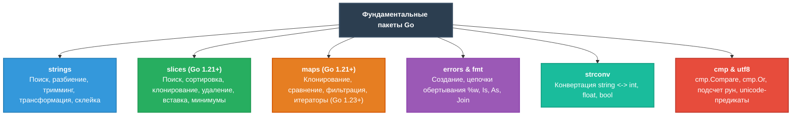

# Практический справочник по стандартным пакетам Go: `strings`, `slices`, `maps`, `errors`, `strconv`, `cmp` и `utf8`

> [!TIP]
> 📚 **Навигация:** [📖 Главное оглавление](README.md) | [Том 1: Основы языка, типы и срезы](01-go-core-basics.md) | [Шпаргалка по Go](go-core-cheatsheet.md)
>
> Этот документ — **быстрый настольный справочник (Cheat Sheet / Cookbook)** по самым часто используемым функциям стандартной библиотеки Go: **строкам (`strings`)**, **срезам (`slices`)**, **картам (`maps`)**, **обработке ошибок (`errors`)**, **конвертации типов (`strconv`)**, **компараторам (`cmp`)** и **символам (`unicode/utf8`)**.

---



---

## 1. Пакет `strings`: Работа со строками

Строки в Go неизменяемы (`immutable`). Все функции возвращают **новую** строку, не изменяя исходную.

```go
import "strings"
```

### Сводная таблица функций `strings`

| Функция | Назначение | Пример вызова | Результат |
| :--- | :--- | :--- | :--- |
| `strings.Contains(s, substr)` | Проверка наличия подстроки | `strings.Contains("Golang", "lan")` | `true` |
| `strings.HasPrefix(s, prefix)` | Начинается ли строка с префикса | `strings.HasPrefix("order_123", "order_")` | `true` |
| `strings.HasSuffix(s, suffix)` | Заканчивается ли суффиксом | `strings.HasSuffix("photo.png", ".png")` | `true` |
| `strings.Index(s, substr)` | Индекс первого вхождения (-1 если нет) | `strings.Index("hello", "l")` | `2` |
| `strings.LastIndex(s, substr)`| Индекс последнего вхождения | `strings.LastIndex("hello", "l")` | `3` |
| `strings.Count(s, substr)` | Подсчет количества неперекрывающихся вхождений | `strings.Count("banana", "a")` | `3` |
| `strings.ToLower(s)` / `ToUpper` | Смена регистра | `strings.ToLower("GoLang")` | `"golang"` |
| `strings.Trim(s, cutset)` | Срезает символы из `cutset` с краев | `strings.Trim("!?Hello?!", "!?")` | `"Hello"` |
| `strings.TrimSpace(s)` | Удаляет пробелы, табы и переносы строк с краев | `strings.TrimSpace(" \t\n Hi! \n")` | `"Hi!"` |
| `strings.TrimPrefix(s, pfx)` | Безопасно отрезает префикс, если он есть | `strings.TrimPrefix("v1.2.3", "v")` | `"1.2.3"` |
| `strings.TrimSuffix(s, sfx)` | Безопасно отрезает суффикс | `strings.TrimSuffix("file.txt", ".txt")` | `"file"` |
| `strings.Split(s, sep)` | Разрезает строку по разделителю в срез `[]string` | `strings.Split("a,b,c", ",")` | `[]string{"a", "b", "c"}` |
| `strings.Fields(s)` | Разрезает по любым пробелам/табам (удаляя пустые) | `strings.Fields("  foo   bar \n baz ")` | `[]string{"foo", "bar", "baz"}` |
| `strings.Join(elems, sep)` | Склеивает срез строк через разделитель | `strings.Join([]string{"a", "b"}, ":")` | `"a:b"` |
| `strings.ReplaceAll(s, old, new)` | Заменяет все вхождения | `strings.ReplaceAll("apple", "p", "b")` | `"abble"` |
| `strings.Repeat(s, count)` | Повторяет строку N раз | `strings.Repeat("=", 4)` | `"===="` |
| `strings.EqualFold(s1, s2)` | Сравнение без учета регистра (zero-alloc) | `strings.EqualFold("Go", "go")` | `true` |

---

### Примеры и рецепты (`strings`)

#### 1. Очистка слов от знаков препинания и подсчет
```go
text := "Hello, world! Welcome to Go, world."
words := strings.Fields(strings.ToLower(text))

counts := make(map[string]int)
for _, w := range words {
    // ВАЖНО: Trim убирает знаки с обоих концов конкретного слова!
    clean := strings.Trim(w, "!?,.:;\"'")
    if clean != "" {
        counts[clean]++
    }
}
// counts["world"] == 2, counts["hello"] == 1
```

#### 2. Разница между `Trim` и `TrimPrefix`: частая ловушка!
```go
// ❌ Trim удаляет ЛЮБЫЕ символы из переданного набора (пока они встречаются с края):
url := "http://example.com"
strings.Trim(url, "http://") // "example.com"
bad := "pop"
strings.Trim(bad, "op")      // "" (удалил и 'p', и 'o'!)

// ✅ TrimPrefix удаляет СТРОГО точный префикс целиком:
strings.TrimPrefix("http://example.com", "http://") // "example.com"
strings.TrimPrefix("pop", "op")                     // "pop" (не совпал префикс)
```

#### 3. Быстрая конкатенация строк в цикле через `strings.Builder`
```go
var sb strings.Builder
for i := 1; i <= 3; i++ {
    sb.WriteString("Step-")
    sb.WriteString(strconv.Itoa(i))
    sb.WriteString("; ")
}
result := sb.String() // "Step-1; Step-2; Step-3; "
```

---

## 2. Пакет `slices` (Go 1.21+): Работа со срезами

До Go 1.21 многие операции со срезами требовали ручных циклов. Пакет `slices` работает на базе **Generics** с любыми типами срезов.

```go
import "slices"
```

### Сводная таблица функций `slices`

| Функция | Что делает | Пример | Результат / Описание |
| :--- | :--- | :--- | :--- |
| `slices.Contains(s, v)` | Проверяет, есть ли элемент `v` в срезе | `slices.Contains([]int{1, 2}, 2)` | `true` |
| `slices.Index(s, v)` | Индекс первого вхождения (или -1) | `slices.Index([]string{"a", "b"}, "b")` | `1` |
| `slices.IndexFunc(s, fn)` | Индекс по пользовательскому условию | `slices.IndexFunc(nums, func(x int) bool { return x > 10 })` | Индекс первого числа > 10 |
| `slices.Clone(s)` | Поверхностная копия среза (shallow copy) | `copy := slices.Clone(orig)` | Новый срез с новым базовым массивом |
| `slices.Equal(s1, s2)` | Поэлементное сравнение двух срезов | `slices.Equal([]int{1, 2}, []int{1, 2})` | `true` |
| `slices.EqualFunc(s1, s2, fn)` | Сравнение с кастомным компаратором | Сравнение структур по определенному полю | `bool` |
| `slices.Sort(s)` | Сортировка по возрастанию (in-place) | `slices.Sort(nums)` | Мутирует срез, zero-alloc |
| `slices.SortFunc(s, cmp)` | Сортировка с кастомным компаратором | Сортировка структур по нескольким полям | Мутирует срез |
| `slices.IsSorted(s)` | Проверка, отсортирован ли срез | `slices.IsSorted([]int{1, 3, 2})` | `false` |
| `slices.Reverse(s)` | Разворот среза задом наперед (in-place) | `slices.Reverse([]int{1, 2, 3})` | `[3, 2, 1]` |
| `slices.Min(s)` / `Max(s)` | Поиск минимального / максимального элемента | `slices.Max([]int{5, 2, 9, 1})` | `9` (паника, если срез пуст!) |
| `slices.MinFunc` / `MaxFunc` | Min/Max по кастомной функции сравнения | Поиск самого дорогого заказа | Найденный элемент |
| `slices.Delete(s, i, j)` | Удаляет элементы из диапазона `s[i:j]` | `slices.Delete([]int{1, 2, 3, 4}, 1, 3)` | `[1, 4]` (возвращает обновленный срез) |
| `slices.Insert(s, i, v...)` | Вставляет элементы по индексу `i` | `slices.Insert([]int{1, 4}, 1, 2, 3)` | `[1, 2, 3, 4]` |
| `slices.Replace(s, i, j, v...)` | Заменяет диапазон `s[i:j]` на новые значения | `slices.Replace(s, 1, 2, 99)` | Заменяет элемент по индексу 1 |
| `slices.Compact(s)` | Удаляет **подряд идущие** дубликаты | `slices.Compact([]int{1, 1, 2, 2, 1})` | `[1, 2, 1]` (перед этим часто делают `Sort`) |
| `slices.Clip(s)` | Срезает емкость `cap` до длины `len` | `s = slices.Clip(s)` | Защита от мутаций базового массива |

---

### Примеры и рецепты (`slices`)

#### 1. Сортировка структур по нескольким полям (`slices.SortFunc`)
```go
type Order struct {
    CustomerID int
    Price      int
}

orders := []Order{
    {CustomerID: 2, Price: 100},
    {CustomerID: 1, Price: 300},
    {CustomerID: 1, Price: 150},
}

// Создаем копию, чтобы не портить оригинал:
result := slices.Clone(orders)

// Сортировка: сначала по CustomerID (возр.), затем по Price (возр.)
slices.SortFunc(result, func(a, b Order) int {
    if a.CustomerID != b.CustomerID {
        return a.CustomerID - b.CustomerID
    }
    return a.Price - b.Price
})
// result: [{CustomerID: 1, Price: 150}, {CustomerID: 1, Price: 300}, {CustomerID: 2, Price: 100}]
```

#### 2. Удаление элемента по значению
```go
fruits := []string{"яблоко", "банан", "груша", "банан"}

// Находим индекс первого "банана":
if idx := slices.Index(fruits, "банан"); idx != -1 {
    fruits = slices.Delete(fruits, idx, idx+1) // результат: ["яблоко", "груша", "банан"]
}
```

#### 3. Получение уникальных элементов (Uniq) средствами стандартной библиотеки
```go
nums := []int{4, 1, 2, 1, 2, 4, 3}
slices.Sort(nums)         // [1, 1, 2, 2, 3, 4, 4]
nums = slices.Compact(nums) // [1, 2, 3, 4]
```

---

## 3. Пакет `maps` (Go 1.21+): Работа с картами

Пакет `maps` предоставляет функции для манипуляции хеш-таблицами без ручных циклов.

```go
import "maps"
```

### Сводная таблица функций `maps`

| Функция | Что делает | Пример | Описание |
| :--- | :--- | :--- | :--- |
| `maps.Clone(m)` | Создает копию карты (shallow copy) | `copyM := maps.Clone(originalM)` | Если `m == nil`, вернет `nil` |
| `maps.Equal(m1, m2)` | Сравнивает две карты по ключам и значениям | `maps.Equal(map1, map2)` | `true`, если ключи и значения равны |
| `maps.EqualFunc(m1, m2, fn)` | Сравнение с кастомным предикатом значений | Сравнение срезов внутри мап | `bool` |
| `maps.Copy(dst, src)` | Копирует все пары из `src` в `dst` (перезаписывая совпадающие) | `maps.Copy(target, source)` | Аналог `Object.assign` в JS |
| `maps.DeleteFunc(m, fn)` | Удаляет из карты пары, удовлетворяющие условию | `maps.DeleteFunc(m, func(k string, v int) bool { return v == 0 })` | Очистка неактивных элементов in-place |
| `maps.Keys(m)` *(Go 1.23+)* | Возвращает итератор по всем ключам карты | `for k := range maps.Keys(m)` | Порядок не гарантирован |
| `maps.Values(m)` *(Go 1.23+)* | Возвращает итератор по всем значениям карты | `for v := range maps.Values(m)` | Порядок не гарантирован |
| `maps.Collect(iter)` *(Go 1.23+)*| Собирает итератор пар в новую карту | `newM := maps.Collect(iter)` | Создает `map[K]V` |

---

### Примеры и рецепты (`maps`)

#### 1. Как достать и отсортировать ключи карты

##### Способ А: В одну строку (Go 1.23+ через итераторы)
```go
import (
    "maps"
    "slices"
)

scores := map[string]int{"Иван": 80, "Анна": 95, "Борис": 70}

// maps.Keys(m) дает итератор, slices.Sorted собирает и сразу сортирует:
sortedNames := slices.Sorted(maps.Keys(scores))
// sortedNames: ["Анна", "Борис", "Иван"]
```

##### Способ Б: Классический цикл (Go 1.18–1.22)
```go
keys := make([]string, 0, len(scores))
for k := range scores {
    keys = append(keys, k)
}
slices.Sort(keys)
```

#### 2. Сортировка карты по ЗНАЧЕНИЯМ (Преобразование в срез пар)
Поскольку карту нельзя отсортировать по значению напрямую, ее конвертируют в срез пар:

```go
type ItemScore struct {
    Name  string
    Score int
}

scores := map[string]int{"Иван": 80, "Анна": 95, "Борис": 70}

// 1. Преобразуем карту в срез структур:
pairs := make([]ItemScore, 0, len(scores))
for name, score := range scores {
    pairs = append(pairs, ItemScore{Name: name, Score: score})
}

// 2. Сортируем по очкам от большего к меньшему:
slices.SortFunc(pairs, func(a, b ItemScore) int {
    return b.Score - a.Score // убывание
})

// 3. Вывод победителей:
for _, p := range pairs {
    fmt.Printf("%s: %d\n", p.Name, p.Score)
}
// Анна: 95
// Иван: 80
// Борис: 70
```

#### 3. Фильтрация карты на месте (`maps.DeleteFunc`)
```go
// Удаляем всех пользователей с нулевым балансом:
balances := map[string]int{"user1": 150, "user2": 0, "user3": -10}

maps.DeleteFunc(balances, func(user string, balance int) bool {
    return balance <= 0
})
// balances: map["user1": 150]
```

---

## 4. Пакет `errors` и `fmt.Errorf`: Современная обработка ошибок

В Go ошибки — это обычные значения (`values`), реализующие интерфейс `error`:
```go
type error interface {
    Error() string
}
```

```go
import (
    "errors"
    "fmt"
)
```

### Сводная таблица функций `errors` и `fmt`

| Функция / Механизм | Назначение | Пример вызова | Поведение |
| :--- | :--- | :--- | :--- |
| `errors.New(text)` | Создание статической (sentinel) ошибки | `var ErrNotFound = errors.New("not found")` | Создает константную ошибку для сравнения |
| `fmt.Errorf("...: %w", err)`| **Обертывание ошибки (Wrapping)** с сохранением цепочки | `fmt.Errorf("read file %s: %w", path, err)` | Добавляет контекст, сохраняя исходную ошибку для `errors.Is`/`As` |
| `fmt.Errorf("...: %v", err)`| Маскирование ошибки (без обертывания) | `fmt.Errorf("internal db error: %v", err)` | Превращает в текст; `errors.Is` не сможет найти оригинал |
| `errors.Is(err, target)` | Проверка наличия ошибки `target` в цепочке | `if errors.Is(err, sql.ErrNoRows)` | Разворачивает дерево ошибок, работает сквозь `%w` и `Join` |
| `errors.As(err, &target)`| Извлечение ошибки конкретного типа | `var pathErr *fs.PathError; if errors.As(err, &pathErr)` | Безопасное приведение типов (type assertion) сквозь обертки |
| `errors.Join(errs...)` *(Go 1.20+)* | Объединение нескольких независимых ошибок в одну | `errors.Join(err1, err2)` | Форматирует через `\n`, сохраняет поиск для `Is` и `As` |
| `errors.Unwrap(err)` | Извлечение вложенной ошибки (один шаг назад) | `underlying := errors.Unwrap(err)` | Возвращает вложенный `error` или `nil` |

---

### Примеры и рецепты (`errors`)

#### 1. Создание Sentinel Errors и паттерн обертывания `%w`
```go
// 1. Объявляем статическую ошибку пакета (Sentinel Error):
var ErrUserNotFound = errors.New("user not found")

func FetchUser(id int) (*User, error) {
    user, err := db.Find(id)
    if err != nil {
        if errors.Is(err, sql.ErrNoRows) {
            // Оборачиваем нашу sentinel-ошибку:
            return nil, fmt.Errorf("fetch user id %d: %w", id, ErrUserNotFound)
        }
        // Оборачиваем низкоуровневую техническую ошибку:
        return nil, fmt.Errorf("fetch user id %d from db: %w", id, err)
    }
    return user, nil
}

// 2. В вызывающем коде проверяем через errors.Is (прямое сравнение == НЕ сработает!):
user, err := FetchUser(42)
if errors.Is(err, ErrUserNotFound) {
    // 404 Not Found
}
```

#### 2. Извлечение кастомной структуры ошибки через `errors.As`
```go
type ValidationError struct {
    Field   string
    Problem string
}

func (e *ValidationError) Error() string {
    return fmt.Sprintf("field '%s': %s", e.Field, e.Problem)
}

// Обработка ошибки:
var valErr *ValidationError
// ВАЖНО: в errors.As передается указатель на переменную-приемник (&valErr)!
if errors.As(err, &valErr) {
    fmt.Printf("Ошибка в поле %s: %s\n", valErr.Field, valErr.Problem)
}
```

#### 3. Агрегация нескольких ошибок через `errors.Join` (Go 1.20+)
Идеально подходит для валидаторов форм или освобождения нескольких ресурсов в `defer`:

```go
func CloseResources(f *os.File, db *sql.DB) error {
    var errs []error

    if err := f.Close(); err != nil {
        errs = append(errs, fmt.Errorf("close file: %w", err))
    }
    if err := db.Close(); err != nil {
        errs = append(errs, fmt.Errorf("close db: %w", err))
    }

    // Если список пуст — вернет nil, если есть ошибки — объединит их:
    return errors.Join(errs...)
}

// Проверка: errors.Is находит ошибки внутри объединенного списка!
allErr := CloseResources(file, db)
if errors.Is(allErr, os.ErrClosed) { ... }
```

---

## 5. Пакет `strconv`: Парсинг и конвертация типов

Преобразование строк в числа/булевы типы и обратно — одна из самых частых задач при работе с HTTP, JSON, БД и пользовательским вводом.

```go
import "strconv"
```

### Сводная таблица функций `strconv`

| Функция | Направление | Пример | Результат / Возврат |
| :--- | :--- | :--- | :--- |
| `strconv.Itoa(n)` | `int -> string` | `strconv.Itoa(42)` | `"42"` (быстрее, чем `fmt.Sprintf`) |
| `strconv.Atoi(s)` | `string -> int` | `n, err := strconv.Atoi("42")` | `42, nil` |
| `strconv.FormatInt(n, base)` | `int64 -> string` в любой СС | `strconv.FormatInt(255, 16)` | `"ff"` (шестнадцатеричная строка) |
| `strconv.ParseInt(s, base, bitSize)` | `string -> int64` | `strconv.ParseInt("ff", 16, 64)` | `255, nil` |
| `strconv.FormatFloat(f, fmt, prec, bitSize)` | `float64 -> string` | `strconv.FormatFloat(3.1415, 'f', 2, 64)` | `"3.14"` |
| `strconv.ParseFloat(s, bitSize)` | `string -> float64` | `f, err := strconv.ParseFloat("3.14", 64)`| `3.14, nil` |
| `strconv.FormatBool(b)` | `bool -> string` | `strconv.FormatBool(true)` | `"true"` |
| `strconv.ParseBool(s)` | `string -> bool` | `b, err := strconv.ParseBool("1")` | `true, nil` (понимает `1`, `t`, `true`, `0`, `f`, `false`) |

> [!WARNING]
> 🚨 **Частая ловушка новичков: `string(65)` vs `strconv.Itoa(65)`**  
> В Go явное приведение `string(65)` возвращает **символ по коду Unicode (руну)**, то есть букву `"A"`, а не строку `"65"`!  
> Для получения цифры в виде строки всегда используйте `strconv.Itoa(65)`.

---

## 6. Пакет `cmp` (Go 1.21+): Универсальные компараторы и дефолты

Пакет `cmp` стандартизирует операции упорядочивания для всех сопоставимых (`ordered`) типов (числа, строки).

```go
import "cmp"
```

### Ключевые возможности:

#### 1. `cmp.Compare` — идеальный компаратор для `slices.SortFunc`
Возвращает `-1` если $x < y$, `0` если $x == y$, `+1` если $x > y$:

```go
type User struct {
    Age  int
    Name string
}

// Надежная сортировка без ручных a.Age - b.Age (защищает от int overflow!):
slices.SortFunc(users, func(a, b User) int {
    if n := cmp.Compare(a.Age, b.Age); n != 0 {
        return n // сначала по возрасту
    }
    return cmp.Compare(a.Name, b.Name) // затем по имени
})
```

#### 2. `cmp.Or` (Go 1.22+) — выбор первого непустого значения (Default / Fallback)
Работает как оператор `??` (Nullish Coalescing) или `||` в других языках:

```go
// Берем порт из переменной окружения, а если она пустая — "8080":
port := cmp.Or(os.Getenv("PORT"), os.Getenv("APP_PORT"), "8080")

// Выбор таймаута:
timeout := cmp.Or(customTimeout, defaultTimeout, 5*time.Second)
```

---

## 7. Пакеты `unicode` и `unicode/utf8`: Работа с символами и кодировкой

Поскольку тип `string` в Go — это срез байт (`[]byte`), для корректной работы с кириллицей, эмодзи и спецсимволами используются пакеты `unicode/utf8` и `unicode`.

```go
import (
    "unicode"
    "unicode/utf8"
)
```

### 1. Подсчёт реальных символов: `utf8.RuneCountInString`
```go
word := "Привет 🚀"
bytesLen := len(word)                  // 17 байт!
runesLen := utf8.RuneCountInString(word) // 8 реальных символов (рун)
```

### 2. Проверка свойств символа (`rune`)
```go
ch := '7'
unicode.IsDigit(ch) // true
unicode.IsLetter(ch) // false

r := 'я'
unicode.IsLetter(r) // true
unicode.ToUpper(r)  // 'Я'

sp := '\t'
unicode.IsSpace(sp) // true
```

---

## 8. Главные ловушки и частые ошибки

| Ошибка | В чем проблема | Как правильно |
| :--- | :--- | :--- |
| `string(65)` | Вернет символ `"A"`, а не строку `"65"`! | `strconv.Itoa(65)` |
| `a.Price - b.Price` в компараторе | При больших числах или разнице знаков возможно целочисленное переполнение (`overflow`) | `cmp.Compare(a.Price, b.Price)` |
| `len("Привет")` | Вернет `12` (количество байт в UTF-8), а не `6` символов | `utf8.RuneCountInString("Привет")` |
| `if err == ErrNotFound` | Прямое равенство ломается, если ошибку обернули через `fmt.Errorf("...: %w", err)` | Всегда используйте `errors.Is(err, ErrNotFound)` |
| `errors.As(err, target)` | Если передать `target` вместо указателя `&target`, будет паника в runtime | Всегда передавайте указатель на указатель: `errors.As(err, &valErr)` |
| `fmt.Errorf("...: %v", err)` | Спецификатор `%v` или `%s` стирает цепочку типов, превращая ошибку в строку | Используйте `%w` для сохранения цепочки ошибок |
| `res = copy(res, src)` | `copy` возвращает число скопированных элементов `int`, а не срез! | Просто `copy(res, src)` отдельной строкой |
| `make([]int, maxLen)` + `copy` когда `len(src) < maxLen` | В конце среза появятся лишние нули `[1, 2, 0, 0, 0]` | Размер нового среза: `min(len(src), maxLen)` |
| `strings.Trim(s, "abc")` вместо `TrimPrefix` | `Trim` срезает символы поштучно с краев в любом порядке | Для точного префикса используйте `strings.TrimPrefix` |
| `for _, char := range str` | Переменная `char` имеет тип `rune` (`int32`), а не `string`! | Для сборки в строку: `string(char)` или `strings.Fields` для слов |
| `slices.Min(emptySlice)` | Вызов `slices.Min` или `slices.Max` на пустом срезе вызовет **panic** | Всегда проверяйте `len(s) > 0` перед вызовом |
| `m["unknown"]` | Если ключа нет, вернется Zero Value (`0`, `""`, `nil`), паники не будет | Проверяйте флаг наличия: `val, ok := m["unknown"]` |


