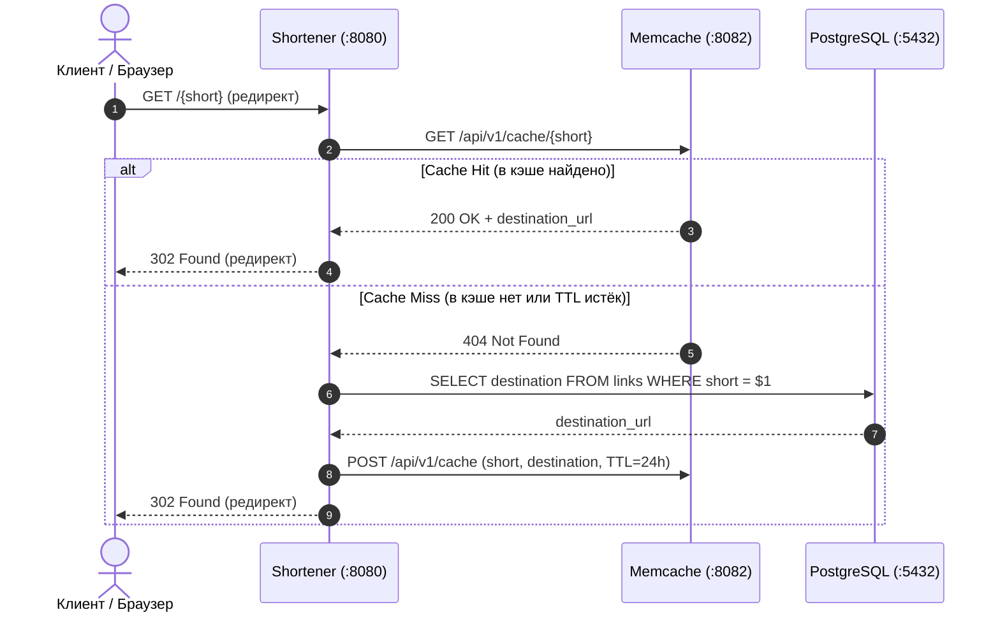
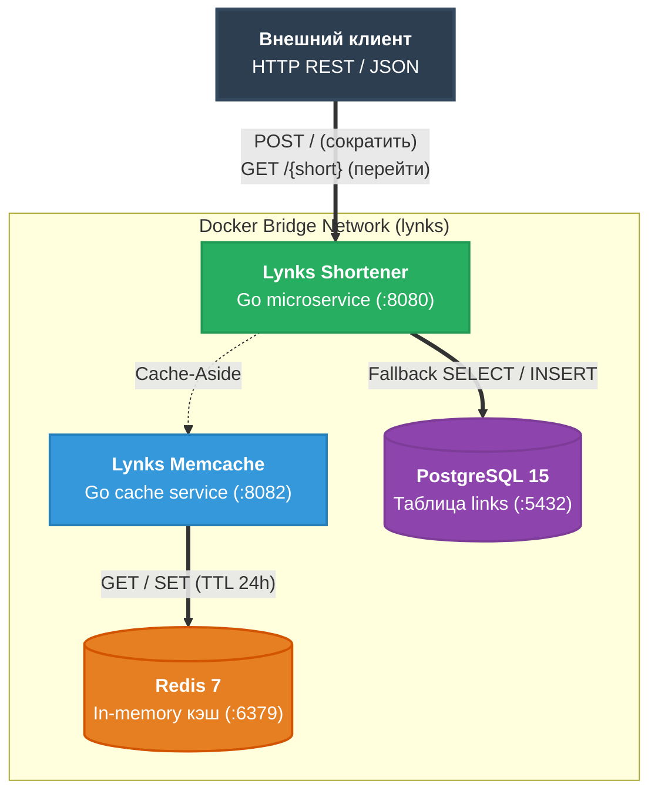
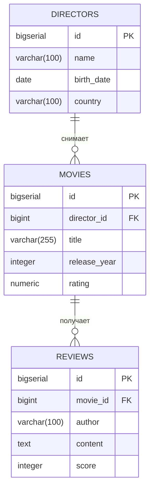

# Mermaid Diagrams — Стандарт архитектурной визуализации Go Course 4

В данном каталоге собраны стандарты, шаблоны и скилл ([`SKILL.md`](file:///Users/user/workspace/golang_projects/go-core-4/go-production-engineering/go-documentation/mermaid-diagrams/SKILL.md)) для построения качественных архитектурных диаграмм в формате **Mermaid** в рамках курса `Go Course 4`.

---

## 📋 Структура каталога

```text
mermaid-diagrams/
├── SKILL.md     # Скилл агента с полным описанием синтаксиса, правил стилей и палитры
└── README.md    # Данный справочник с примерами и каталогом диаграмм курса
```

---

## 🎨 Стандарты оформления и палитра

### 1. Цветовая палитра для компонентов (Flowchart)

| Роль узла | Назначение | fill | stroke | color |
| :--- | :--- | :--- | :--- | :--- |
| **Client / Entrypoint** | Браузер, curl, клиентский шлюз | `#2c3e50` | `#34495e` | `#ffffff` |
| **Core Service** | Основной backend-сервис (Go) | `#27ae60` | `#229954` | `#ffffff` |
| **Secondary / Cache** | Кэш (Redis), вспомогательные микросервисы | `#3498db` | `#2980b9` | `#ffffff` |
| **Database / Storage** | Персистентные СУБД (PostgreSQL) | `#8e44ad` | `#7d3c98` | `#ffffff` |
| **Queue / Broker** | Брокеры сообщений (Apache Kafka, RabbitMQ) | `#e67e22` | `#d35400` | `#ffffff` |
| **Warning / Trap** | Проблемные зоны, антипаттерны, дедлоки | `#e74c3c` | `#c0392b` | `#ffffff` |

### 2. Типографика и форматирование узлов
- Переносы строк внутри блоков выполняются строго через `<br/>` (не `\n`).
- Заголовки оформляются жирным шрифтом с подписью: `["<b>Имя сервиса</b><br/>порт :8080"]`.
- Подписи узлов и действий — на русском языке, технические идентификаторы — в оригинале.

---

## 🔍 Каталог примеров из курса Go Course 4

### 1. Архитектура Cache-Aside ([`20-NoSQL`](file:///Users/user/workspace/golang_projects/go-core-4/go-production-engineering/lessons/20-NoSQL/20-NoSQL.md) и [`lynks`](file:///Users/user/workspace/golang_projects/go-core-4/go-production-engineering/lynks/README.md))



---

### 2. Топология микросервисов и баз данных ([`18-microservices`](file:///Users/user/workspace/golang_projects/go-core-4/go-production-engineering/lessons/18-microservices/18-microservices.md))



---

### 3. Модель данных сущностей реляционной БД ([`15-sql`](file:///Users/user/workspace/golang_projects/go-core-4/go-production-engineering/lessons/15-sql/15-sql.md))



---

## 🔗 Модули с диаграммами в проекте
- [15-sql — Реляционные базы данных и ER-диаграммы](file:///Users/user/workspace/golang_projects/go-core-4/go-production-engineering/lessons/15-sql/15-sql.md)
- [17-system-design — Чистая архитектура и слои Clean Architecture](file:///Users/user/workspace/golang_projects/go-core-4/go-production-engineering/lessons/17-system-design/17-system-design.md)
- [18-microservices — Контейнеризация и топология микросервисов](file:///Users/user/workspace/golang_projects/go-core-4/go-production-engineering/lessons/18-microservices/18-microservices.md)
- [19-queue — Потоки сообщений Apache Kafka](file:///Users/user/workspace/golang_projects/go-core-4/go-production-engineering/lessons/19-queue/19-queue.md)
- [20-NoSQL — Архитектура кэширования Cache-Aside](file:///Users/user/workspace/golang_projects/go-core-4/go-production-engineering/lessons/20-NoSQL/20-NoSQL.md)
- [lynks — Архитектура итогового проекта](file:///Users/user/workspace/golang_projects/go-core-4/go-production-engineering/lynks/README.md)
