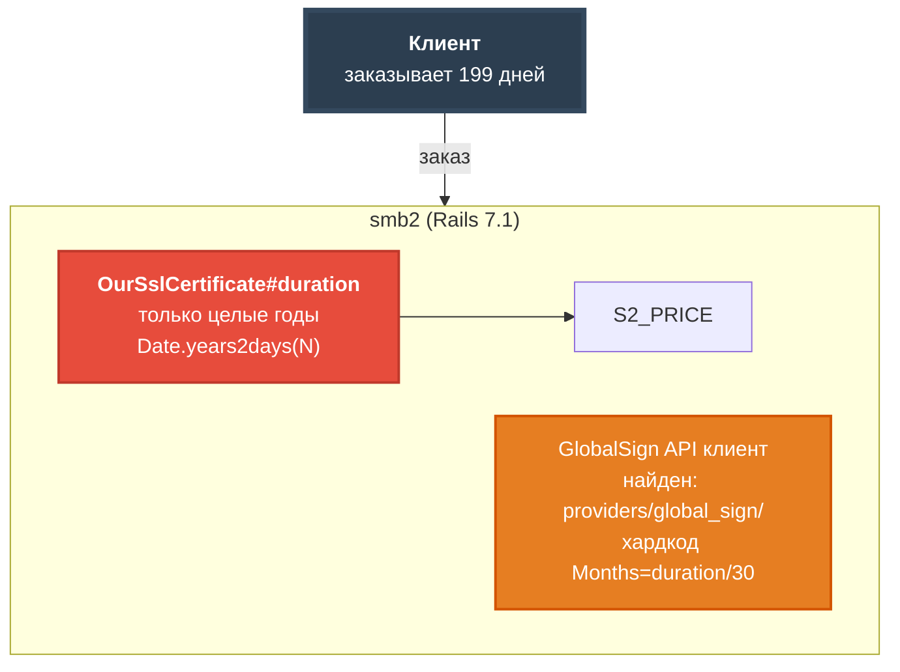
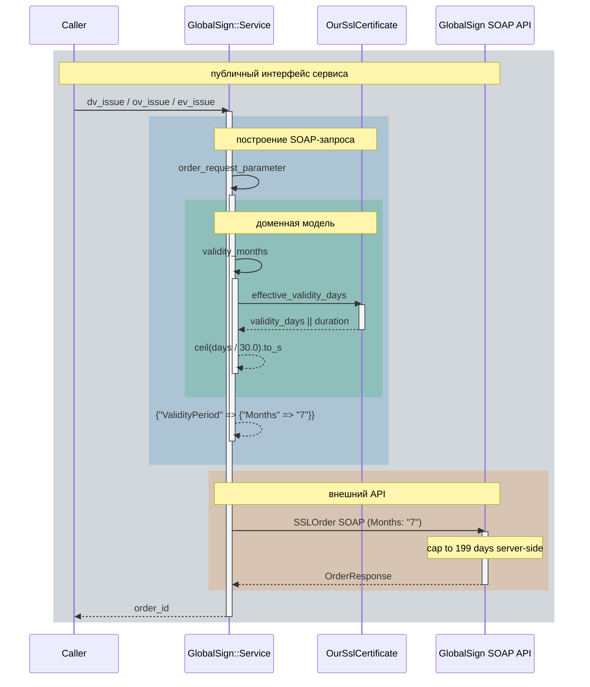
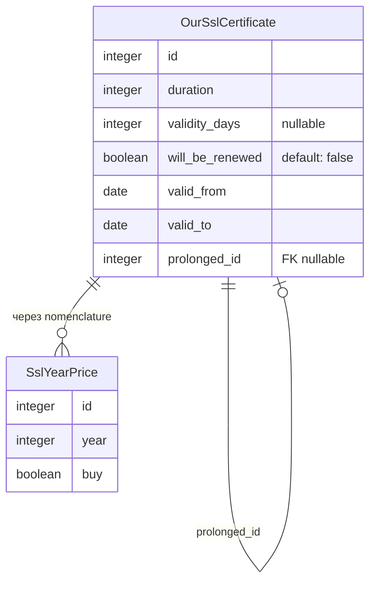
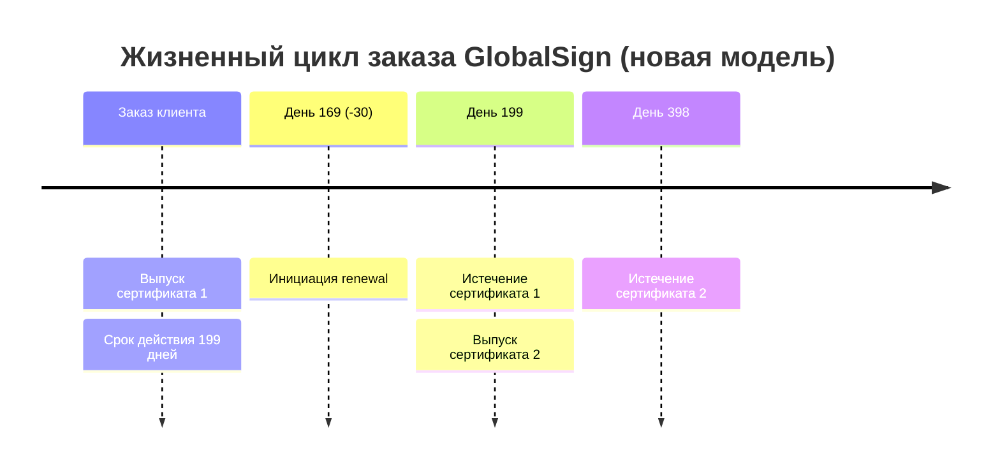

# Mermaid Diagrams Skill

Создание диаграмм в стиле проекта Go Course 4. Все паттерны извлечены из реальных диаграмм проекта.

## Общие правила

- Перенос строки в нодах: `<br/>` (не `\n`)
- Текст в нодах с разметкой: `["<b>Заголовок</b><br/>подпись"]`
- Все подписи на русском, технические идентификаторы — как есть
- Всегда использовать Mermaid — никаких других инструментов без явного запроса

---

## flowchart / graph

### Когда использовать

- Зависимости между компонентами системы
- Граф задач и их связей
- Архитектурные блок-схемы

### Палитра цветов (style-директивы)

| Роль                         | fill      | stroke    | color  |
| ---------------------------- | --------- | --------- | ------ |
| Клиент / точка входа         | `#2c3e50` | `#34495e` | `#fff` |
| Хардкод / проблема           | `#e74c3c` | `#c0392b` | `#fff` |
| Предупреждение / не критично | `#e67e22` | `#d35400` | `#fff` |
| Основной backend (smb2)      | `#27ae60` | `#229954` | `#fff` |
| Вторичный компонент          | `#3498db` | `#2980b9` | `#fff` |
| Партнёр / ЛК                 | `#f39c12` | `#d68910` | `#000` |
| Legacy (smb)                 | `#9b59b6` | `#8e44ad` | `#fff` |
| Вспомогательный (светлый)    | `#c8e6c9` | `#2e7d32` | `#000` |

### stroke-width

- Главный узел: `stroke-width:3px` или `4px`
- Обычный узел: `stroke-width:2px`

### Пример (из BASELINE.md §5)



### Рёбра

| Тип             | Синтаксис                       |
| --------------- | ------------------------------- | --------- | --- |
| Основной поток  | `==>` или `-->` с `\|"текст"\|` |
| Вторичный поток | `-.->` (пунктир)                |
| С подписью      | `-->                            | "подпись" | `   |

---

## sequenceDiagram

### Когда использовать

- Взаимодействие объектов во времени (Golang методы, HTTP, SOAP)
- Показ стека вызовов с activation boxes
- Разграничение слоёв абстракции

### Обязательный init-блок (тёмные рамки)

```
%%{init: {"themeVariables": {
  "activationBorderColor": "#1a252f",
  "labelBoxBorderColor": "#1a252f"
}}}%%
```

### Участники

- Объект — один participant. Self-call (`Svc->>Svc:`) — единственный способ показать внутренние вызовы.
- Не создавать двух участников для одного класса.
- Псевдонимы: `participant Svc as GlobalSign::Service`

### Activation boxes (границы методов)

- `activate` / `deactivate` обрамляют тело метода
- Вложенные активации поддерживаются — показывают стек вызовов
- Self-call стрелки с именем метода (`Svc->>Svc: order_request_parameter`) идут перед `activate` — это и есть подпись к activation box
- Возвраты: `-->>` (пунктир)

### Слои абстракции (rect)

Используй `rect rgba(r, g, b, 0.22)` + `Note over` для выделения слоёв:

| Слой                | Цвет                       |
| ------------------- | -------------------------- |
| Публичный интерфейс | `rgba(52, 73, 94, 0.22)`   |
| Построение запроса  | `rgba(41, 128, 185, 0.22)` |
| Доменная модель     | `rgba(39, 174, 96, 0.22)`  |
| Внешний API         | `rgba(230, 126, 34, 0.22)` |

**Важно**: `rect` в sequenceDiagram не имеет отдельного свойства для цвета рамки — `labelBoxBorderColor` действует только на `loop`/`alt`, не на `rect`. Граница слоя создаётся контрастом заливок.

### Ограничения Mermaid (sequenceDiagram)

- Activation boxes не поддерживают встроенные подписи — имя метода показывается стрелкой перед `activate`
- `rect` не имеет отдельного stroke — только rgba fill
- `rgba` поддерживается в Mermaid v10+

### Пример (из 02-Sequence-Diagrams.md §4.3)



---

## erDiagram

### Когда использовать

- Модель данных ActiveRecord
- Связи между таблицами

### Пример (из IMPLEMENTATION_PLAN.md)



---

## timeline

### Когда использовать

- Хронология событий, расписания изменений

### Пример (из BASELINE.md §1)



---

## Процесс создания диаграммы

1. Определи тип: поток → `flowchart`; взаимодействие объектов → `sequenceDiagram`; модель данных → `erDiagram`; хронология → `timeline`
2. Для sequenceDiagram: добавь init-блок с тёмными рамками
3. Для flowchart: применяй style-директивы из палитры по смысловой роли узла
4. Перенос строк в нодах: только `<br/>`
5. Русский текст в подписях, английские идентификаторы — как есть

## Источники диаграмм в проекте

- [doc/ssl/BASELINE.md](../../../doc/ssl/BASELINE.md) — flowchart, graph LR, timeline
- [doc/ssl/SMB2-455_TDR.md](../../../doc/ssl/SMB2-455_TDR.md) — sequenceDiagram с rect-слоями
- [doc/ssl/IMPLEMENTATION_PLAN.md](../../../doc/ssl/IMPLEMENTATION_PLAN.md) — erDiagram, flowchart зависимостей фаз
- [doc/architecture/ddd_framework/](../../../doc/architecture/ddd_framework/) — graph LR архитектуры, classDiagram, sequenceDiagram DDD-потока
- [doc/tech-debt/SMB2-http-streaming-proxy.md](../../../doc/tech-debt/SMB2-http-streaming-proxy.md) — sequenceDiagram с DDD-потоком
