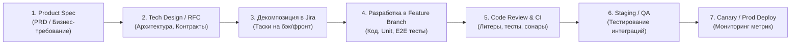

# 🏢 Реальная работа Go-разработчика: Процессы, Задачи, Код и Жизненный цикл в Production

> [!IMPORTANT]
> **Мост между теорией и первым рабочим днем:**  
> Изучая Go, легко научиться писать синтаксические конструкции, алгоритмы и решать учебные задачи. Но когда вы приходите в команду (в Fintech, E-commerce, Delivery, BigTech или Enterprise), реальность выглядит иначе: вы не пишете алгоритмы сортировки — вы проектируете устойчивые к сбоям распределенные системы, читаете трейсы в Grafana, настраиваете распределенные блокировки и дебажите утечки соединений в Kubernetes.
>
> Этот гайд подробно разбирает:
> 1. **Как устроен рабочий процесс (Workflow)** Go-бэкендера от получения тикета до продакшена.
> 2. **5 реальных коммерческих задач** с подробнейшим разбором кода, архитектурных грабель и production-решений.
> 3. **Культуру Code Review** в Go-командах: на что смотрят сеньоры в Pull Request.
> 4. **Инструментарий рабочего дня**: с чем вы будете взаимодействовать кроме IDE.

---

## 📑 Оглавление

1. [Анатомия рабочего дня и процесса (Day-in-the-Life & Agile-цикл)](#1-анатомия-рабочего-дня-и-процесса)
2. [Инженерный стек инструментов современного Go-бэкендера](#2-инженерный-стек-инструментов-современного-go-бэкендера)
3. [Реальная задача №1: Прием вебхуков платежей (Idempotency, HMAC & Transactions)](#3-реальная-задача-1-прием-вебхуков-платежей)
4. [Реальная задача №2: Асинхронный воркер событий из Kafka (Consumer Group & DLQ)](#4-реальная-задача-2-асинхронный-воркер-событий-из-kafka)
5. [Реальная задача №3: Оптимизация горячего эндпоинта под нагрузкой (N+1 & Singleflight)](#5-реальная-задача-3-оптимизация-горячего-эндпоинта-под-нагрузкой)
6. [Реальная задача №4: Периодический биллинг и Cron с Distributed Lock](#6-реальная-задача-4-периодический-биллинг-и-cron-с-distributed-lock)
7. [Реальная задача №5: Миграции базы данных без простоя (Zero-Downtime / Expand-Contract)](#7-реальная-задача-5-миграции-базы-данных-без-простоя)
8. [Чек-лист боевого Code Review в Go: На что смотрят сеньоры](#8-чек-лист-боевого-code-review-в-go)

---

## 1. Анатомия рабочего дня и процесса

### Как задача попадает к вам (Жизненный цикл фичи)



1. **Бизнес-постановка (Product Requirement Document, PRD):**
   * Продукт говорит: *«Нам нужно добавить подписку со скидкой для новых пользователей и автоматическое продление каждые 30 дней»*.
2. **Архитектурный дизайн (RFC / Tech Design Doc):**
   * Для нетривиальных задач вы пишете короткий документ (1–3 страницы в Confluence/Notion):
     - Какие таблицы БД изменятся (схема миграций).
     - Контракт API: REST (OpenAPI/Swagger) или gRPC (`.proto` файл).
     - Модель сбоев: что делать, если банк недоступен? Нужен ли Outbox?
     - Оценка нагрузки: сколько запросов в секунду (RPS), размер кэша, объем диска.
3. **Согласование контрактов со смежниками:**
   * До написания кода контракт фиксируется в репозитории (например, `api/proto/billing/v1/billing.proto`). Фронтенд, мобильные разработчики и смежные сервисы могут генерировать моки и писать свой код параллельно с вами.
4. **Разработка и автоматизация (Git Flow / Trunk-Based):**
   * Вы создаете ветку `feat/PROJ-1234-subscription-auto-renew`.
   * Пишете код по слоям (Domain $\rightarrow$ Repository $\rightarrow$ Usecase $\rightarrow$ Delivery).
   * Пишете unit-тесты для бизнес-логики и интеграционные тесты с реальной БД через Docker (`testcontainers-go`).
5. **Code Review:**
   * Создается Pull Request. Минимум 1–2 аппрува от коллег. Робот в CI прогоняет `golangci-lint`, `go test -race`, `govulncheck`.
6. **Выкатка (CI/CD):**
   * Слияние в `main` $\rightarrow$ автобилд Docker-образа $\rightarrow$ деплой в стейджинг (Staging) $\rightarrow$ смоук-тесты $\rightarrow$ канареечный деплой (Canary 5% $\rightarrow$ 25% $\rightarrow$ 100%) в Kubernetes (Prod).

---

## 2. Инженерный стек инструментов современного Go-бэкендера

Когда вы открываете рабочий ноутбук, кроме GoLand / VS Code вы ежедневно используете:

| Категория | Инструменты | Для чего нужны в реальной работе |
| :--- | :--- | :--- |
| **Оркестрация & Инфраструктура** | `Docker`, `Kubernetes`, `k9s`, `Helm` | Просмотр подов, чтение живых логов контейнеров, перезапуск упавших сервисов, проверка лимитов памяти. |
| **Базы данных & Миграции** | `PostgreSQL`, `pgx`, `golang-migrate`, `sqlc`, `DBeaver` | Написание оптимизированных SQL-запросов, генерация типобезопасного Go-кода через `sqlc`, анализ планов `EXPLAIN ANALYZE`. |
| **Очереди сообщений** | `Apache Kafka`, `Kafka UI`, `Redpanda Console` | Просмотр топиков, партиций, оффсетов consumer group, повторный запуск битых сообщений (DLQ). |
| **Наблюдаемость (Observability)** | `Prometheus`, `Grafana`, `Loki`, `OpenTelemetry`, `Jaeger` | Дежурство (On-call): анализ графиков задержек (p50, p95, p99), трейсинг пути запроса через 5 микросервисов, поиск паник в логах. |
| **Тестирование и статический анализ** | `golangci-lint`, `mockery`, `testcontainers-go`, `go test -race` | Запуск 50+ линтеров на каждый коммит, поднятие реального Postgres/Redis в контейнере на время тестов. |
| **API & Документация** | `Buf / protoc` (gRPC), `Swagger/OpenAPI`, `Postman`, `Bruno` | Управление контрактами между микросервисами, тестирование ручек. |

---

## 3. Реальная задача №1: Прием вебхуков платежей

### Контекст бизнеса
Вы работаете в платежном шлюзе или интернет-магазине. Пользователь оплачивает заказ на странице банка (Тинькофф, Stripe, ЮKassa). Банк шлет `POST /api/v1/payments/webhook` с результатом оплаты.

### Почему это сложно в проде:
1. **Дублирование сети:** Банк шлет один и тот же вебхук до 5–10 раз, пока не получит ответ `200 OK`. Если обработать дважды — клиенту начислят баланс дважды!
2. **Подделка запросов:** Любой злоумышленник может отправить POST-запрос с фальшивым статусом `status: SUCCESS`. Нужна верификация HMAC-подписи.
3. **Состояние гонки (Race condition):** Два одинаковых вебхука могут прийти одновременно на две разные реплики сервиса в Kubernetes.

### Реализация Production-уровня:

```go
package payment

import (
	"context"
	"crypto/hmac"
	"crypto/sha256"
	"encoding/hex"
	"errors"
	"fmt"
	"net/http"
	"time"

	"github.com/google/uuid"
	"github.com/jackc/pgx/v5"
	"github.com/jackc/pgx/v5/pgxpool"
)

// WebhookPayload представляет полезную нагрузку от платежной системы
type WebhookPayload struct {
	EventID       string `json:"event_id"`
	PaymentID     string `json:"payment_id"`
	OrderID       string `json:"order_id"`
	AmountCents   int64  `json:"amount_cents"`
	Status        string `json:"status"` // SUCCESS, FAILED
	Signature     string `json:"signature"`
}

type PaymentService struct {
	db        *pgxpool.Pool
	secretKey []byte
}

func NewPaymentService(db *pgxpool.Pool, secretKey string) *PaymentService {
	return &PaymentService{
		db:        db,
		secretKey: []byte(secretKey),
	}
}

// VerifySignature проверяет, что запрос действительно пришел от банка
func (s *PaymentService) VerifySignature(payload []byte, receivedSig string) bool {
	h := hmac.New(sha256.New, s.secretKey)
	h.Write(payload)
	expectedSig := hex.EncodeToString(h.Sum(nil))
	// subtle.ConstantTimeCompare предотвращает Timing Attacks
	return hmac.Equal([]byte(expectedSig), []byte(receivedSig))
}

// ProcessWebhook обрабатывает вебхук строго один раз (Идемпотентность)
func (s *PaymentService) ProcessWebhook(ctx context.Context, payload WebhookPayload) error {
	// 1. Открываем транзакцию с уровнем изоляции Read Committed
	tx, err := s.db.BeginTx(ctx, pgx.TxOptions{IsoLevel: pgx.ReadCommitted})
	if err != nil {
		return fmt.Errorf("begin tx: %w", err)
	}
	defer tx.Rollback(ctx) // безопасный откат, если не был совершен Commit

	// 2. Идемпотентная блокировка: пытаемся вставить идентификатор события event_id.
	// Таблица: processed_events (event_id VARCHAR PRIMARY KEY, processed_at TIMESTAMPTZ)
	tag, err := tx.Exec(ctx, `
		INSERT INTO processed_events (event_id, processed_at)
		VALUES ($1, $2)
		ON CONFLICT (event_id) DO NOTHING;
	`, payload.EventID, time.Now().UTC())
	if err != nil {
		return fmt.Errorf("insert idempotency key: %w", err)
	}

	// Если строк вставлено 0 — значит, этот вебхук уже был обработан ранее другой горутиной/подом!
	if tag.RowsAffected() == 0 {
		// Мы возвращаем nil (HTTP 200 OK), чтобы банк прекратил повторную отправку,
		// но повторно баланс не пополняем!
		return nil
	}

	// 3. Блокируем строку заказа через SELECT ... FOR UPDATE во избежание параллельной мутации
	var currentStatus string
	err = tx.QueryRow(ctx, `
		SELECT status FROM orders 
		WHERE id = $1 
		FOR UPDATE;
	`, payload.OrderID).Scan(&currentStatus)
	if err != nil {
		if errors.Is(err, pgx.ErrNoRows) {
			return fmt.Errorf("order not found: %s", payload.OrderID)
		}
		return fmt.Errorf("select order for update: %w", err)
	}

	// Если заказ уже оплачен или отменен — ничего не делаем
	if currentStatus == "PAID" {
		return tx.Commit(ctx)
	}

	// 4. Обновляем статус заказа и начисляем баланс
	if payload.Status == "SUCCESS" {
		_, err = tx.Exec(ctx, `
			UPDATE orders 
			SET status = 'PAID', updated_at = NOW() 
			WHERE id = $1;
		`, payload.OrderID)
		if err != nil {
			return fmt.Errorf("update order status: %w", err)
		}

		// Выполняем бизнес-логику (например, запись в балансовый журнал)
		_, err = tx.Exec(ctx, `
			INSERT INTO transactions (id, order_id, amount_cents, type, created_at)
			VALUES ($1, $2, $3, 'PAYMENT', NOW());
		`, uuid.New().String(), payload.OrderID, payload.AmountCents)
		if err != nil {
			return fmt.Errorf("insert ledger transaction: %w", err)
		}
	}

	// 5. Фиксируем транзакцию
	if err := tx.Commit(ctx); err != nil {
		return fmt.Errorf("commit tx: %w", err)
	}

	return nil
}
```

---

## 4. Реальная задача №2: Асинхронный воркер событий из Kafka

### Контекст бизнеса
Микросервис заказов публикует событие `OrderCreated` в Kafka. Ваш сервис уведомлений должен:
1. Вычитать событие.
2. Отправить email / push-уведомление клиенту.
3. В случае критической ошибки (невалидные данные) не блокировать партицию, а отправить сообщение в **Dead Letter Queue (DLQ)**.
4. При деплое новой версии приложения корректно завершить работу (**Graceful Shutdown**), дождавшись обработки текущего батча и не потеряв коммит оффсета.

### Реализация Production-уровня:

```go
package worker

import (
	"context"
	"encoding/json"
	"errors"
	"log/slog"
	"sync"
	"time"

	"github.com/segmentio/kafka-go"
)

type OrderCreatedEvent struct {
	OrderID   string `json:"order_id"`
	UserEmail string `json:"user_email"`
	TotalUSD  string `json:"total_usd"`
}

type NotificationWorker struct {
	reader    *kafka.Reader
	dlqWriter *kafka.Writer
	logger    *slog.Logger
}

func NewNotificationWorker(brokers []string, groupID, topic, dlqTopic string, logger *slog.Logger) *NotificationWorker {
	return &NotificationWorker{
		reader: kafka.NewReader(kafka.ReaderConfig{
			Brokers:        brokers,
			GroupID:        groupID,
			Topic:          topic,
			MinBytes:       10e3,            // 10KB
			MaxBytes:       10e6,            // 10MB
			MaxWait:        1 * time.Second, // Время ожидания наполнения батча
			CommitInterval: 0,               // Явный ручной коммит каждого сообщения
		}),
		dlqWriter: &kafka.Writer{
			Addr:         kafka.TCP(brokers...),
			Topic:        dlqTopic,
			Balancer:     &kafka.LeastBytes{},
			RequiredAcks: kafka.RequireAll, // Гарантия надежности доставки в DLQ
		},
		logger: logger,
	}
}

// Run запускает бесконечный цикл вычитки с поддержкой Graceful Stop
func (w *NotificationWorker) Run(ctx context.Context, wg *sync.WaitGroup) {
	defer wg.Done()
	w.logger.Info("starting notification consumer loop...")

	for {
		// 1. FetchMessage не коммитит оффсет автоматически
		msg, err := w.reader.FetchMessage(ctx)
		if err != nil {
			if errors.Is(err, context.Canceled) {
				w.logger.Info("consumer context canceled, stopping gracefully")
				return
			}
			w.logger.Error("error fetching kafka message", "err", err)
			time.Sleep(500 * time.Millisecond) // защита от спин-лока при сетевых сбоях
			continue
		}

		// 2. Обработка сообщения
		if err := w.processSingleMessage(ctx, msg); err != nil {
			w.logger.Error("unrecoverable error processing message, redirecting to DLQ",
				"key", string(msg.Key), "err", err)

			// 3. Отправляем в Dead Letter Queue (DLQ)
			dlqErr := w.dlqWriter.WriteMessages(ctx, kafka.Message{
				Key:   msg.Key,
				Value: msg.Value,
				Headers: append(msg.Headers, kafka.Header{
					Key:   "error-cause",
					Value: []byte(err.Error()),
				}),
			})
			if dlqErr != nil {
				w.logger.Error("FATAL: failed to write to DLQ", "err", dlqErr)
				// Не коммитим оффсет, чтобы не потерять сообщение
				continue
			}
		}

		// 4. Фиксируем оффсет только после успешной обработки или успешной отправки в DLQ
		if err := w.reader.CommitMessages(ctx, msg); err != nil {
			w.logger.Error("failed to commit offset", "partition", msg.Partition, "offset", msg.Offset, "err", err)
		}
	}
}

func (w *NotificationWorker) processSingleMessage(ctx context.Context, msg kafka.Message) error {
	var event OrderCreatedEvent
	if err := json.Unmarshal(msg.Value, &event); err != nil {
		// Невалидный JSON невозможно починить повторами — сразу в DLQ
		return fmt.Errorf("malformed json: %w", err)
	}

	// Имитация отправки email с таймаутом
	reqCtx, cancel := context.WithTimeout(ctx, 3*time.Second)
	defer cancel()

	return sendEmail(reqCtx, event.UserEmail, event.OrderID)
}

func sendEmail(ctx context.Context, email, orderID string) error {
	select {
	case <-time.After(50 * time.Millisecond):
		return nil
	case <-ctx.Done():
		return ctx.Err()
	}
}

func (w *NotificationWorker) Close() error {
	err1 := w.reader.Close()
	err2 := w.dlqWriter.Close()
	return errors.Join(err1, err2)
}
```

---

## 5. Реальная задача №3: Оптимизация горячего эндпоинта под нагрузкой

### Контекст инцидента
В пятницу вечером во время распродажи у ручки `GET /api/v1/products/popular` время ответа взлетает с 10 мс до 4 секунд (**p99 latency degradation**). База данных PostgreSQL упирается в 100% CPU.

### Диагностика в Grafana и pprof:
1. **Проблема N+1:** Для каждого из 20 популярных товаров сервер делает отдельный запрос `SELECT * FROM categories WHERE id = $1` и `SELECT * FROM reviews WHERE product_id = $1` (20 + 20 + 1 = 41 запрос к БД на 1 HTTP-запрос!). При 1000 RPS это 41 000 запросов к БД в секунду.
2. **Проблема Cache Stampede (Thundering Herd):** Когда TTL кэша истекает, 500 одновременных запросов видят «кэша нет» и все одновременно бьют в БД одним и тем же тяжелым запросом.

### Решение: Пакетная выборка + singleflight

```go
package catalog

import (
	"context"
	"encoding/json"
	"fmt"
	"time"

	"github.com/redis/go-redis/v9"
	"golang.org/x/sync/singleflight"
)

type Product struct {
	ID       string   `json:"id"`
	Name     string   `json:"name"`
	Price    float64  `json:"price"`
	Category string   `json:"category"`
	Tags     []string `json:"tags"`
}

type CatalogService struct {
	rdb         *redis.Client
	db          DBInterface
	// group защищает от эффекта собачьей стаи (Thundering Herd)
	// Если 1000 горутин одновременно запросят "popular_products", 
	// реальный запрос в БД выполнит только ОДНА из них, а остальные 999 дождутся результата!
	requestGroup singleflight.Group
}

type DBInterface interface {
	FetchPopularProductsFromDB(ctx context.Context) ([]Product, error)
}

func (s *CatalogService) GetPopularProducts(ctx context.Context) ([]Product, error) {
	cacheKey := "catalog:popular_products"

	// 1. Быстрый путь: проверяем Redis
	val, err := s.rdb.Get(ctx, cacheKey).Bytes()
	if err == nil {
		var products []Product
		if json.Unmarshal(val, &products) == nil {
			return products, nil
		}
	}

	// 2. Медленный путь: Кэша нет. Используем singleflight.Group
	v, err, _ := s.requestGroup.Do(cacheKey, func() (any, error) {
		// Вторичная проверка (Double-Check): вдруг пока первая горутина ждала блокировки, 
		// кэш уже прогрелся?
		cachedVal, cErr := s.rdb.Get(ctx, cacheKey).Bytes()
		if cErr == nil {
			var products []Product
			if json.Unmarshal(cachedVal, &products) == nil {
				return products, nil
			}
		}

		// Выполняем 1 пакетный запрос к БД (без N+1)
		products, dbErr := s.db.FetchPopularProductsFromDB(ctx)
		if dbErr != nil {
			return nil, fmt.Errorf("db fetch: %w", dbErr)
		}

		// Асинхронно или синхронно пишем в Redis с TTL (5 минут)
		data, _ := json.Marshal(products)
		_ = s.rdb.Set(context.Background(), cacheKey, data, 5*time.Minute).Err()

		return products, nil
	})

	if err != nil {
		return nil, err
	}

	return v.([]Product), nil
}
```

> [!TIP]
> **Результат в цифрах:** Нагрузка на PostgreSQL падает с 41 000 RPS до **1 запроса раз в 5 минут**. Задержка p99 возвращается к 2 мс.

---

## 6. Реальная задача №4: Периодический биллинг и Cron с Distributed Lock

### Контекст бизнеса
Каждую ночь в 00:00 сервис должен списать деньги за подписки пользователей. Сервис развернут в Kubernetes с параметром `replicas: 5`.

### Проблема:
Если запустить стандартный таймер `time.NewTicker`, в полночь таймер сработает **на всех 5 репликах одновременно**, и с пользователей спишут абонентскую плату 5 раз!

### Решение: Распределенный замок (Postgres Advisory Lock или Redis Redlock)

```go
package cronjob

import (
	"context"
	"database/sql"
	"errors"
	"fmt"
	"log/slog"
	"time"
)

type BillingWorker struct {
	db     *sql.DB
	logger *slog.Logger
}

// Константа-хеш для Advisory Lock (уникальное 64-битное число для всей системы)
const BillingJobLockID int64 = 8847291038472

func (w *BillingWorker) StartDailyBilling(ctx context.Context) {
	ticker := time.NewTicker(1 * time.Minute)
	defer ticker.Stop()

	for {
		select {
		case <-ctx.Done():
			return
		case now := <-ticker.C:
			// Проверяем, наступило ли время 00:00 (UTC)
			if now.UTC().Hour() == 0 && now.UTC().Minute() == 0 {
				w.executeWithDistributedLock(ctx)
			}
		}
	}
}

func (w *BillingWorker) executeWithDistributedLock(ctx context.Context) {
	// Берем выделенное соединение из пула, так как advisory lock привязан к сессии соединения!
	conn, err := w.db.Conn(ctx)
	if err != nil {
		w.logger.Error("failed to acquire connection for lock", "err", err)
		return
	}
	defer conn.Close()

	// Пытаемся захватить НЕБЛОКИРУЮЩИЙ замок:
	// pg_try_advisory_lock вернет true только ОДНОЙ реплике из 5!
	// Остальные 4 реплики мгновенно получат false и выйдут.
	var acquired bool
	err = conn.QueryRowContext(ctx, "SELECT pg_try_advisory_lock($1)", BillingJobLockID).Scan(&acquired)
	if err != nil {
		w.logger.Error("error checking advisory lock", "err", err)
		return
	}

	if !acquired {
		w.logger.Info("another replica is already executing the billing job. Skipping.")
		return
	}

	// Гарантируем освобождение замка по завершении работы
	defer func() {
		_, _ = conn.ExecContext(context.Background(), "SELECT pg_advisory_unlock($1)", BillingJobLockID)
		w.logger.Info("advisory lock released")
	}()

	w.logger.Info("lock acquired! Starting recurring billing processing...")
	w.processBillingBatch(ctx)
}

func (w *BillingWorker) processBillingBatch(ctx context.Context) {
	// Пакетная обработка по 100 записей (Keyset / Cursor Pagination) во избежание OOM
	cursorID := 0
	batchSize := 100

	for {
		// SELECT id, user_id, amount FROM subscriptions WHERE status = 'ACTIVE' AND next_charge_at <= NOW() AND id > $1 ORDER BY id ASC LIMIT $2
		// ... списание средств и обновление next_charge_at ...
		// Если обработано < batchSize записей — цикл завершается
		break
	}
}
```

---

## 7. Реальная задача №5: Миграции базы данных без простоя

В продакшене **запрещено** выполнять миграции вида:
```sql
-- ОПАСНО В PRODUCTION!
ALTER TABLE users DROP COLUMN phone;
ALTER TABLE users RENAME COLUMN old_name TO new_name;
```
Пока выполняется `ALTER TABLE`, таблица эксклюзивно блокируется (`AccessExclusiveLock`). При 50 миллионах записей сервис ляжет на 10–30 минут, а работающие старые реплики приложения начнут падать с ошибками, так как они еще ждут старую колонку.

### Паттерн Expand & Contract (Параллельное расширение)

```
Этап 1 (Expand)        Этап 2 (Dual-Write)      Этап 3 (Backfill)     Этап 4 (Contract)
┌──────────────┐       ┌──────────────┐        ┌──────────────┐      ┌──────────────┐
│ Добавили     │  ──>  │ Бэк пишет    │   ──>  │ Скрипт миг-  │ ──> │ Удаляем      │
│ новую        │       │ в обе колонки│        │ рирует старые│      │ старую       │
│ колонку      │       │ (new + old)  │        │ данные       │      │ колонку      │
└──────────────┘       └──────────────┘        └──────────────┘      └──────────────┘
```

1. **Релиз 1:** Добавляем новую колонку `phone_e164 VARCHAR NULL`. Код приложения умеет читать из `phone`, но если есть `phone_e164`, берет его.
2. **Релиз 2 (Dual Write):** При любых обновлениях и создании пользователей Go-код пишет и в старую колонку `phone`, и в новую `phone_e164`.
3. **Фоновый Backfill:** Фоновый скрипт или фоновый воркер чанками по 1000 записей переносит старые телефоны в новый формат.
4. **Релиз 3:** Приложение полностью переключается на чтение и запись только в `phone_e164`.
5. **Релиз 4 (Contract):** Удаляем старую колонку `ALTER TABLE users DROP COLUMN phone;`.

---

## 8. Чек-лист боевого Code Review в Go

Когда вы отправляете Pull Request или ревьюите код коллеги, сеньоры обращают внимание на 7 ключевых аспектов:

```
┌────────────────────────────────────────────────────────────────────────┐
│                   БОЕВОЙ ЧЕК-ЛИСТ CODE REVIEW В GO                     │
├────────────────────────────────────────────────────────────────────────┤
│ 1. [ ] Управление контекстом: ctx передается первым аргументом?       │
│ 2. [ ] Утечки горутин: есть ли defer cancel() при WithTimeout?        │
│ 3. [ ] Закрытие ресурсов: resp.Body / rows.Close() закрыты сразу?      │
│ 4. [ ] Ошибки: оборачиваются через fmt.Errorf("...: %w", err)?        │
│ 5. [ ] Аллокации: нет ли создания слайса без указания cap в цикле?    │
│ 6. [ ] Потокобезопасность: защищен ли доступ к shared map мьютексом?   │
│ 7. [ ] Graceful Shutdown: корректно ли реагирует на SIGTERM/SIGINT?    │
└────────────────────────────────────────────────────────────────────────┘
```

### 1. Передача и завершение контекста (`context.Context`)
* Контекст всегда передается **первым аргументом** (`ctx context.Context`).
* При создании `context.WithTimeout` или `context.WithCancel` вызов `defer cancel()` обязан стоять на следующей же строке, иначе горутина таймера зависнет в памяти до истечения срока!

### 2. Закрытие ресурсов и утечки дескрипторов
* Тело HTTP-ответа обязано закрываться:
  ```go
  resp, err := client.Do(req)
  if err != nil {
      return err
  }
  defer resp.Body.Close() // ОБЯЗАТЕЛЬНО! Иначе утечка TCP-соединения
  // Вычитка остатка тела для переиспользования Keep-Alive сокета:
  _, _ = io.Copy(io.Discard, resp.Body)
  ```
* Итерация по строкам БД:
  ```go
  rows, err := db.Query(ctx, query)
  if err != nil {
      return err
  }
  defer rows.Close() // ОБЯЗАТЕЛЬНО!
  for rows.Next() { ... }
  if err := rows.Err(); err != nil { return err } // Проверка ошибки после цикла
  ```

### 3. Ошибки: обертка `%w` vs `%v`
* Используйте `%w` для сохранения цепочки ошибок (`errors.Is`, `errors.As`):
  ```go
  return fmt.Errorf("fetch user %s from db: %w", userID, err)
  ```

### 4. Отсутствие глобального изменяемого состояния
* В продакшене не должно быть глобальных `var Client = &http.Client{}` или `var DB *sql.DB`, если они инициализируются неявно. Все зависимости передаются явно через структуры и конструкторы `NewService(db, client)`.

### 5. Выделение памяти под коллекции
* Если размер известен заранее, слайс аллоцируется с емкостью:
  ```go
  // ПЛОХО (аллокация и копирование массива на шагах 1, 2, 4, 8, 16...)
  res := make([]UserDTO, 0)
  for _, u := range users { res = append(res, toDTO(u)) }

  // ХОРОШО (ровно 1 аллокация в куче)
  res := make([]UserDTO, 0, len(users))
  for _, u := range users { res = append(res, toDTO(u)) }
  ```

---

## 🎯 Итог: Что отличает коммерческого разработчика от новичка

| Новичок (Учебный код) | Коммерческий инженер (Production) |
| :--- | :--- |
| «Код работает на моем ноутбуке» | «Код готов к падению БД, сбоям сети и разрыву коннектов» |
| Пишет `os.Getenv` в середине функции | Валидирует конфиг при старте (Fail-Fast) |
| Конкатенирует SQL строки | Использует параметризованные запросы и миграции без простоя |
| Запускает горутину без `sync.WaitGroup` | Управляет жизненным циклом и делает Graceful Shutdown |
| Отправляет запрос без таймаута | Ограничивает запросы дедлайнами и защищает вызовы Circuit Breaker |
| Не думает о дублировании запросов | Проектирует ручки с учетом идемпотентности (Idempotency Key) |

