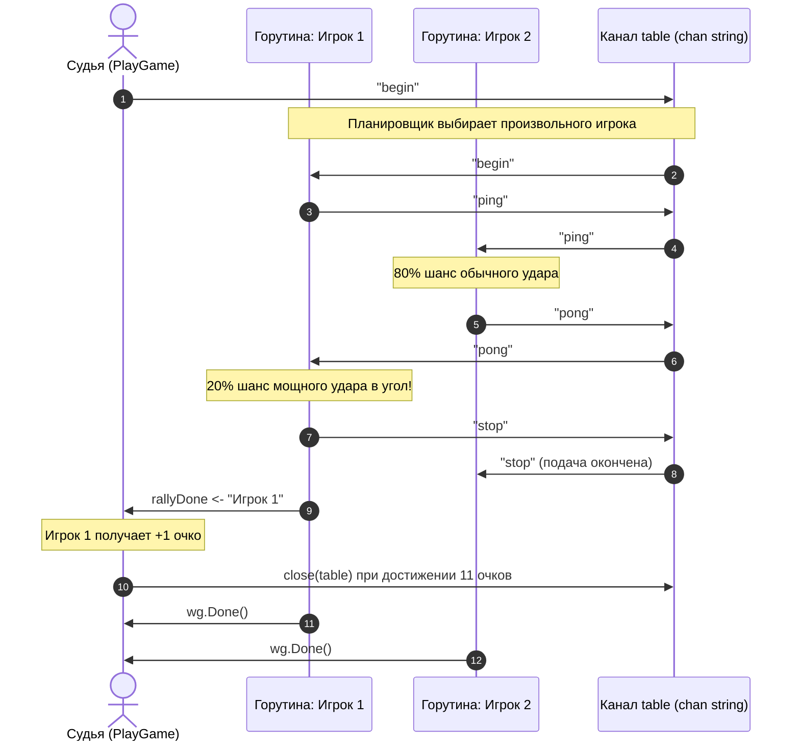

# Домашнее задание №10: Конкурентное программирование (Игра в Пинг-Понг)

## Описание задачи
Смоделировать условную игру в пинг-понг с помощью каналов, потоков (горутин) и групп ожидания (`sync.WaitGroup`).

### Правила и требования:
1. **Каждому игроку соответствует отдельный поток (горутина)**.
2. Для перебрасывания шарика между половинами стола используется **небуферизованный канал**.
3. Подача начинается командой **`"begin"`** в канал.
4. Произвольный игрок, принявший подачу, подаёт и пишет в канал **`"ping"`**. Соперник отвечает **`"pong"`**.
5. Эти надписи выводятся на экран вместе с именем игрока, совершившего удар.
6. В **20% случаев** любому игроку во время удара может повезти, и он мощно гасит шарик в самый угол и выигрывает очко.
7. В этом случае в канал подаётся сигнал **`"stop"`**, означающий завершение подачи.
8. Партия играется до целевого количества очков (по умолчанию 11 очков). В конце партии на экран печатается итоговый счёт.
9. Все горутины синхронизируются и корректно завершают работу через `sync.WaitGroup` без утечек (Goroutine Leaks) и состояний гонки (Data Race Free).

---

## Архитектура решения



### Ключевые компоненты:
- **`pkg/pingpong`**: чистый пакет логики игры.
  - `PlayGame(cfg Config) Result`: проводит партию, возвращает результаты и счет.
  - Поддержка кастомного вывода `io.Writer`, настраиваемого `TargetScore`, `LuckyChance`, задержки ударов `HitDelay`.
  - Потокобезопасный логгер и независимые генераторы `rand.Rand` для каждого игрока.
- **`cmd/pingpong/main.go`**: консольная утилита с флагами командной строки:
  - `-p1`: имя первого игрока (по умолчанию "Игрок 1")
  - `-p2`: имя второго игрока (по умолчанию "Игрок 2")
  - `-score`: очки для победы (по умолчанию 11)
  - `-delay`: задержка между ударами в мс (по умолчанию 25 мс)

---

## Запуск приложения

```bash
# Запуск матча до 11 очков:
go run ./cmd/pingpong/main.go

# Запуск быстрого демонстрационного матча до 5 очков:
go run ./cmd/pingpong/main.go -p1 "Тимо Болль" -p2 "Ма Лун" -score 5 -delay 10
```

---

## Запуск тестов

```bash
go test -v -count=1 -race -cover ./lessons/10-concurrency/homework-10/...
```

### Результаты тестирования:
- **Покрытие кода:** **98.8%** statements в `pkg/pingpong`.
- **Race Detector:** **0** гонок данных при многократных стресс-тестах.
- Все тестовые сценарии успешно пройдены.
