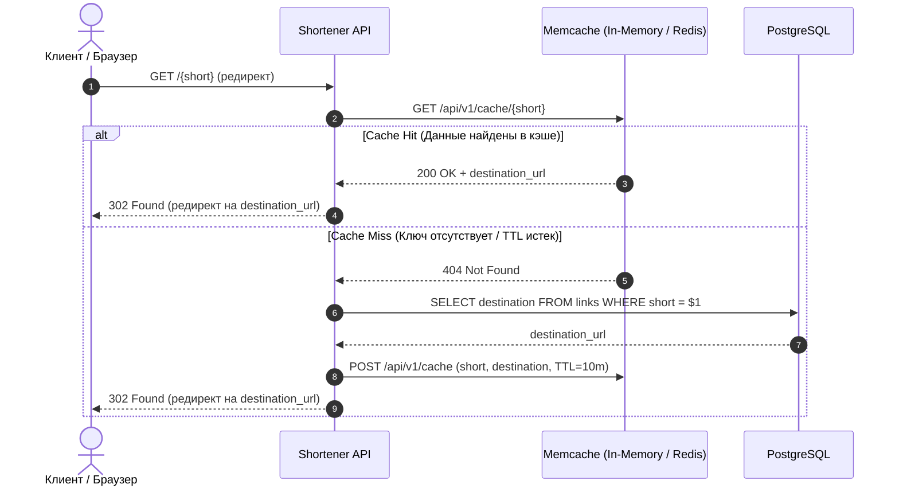

# 20-NoSQL — NoSQL хранилища: Redis, MongoDB и Key-Value базы данных

В данном модуле изучаются нереляционные хранилища данных (**NoSQL**), стратегии кэширования в оперативной памяти (**In-Memory Cache**), работа с **Redis** и **MongoDB**, а также создание собственного потокобезопасного Key-Value хранилища на Go.

---

## 📋 Структура каталога

```text
20-NoSQL/
├── 1-mongo/             # Документоориентированная СУБД MongoDB (драйвер mongo-go-driver, BSON, курсоры)
│   └── mongo.go
├── 2-KVStore/           # Собственная Key-Value БД на Go с sync.RWMutex и тестами
│   ├── cmd/app/app.go   # Точка входа / демонстрация
│   └── pkg/kvdb/        # Пакет хранилища (New, GET, Get, SET, DELETE, Len)
│       ├── kvdb.go
│       └── kvdb_test.go
├── 3-redis/             # Высокопроизводительный кэш Redis (go-redis: GET, SET, TTL, обработка redis.Nil)
│   └── redis.go
├── docker-compose.yml   # Запуск серверов Redis и MongoDB в Docker
└── homework-20/         # ДЗ: микросервисная архитектура кэширования Lynks (Shortener + Memcache)
    ├── docker-compose.yml
    ├── e2e_test.go
    ├── memcache/        # Сервис кэширования в памяти / Redis с HTTP API и Prometheus-метриками
    └── shortener/       # Сервис сокращения ссылок с паттерном Cache-Aside
```

---

## 🔍 Сравнительная характеристика хранилищ

| Характеристика | In-Memory KV (`kvdb`) | Redis | MongoDB | PostgreSQL (SQL) |
| :--- | :--- | :--- | :--- | :--- |
| **Модель данных** | Хэш-таблица (`map[string]string`) | Key-Value / структуры (Hashes, Sets, Lists) | Документы (BSON / JSON) | Реляционные таблицы (Строки / Колонки) |
| **Хранение** | Оперативная память (RAM) | RAM + снапшоты (RDB/AOF) | Диск (WiredTiger) + RAM кэш | Диск + Shared Buffers |
| **Задержка (Latency)** | < 1 мкс (внутри процесса) | < 1 мс (сетевой I/O) | ~1–5 мс | ~2–10 мс |
| **Схема данных** | Свободная | Свободная | Гибкая (Schema-less) | Строгая (DDL, Constraints) |
| **Транзакции** | Нет / мьютексы | MULTI/EXEC (однопоточный движок) | Multi-document ACID (с v4.0) | Полный ACID (MVCC) |
| **Основной сценарий** | Локальный кэш процесса | Распределенный кэш, сессии, очереди | Каталоги товаров, аналитика, логи | Транзакционный учет, финансовые операции |

---

## ⚙️ Архитектурный паттерн: Cache-Aside (Lazy Loading)

В рамках домашнего задания [homework-20](file:///Users/user/workspace/golang_projects/go-core-4/go_course_4/lessons/20-NoSQL/homework-20) реализован классический паттерн **Cache-Aside**:



### Преимущества Cache-Aside:
1. **Устойчивость к сбоям кэша:** если кэш временно недоступен, сервис обращается напрямую к PostgreSQL без деградации доступности данных.
2. **Экономия ресурсов:** в кэш попадают только реально запрашиваемые «горячие» ключи.
3. **TTL (Time-To-Live):** автоматическая инвалидация устаревших записей предотвращает переполнение оперативной памяти.

---

## 🧪 Компоненты модуля

### 1. Собственное KV-хранилище [`2-KVStore`](file:///Users/user/workspace/golang_projects/go-core-4/go_course_4/lessons/20-NoSQL/2-KVStore)
- Реализация: [`kvdb.go`](file:///Users/user/workspace/golang_projects/go-core-4/go_course_4/lessons/20-NoSQL/2-KVStore/pkg/kvdb/kvdb.go).
- Безопасность: разделяемые блокировки чтения `sync.RWMutex.RLock()` и исключительные блокировки записи `sync.RWMutex.Lock()`.
- Тесты и бенчмарки: [`kvdb_test.go`](file:///Users/user/workspace/golang_projects/go-core-4/go_course_4/lessons/20-NoSQL/2-KVStore/pkg/kvdb/kvdb_test.go).
- Производительность:
  - `BenchmarkDB_SET`: **~384 ns/op**
  - `BenchmarkDB_GET`: **~347 ns/op**
  - `BenchmarkDB_ParallelGET`: **~595 ns/op**

### 2. Клиент Redis [`3-redis`](file:///Users/user/workspace/golang_projects/go-core-4/go_course_4/lessons/20-NoSQL/3-redis)
- Реализация: [`redis.go`](file:///Users/user/workspace/golang_projects/go-core-4/go_course_4/lessons/20-NoSQL/3-redis/redis.go).
- Использование пакета `github.com/go-redis/redis/v8`.
- Корректная обработка отсутствия ключа через `errors.Is(err, redis.Nil)`.
- Установка TTL через параметр `time.Duration` в вызове `client.Set()`.
- Денормализация и хранение объектов через JSON-сериализацию.

### 3. Клиент MongoDB [`1-mongo`](file:///Users/user/workspace/golang_projects/go-core-4/go_course_4/lessons/20-NoSQL/1-mongo)
- Реализация: [`mongo.go`](file:///Users/user/workspace/golang_projects/go-core-4/go_course_4/lessons/20-NoSQL/1-mongo/mongo.go).
- Использование официального драйвера `go.mongodb.org/mongo-driver`.
- Маппинг BSON-тегов (`bson:"id"`, `bson:"name"`).
- Потоковое чтение документов через `cur.Next()`, `cur.Decode()` с обязательной валидацией `cur.Err()`.
- Пул соединений и управление таймаутами через `context.WithTimeout`.

### 4. Домашнее задание [`homework-20`](file:///Users/user/workspace/golang_projects/go-core-4/go_course_4/lessons/20-NoSQL/homework-20)
- Два микросервиса:
  - [`shortener`](file:///Users/user/workspace/golang_projects/go-core-4/go_course_4/lessons/20-NoSQL/homework-20/shortener): API сокращения ссылок, клиент к Memcache, Fallback на PostgreSQL, метрики Prometheus (`shortener_cache_hits_total`, `shortener_cache_misses_total`).
  - [`memcache`](file:///Users/user/workspace/golang_projects/go-core-4/go_course_4/lessons/20-NoSQL/homework-20/memcache): сервис кэширования со встроенным in-memory движком и фоновым потоком очистки устаревших ключей по TTL (Janitor loop).
- Сквозное E2E тестирование: [`e2e_test.go`](file:///Users/user/workspace/golang_projects/go-core-4/go_course_4/lessons/20-NoSQL/homework-20/e2e_test.go).
- Контейнеризация: Docker Compose с сервисами Shortener, Memcache, Redis и PostgreSQL.

---

## 🚀 Запуск и проверка

```bash
# 1. Запуск всех тестов модуля с проверкой гонок (-race) и бенчмарками
go test -v -race -bench=. ./lessons/20-NoSQL/...

# 2. Запуск Docker Compose для Redis и MongoDB
docker compose -f ./lessons/20-NoSQL/docker-compose.yml up -d

# 3. Запуск демо-приложения KVStore
go run ./lessons/20-NoSQL/2-KVStore/cmd/app/app.go
```

---

## 🔗 Связанные материалы
- **Теория:** [Том 4: Backend и Web (Раздел 13: NoSQL хранилища)](file:///Users/user/workspace/golang_projects/go-core-4/go_course_4/go-documentation/04-go-core-backend-web.md)
- **Гайд по базам данных:** [go-database-interview-guide.md](file:///Users/user/workspace/golang_projects/go-core-4/go_course_4/go-documentation/go-database-interview-guide.md)
- **Практическое ДЗ:** [README домашнего задания 20](file:///Users/user/workspace/golang_projects/go-core-4/go_course_4/lessons/20-NoSQL/homework-20/README.md)
