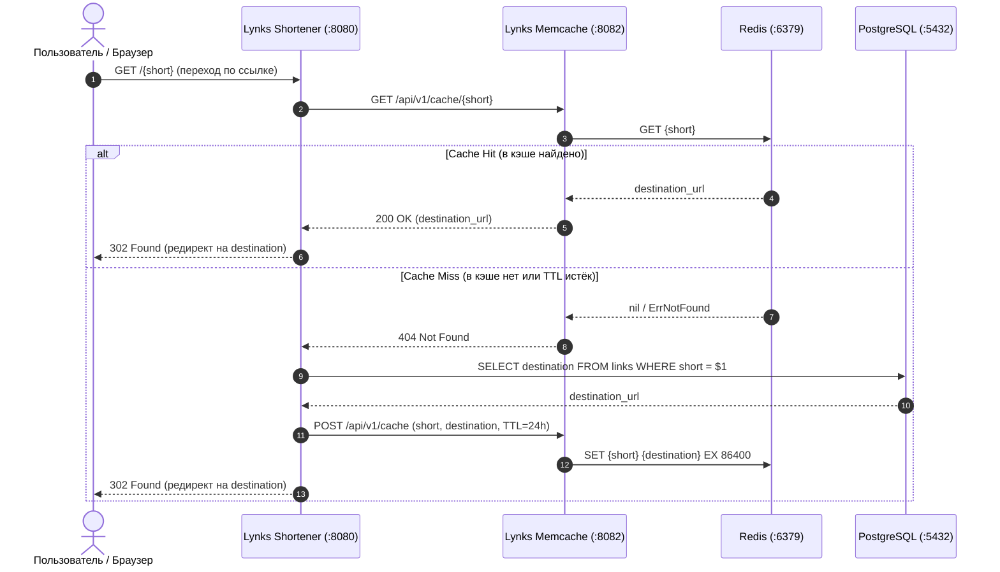

# Lynks — Итоговый проект курса (URL Shortener & Caching Microservices)

**Lynks** — полнофункциональный сервис сокращения и кэширования гиперссылок (URL Shortener), спроектированный по микросервисной архитектуре с применением паттерна **Cache-Aside**, метрик Prometheus, структурированного логирования Zerolog и контейнеризации в Docker Compose.

---

## 📋 Архитектура и структура каталогов

```text
lynks/
├── cmd/
│   ├── shortener/server/main.go  # Точка входа сервиса Shortener (HTTP :8080)
│   └── memcache/server/main.go   # Точка входа сервиса Memcache (HTTP :8082)
├── pkg/
│   ├── shortener/
│   │   ├── api/                  # HTTP REST API, gorilla/mux, prometheus middleware
│   │   ├── cacheclient/          # HTTP-клиент к сервису Memcache
│   │   ├── config/               # Загрузка переменных окружения
│   │   ├── metrics/              # Метрики Prometheus (Hits, Misses, Latency, Requests)
│   │   ├── storage/              # Слой данных (PostgreSQL + Memory fallback)
│   │   └── urls/                 # Криптографический генератор коротких ссылок (Shorten)
│   └── memcache/
│       ├── api/                  # HTTP REST API кэширования (/api/v1/cache)
│       ├── config/               # Конфигурация портов и TTL
│       ├── metrics/              # Метрики кэша (Total, Latency)
│       ├── redis/                # Драйвер Redis с поддержкой TTL 24 часа
│       └── store/                # Движок хранения (Redis + In-Memory Janitor с TTL)
├── Dockerfile.memcache           # Многоэтапная сборка образа Memcache
├── Dockerfile.shortener          # Многоэтапная сборка образа Shortener
├── docker-compose.yml            # Полный оркестратор: Postgres, Redis, Memcache, Shortener
├── schema.sql                    # DDL-схема PostgreSQL с B-Tree индексами
├── e2e_test.go                   # Сквозное интеграционное E2E тестирование
├── final.md                      # Исходное техническое задание курса
└── README.md                     # Данная документация
```

---

## ⚙️ Архитектурный паттерн: Cache-Aside



---

## 📡 Спецификация HTTP REST API

### 1. Сервис `shortener` (порт `8080`)
- **`POST /`** — Сокращение гиперссылки.
  - Request body:
    ```json
    { "destination": "https://github.com/thinknetica/go_course_4" }
    ```
  - Response (201 Created):
    ```json
    {
      "shortUrl": "http://localhost:8080/qz6d7",
      "destination": "https://github.com/thinknetica/go_course_4"
    }
    ```
- **`GET /{short}`** — Переход по короткой ссылке.
  - Response: `302 Found` с заголовком `Location: <destination_url>`.
- **`GET /healthz`** — Проверка жизнеспособности (liveness probe).
- **`GET /metrics`** — Экспорт метрик Prometheus.

### 2. Сервис `memcache` (порт `8082`)
- **`POST /api/v1/cache`** — Сохранение пары в кэш.
  - Request body: `{ "key": "qz6d7", "value": "https://github.com/thinknetica/go_course_4" }`
  - Response: `201 Created`.
- **`GET /api/v1/cache/{key}`** — Получение пары из кэша.
  - Response: `200 OK` `{ "key": "qz6d7", "value": "https://..." }` или `404 Not Found`.
- **`GET /healthz`** — Проверка работоспособности.
- **`GET /metrics`** — Экспорт метрик Prometheus.

---

## 📊 Результаты бенчмарков

```text
BenchmarkShorten-8                         2692082       438.1 ns/op
BenchmarkMemoryStorage_Save-8              2207596       533.4 ns/op
BenchmarkMemoryStorage_FindByShort-8       3019298       398.0 ns/op
BenchmarkMemoryStore_Set-8                 1869876       630.8 ns/op
BenchmarkMemoryStore_Get-8                 2356299       505.2 ns/op
```

---

## 🚀 Запуск и проверка

### 1. Запуск всех тестов и бенчмарков с детектором гонок (`-race`)
```bash
go test -v -race -bench=. ./lynks/...
```

### 2. Запуск через Docker Compose
```bash
# Сборка и старт всех контейнеров
docker compose -f ./lynks/docker-compose.yml up --build -d

# Проверка статуса контейнеров
docker compose -f ./lynks/docker-compose.yml ps
```

### 3. Проверка работы через cURL
```bash
# 1. Создание короткой ссылки
curl -X POST http://localhost:8080/ \
  -H "Content-Type: application/json" \
  -d '{"destination": "https://github.com/thinknetica/go_course_4"}'

# 2. Переход по короткой ссылке (проверка редиректа 302)
curl -i http://localhost:8080/<короткий_код>

# 3. Просмотр метрик кэша
curl http://localhost:8080/metrics | grep shortener_cache
```

---

## 🔗 Связанные материалы курса
- [16-db-apps — Работа с PostgreSQL и пулом соединений pgxpool](file:///Users/user/workspace/golang_projects/go-core-4/go_course_4/16-db-apps/16-db-apps.md)
- [18-microservices — Контейнеризация и 12-Factor App](file:///Users/user/workspace/golang_projects/go-core-4/go_course_4/18-microservices/18-microservices.md)
- [20-NoSQL — Хранилища данных Redis и кэширование](file:///Users/user/workspace/golang_projects/go-core-4/go_course_4/20-NoSQL/20-NoSQL.md)
